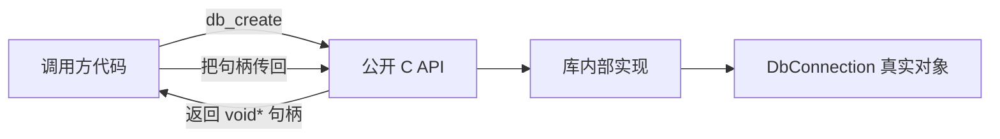
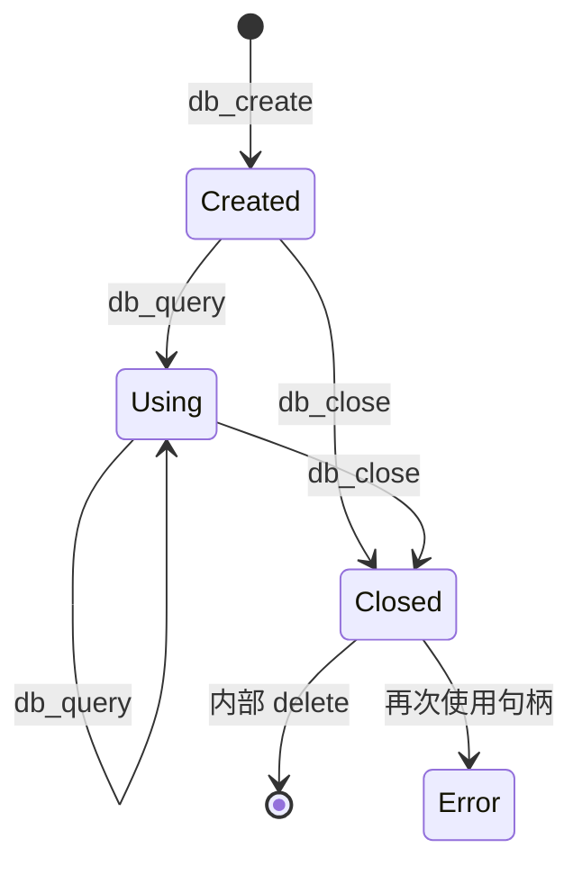
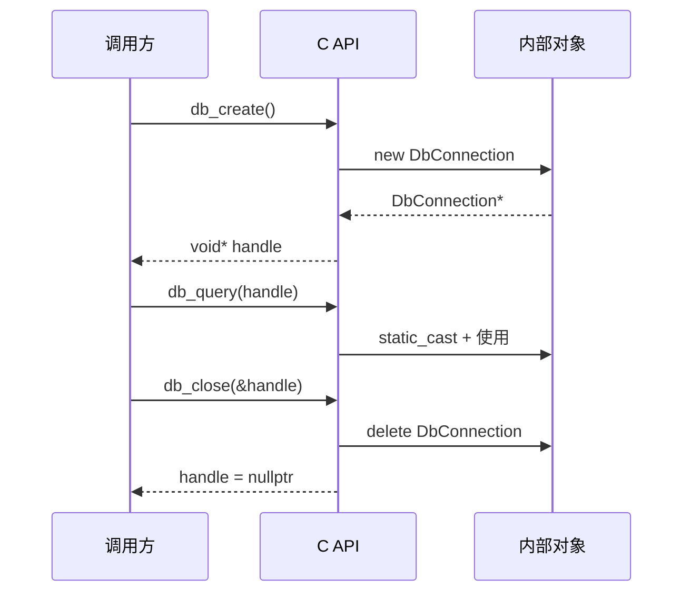
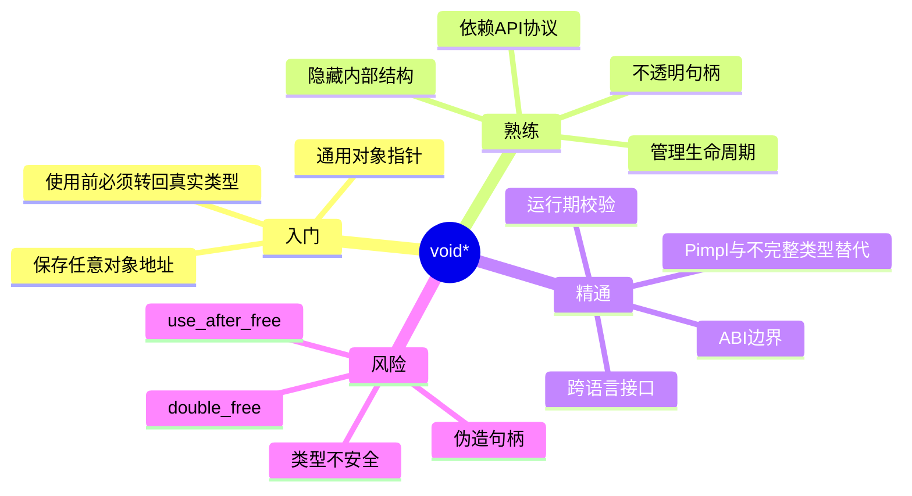

# 1. 背景与动机

如果库作者想控制**接口边界**，那么他不应把真实类型暴露给调用方，只给调用方一个 `void*` 句柄。调用方想继续使用这个句柄，就必须按照库作者提供的 API 协议传回去。

这里所谓“隐藏返回类型”，更准确地说是：

> **隐藏真实对象类型，而不是隐藏返回值本身。**

调用方知道函数返回的是一个指针，但不知道它实际指向什么结构体、类对象、状态机或资源集合。

> [!question] 为什么要隐藏真实类型？

如果库直接暴露真实类型：

```cpp
struct DbConnection {
    std::string host;
    int port;
    bool connected;
    std::vector<std::string> cache;
};
```

调用方就能看到并依赖这些字段：

```cpp
DbConnection* conn = db_create("127.0.0.1", 3306);
conn->connected = false;     // 外部绕过 API 修改内部状态
conn->cache.clear();         // 外部破坏内部缓存策略
```

这样会带来几个问题：

| 问题 | 说明 |
|---|---|
| **封装破坏** | 调用方可以直接读写内部字段 |
| **实现难以演进** | 一旦字段被外部依赖，库内部结构就不敢改 |
| **ABI 不稳定** | 动态库边界上，类布局、成员顺序、编译器 ABI 都可能影响兼容性 |
| **生命周期混乱** | 调用方可能自己 `delete`，而不是走库提供的销毁函数 |
| **跨语言困难** | C、Lua、Python、C# 等语言不理解 C++ 类布局 |

所以库作者可能选择只暴露：

```cpp
using DbHandle = void*;

DbHandle db_create(const char* host, int port);
void db_query(DbHandle handle, const char* sql);
void db_close(DbHandle handle);
```

调用方拿到的是 `DbHandle`，本质是 `void*`。它只能把这个值传回 `db_query` / `db_close`，不能直接访问内部对象。

因此 `void*` 的核心价值是：**在接口边界上擦掉静态类型，让真实类型只存在于实现文件内部。**

它常用于：

| 场景 | 说明 |
|---|---|
| **C 风格库接口** | 对外提供稳定头文件，内部类型不暴露 |
| **动态库 ABI 边界** | 避免把 C++ 类布局暴露给外部二进制 |
| **插件系统** | 主程序与插件之间用句柄交换上下文 |
| **跨语言绑定** | 其他语言只保存一个 native 指针 |
| **回调用户数据** | `void* user_data` 让调用方携带任意上下文 |
| **原始内存管理** | `malloc` / 内存池返回无类型内存 |

> [!summary]
> `void*` 的本质是**类型擦除后的裸指针**。它让接口变得更通用、更稳定，但也让编译器失去类型检查能力。

---

# 2. `void*`

## 2.1 基本定义

`void*` 是一种**通用对象指针类型**，可以保存任意对象地址：

```cpp
int x = 10;
double y = 3.14;

void* p1 = &x;  // int* 可以隐式转换为 void*
void* p2 = &y;  // double* 可以隐式转换为 void*
```

但是 `void*` 不知道自己指向的对象类型，因此不能直接解引用：

```cpp
void* p = &x;

// std::cout << *p;  // 错误：void 没有大小，也没有可解引用的对象类型
```

必须先转回正确类型：

```cpp
int* ip = static_cast<int*>(p);
std::cout << *ip << "\n";
```

## 2.2 `void*` 的作用

| 操作 | 是否允许 | 说明 |
|---|---|---|
| `int* -> void*` | 允许 | 对象指针可隐式转成 `void*` |
| `void* -> int*` | 允许 | 需要显式 `static_cast<int*>` |
| `*void_ptr` | 不允许 | `void` 没有对象大小 |
| `void_ptr->member` | 不允许 | 编译器不知道成员布局 |
| `void_ptr + n` | 标准 C++ 不允许 | `void` 没有大小，不能做标准指针算术 |
| 保存对象地址 | 允许 | 但调用方必须知道如何恢复类型 |
| 保存函数地址 | 不推荐/不可移植 | 函数指针与对象指针不是一回事 |

> [!warning]
> `void*` 只擦掉**编译期类型信息**，不会保存运行期类型信息。它不是 `std::any`，也不是 `std::variant`，更不是反射系统。

## 2.3 示例

下面这个例子展示 `void*` 的基本使用方式：保存不同类型对象地址，并在使用前转回原类型。

```cpp
#include <iostream>
#include <string>

int main() {
    int age = 18;
    double score = 99.5;
    std::string name = "Alice";

    // 1. 任意对象指针都可以转成 void*
    void* p_age = &age;
    void* p_score = &score;
    void* p_name = &name;

    // 2. 使用前必须转回正确类型
    int* real_age = static_cast<int*>(p_age);
    double* real_score = static_cast<double*>(p_score);
    std::string* real_name = static_cast<std::string*>(p_name);

    std::cout << "age   = " << *real_age << "\n";
    std::cout << "score = " << *real_score << "\n";
    std::cout << "name  = " << *real_name << "\n";

    // 3. 错误示范：把 double* 当成 int* 使用
    //    这通常可以通过编译，但属于未定义行为。
    // int* wrong = static_cast<int*>(p_score);
    // std::cout << *wrong << "\n";

    return 0;
}
```

> [!summary]
>
> - `void*` 能保存地址；
> - `void*` 不知道地址背后的真实类型；
> - 使用者必须根据协议转回正确类型。

---

# 3. `void*` 实现隐藏接口

## 3.1 不透明句柄

> [!abstract]
> **不透明句柄（Opaque Handle）**：调用方只能持有和传递，不能理解其内部结构的对象标识。

`void*` 常被用来实现不透明句柄：

```cpp
using DbHandle = void*;
```

调用方看到的是 `DbHandle`，但不知道它内部实际是：

```cpp
struct DbConnection;
```

也可能是：

```cpp
class MysqlConnection;
```

甚至以后改成：

```cpp
struct DbContext {
    void* driver;
    void* connection_pool;
    void* logger;
};
```

只要对外函数签名不变，调用方就不需要重新理解内部结构。

## 3.2 接口边界模型



调用方能做的事：

- 保存句柄；
- 比较句柄是否为空；
- 把句柄传回库函数；
- 按协议调用销毁函数。

调用方不能可靠做的事：

- 访问内部字段；
- 猜测真实类型；
- 自己释放内部对象；
- 把别的指针伪装成句柄；
- 在销毁后继续使用句柄。

## 3.3 示例：数据库连接句柄

下面是一个**单文件**的例子。但真实项目里会把“公开 API”放在 `.h`，把“内部实现”放在 `.cpp`；为了方便直接复制运行，这里写在同一个文件中，并用注释标出边界。

```cpp
#include <iostream>
#include <stdexcept>
#include <string>
#include <utility>
#include <vector>

// ============================================================
// 公开 API 区域：假设这些内容放在 db_api.h 中
// ============================================================

// 对外只暴露 DbHandle，不暴露 DbConnection 的字段。
// DbHandle 本质是 void*，语义上表示“数据库连接句柄”。
using DbHandle = void*;

DbHandle db_create(const char* host, int port);
void db_query(DbHandle handle, const char* sql);
void db_close(DbHandle handle);

// ============================================================
// 内部实现区域：假设这些内容放在 db_api.cpp 中
// ============================================================

namespace {

// 真实类型只存在于实现文件内部。
// 调用方看不到这个结构体，也不能访问 host/cache 等成员。
struct DbConnection {
    std::string host;
    int port = 0;
    bool connected = false;
    std::vector<std::string> query_cache;

    DbConnection(std::string h, int p)
        : host(std::move(h)), port(p), connected(true) {
        std::cout << "[internal] connect to "
                  << host << ":" << port << "\n";
    }

    ~DbConnection() {
        std::cout << "[internal] destroy connection, cached queries = "
                  << query_cache.size() << "\n";
    }
};

// 这是内部辅助函数：把对外的 void* 恢复成内部真实类型。
// 所有公开 API 都通过它集中完成类型恢复。
DbConnection* as_connection(DbHandle handle) {
    if (handle == nullptr) {
        throw std::invalid_argument("DbHandle is null");
    }

    // 前提：handle 必须是 db_create 返回的值。
    // 如果调用方传入其他指针，这里会产生未定义行为。
    return static_cast<DbConnection*>(handle);
}

} // namespace

DbHandle db_create(const char* host, int port) {
    if (host == nullptr) {
        return nullptr;
    }

    // new 返回 DbConnection*，可以隐式转换成 void* 返回。
    DbConnection* conn = new DbConnection(host, port);
    return conn;
}

void db_query(DbHandle handle, const char* sql) {
    DbConnection* conn = as_connection(handle);

    if (sql == nullptr) {
        std::cout << "[api] empty sql\n";
        return;
    }

    if (!conn->connected) {
        std::cout << "[api] connection already closed\n";
        return;
    }

    conn->query_cache.push_back(sql);

    std::cout << "[api] query on " << conn->host
              << ":" << conn->port
              << " => " << sql << "\n";
}

void db_close(DbHandle handle) {
    DbConnection* conn = as_connection(handle);

    if (!conn->connected) {
        std::cout << "[api] duplicate close ignored by demo\n";
        return;
    }

    conn->connected = false;
    std::cout << "[api] close connection\n";

    // 谁创建，谁销毁。
    // 既然 db_create 内部用了 new，销毁也应该由 db_close 内部 delete。
    delete conn;
}

// ============================================================
// 调用方代码：假设这是 main.cpp
// ============================================================

int main() {
    // 1. 调用方拿到的是 void* 句柄，不知道内部类型。
    DbHandle db = db_create("127.0.0.1", 3306);

    // 2. 调用方只能把句柄传回 API 使用。
    db_query(db, "select * from users");
    db_query(db, "select * from orders");

    // 3. 调用方必须按协议关闭句柄。
    db_close(db);

    // 4. 错误示范：关闭后继续使用，属于 use-after-free。
    //    真实工程中需要把 db 置空，或者让 close 接收 DbHandle*。
    // db_query(db, "select * from products");

    // 5. 错误示范：把其他指针伪装成 DbHandle。
    // int fake = 123;
    // db_query(&fake, "select * from users"); // 未定义行为

    return 0;
}
```

对调用方而言，`DbHandle` 只是一块地址：

```cpp
DbHandle db = db_create("127.0.0.1", 3306);
```

调用方不能写：

```cpp
db->host = "localhost";  // 错误：void* 没有成员
```

因为 `db` 的静态类型是 `void*`。编译器不知道：

- 它是不是 `DbConnection*`；
- `DbConnection` 里有没有 `host`；
- `host` 在对象布局中的偏移是多少；
- 这个对象应该由谁释放。

所以调用方只能遵守库定义的协议：

```text
db_create  -> 创建连接
db_query   -> 使用连接
db_close   -> 销毁连接
```

## 3.5 协议

`void*` 本身不携带规则，规则必须由 API 文档定义。

以上面的数据库接口为例，协议至少包括：

| 协议项 | 说明 |
|---|---|
| **来源协议** | 传给 `db_query` / `db_close` 的句柄必须来自 `db_create` |
| **类型协议** | 句柄内部真实类型必须是库内部的 `DbConnection` |
| **生命周期协议** | `db_close` 后句柄失效，不能再使用 |
| **所有权协议** | 调用方不能自己 `delete` 句柄 |
| **线程协议** | 是否允许多个线程同时使用同一个句柄，需要文档说明 |
| **错误协议** | 空指针、重复关闭、查询失败如何返回，需要文档说明 |

> [!warning]
> `void*` 接口的安全性不来自编译器，而来自**协议约束 + 实现校验 + 调用方自律**。协议写得越模糊，运行期问题越多。

---

# 4. `void*` 的类型恢复与生命周期

## 4.1 指针转换的正确姿势

对象指针到 `void*`：

```cpp
DbConnection* conn = new DbConnection("127.0.0.1", 3306);
void* handle = conn;  // 隐式转换
```

`void*` 转回对象指针：

```cpp
DbConnection* conn = static_cast<DbConnection*>(handle);
```

对于 `void* -> T*`，优先使用 `static_cast<T*>`，因为它表达的是“从通用对象指针恢复成具体对象指针”。

```cpp
T* p = static_cast<T*>(raw);
```

`reinterpret_cast<T*>` 也常见，但语义更重，表示底层重解释。普通 `void*` 恢复对象指针不需要它。

## 4.2 类型恢复的前提

下面这段代码只有在 `handle` 原本就是 `DbConnection*` 转成的 `void*` 时才正确：

```cpp
DbConnection* conn = static_cast<DbConnection*>(handle);
```

如果调用方传入：

```cpp
int fake = 123;
db_query(&fake, "select * from users");
```

内部会把 `int*` 当成 `DbConnection*` 使用。此时：

```text
真实内存：int 对象
内部解释：DbConnection 对象
```

二者布局完全不匹配，结果是**未定义行为**。

## 4.3 生命周期状态机



`void*` 句柄最大的风险往往不是“指针转换写错”，而是**生命周期协议被破坏**。

常见错误：

```cpp
DbHandle db = db_create("127.0.0.1", 3306);
db_close(db);
db_query(db, "select 1");  // use-after-free
```

为了降低风险，可以把销毁接口设计成：

```cpp
void db_close(DbHandle* handle);
```

这样销毁后能把调用方手里的句柄置空。

## 4.4 改进版示例：关闭后自动置空

下面的示例实现的是让 `db_close` 接收 `DbHandle*`，销毁后自动写回 `nullptr`，减少悬空指针风险。

```cpp
#include <iostream>
#include <stdexcept>
#include <string>
#include <utility>

using DbHandle = void*;

DbHandle db_create(const char* host, int port);
void db_query(DbHandle handle, const char* sql);
void db_close(DbHandle* handle);

namespace {

struct DbConnection {
    std::string host;
    int port;
    bool connected;

    DbConnection(std::string h, int p)
        : host(std::move(h)), port(p), connected(true) {
        std::cout << "connect: " << host << ":" << port << "\n";
    }

    ~DbConnection() {
        std::cout << "destroy connection\n";
    }
};

DbConnection* as_connection(DbHandle handle) {
    if (handle == nullptr) {
        throw std::invalid_argument("DbHandle is null");
    }
    return static_cast<DbConnection*>(handle);
}

} // namespace

DbHandle db_create(const char* host, int port) {
    if (host == nullptr) {
        return nullptr;
    }
    return new DbConnection(host, port);
}

void db_query(DbHandle handle, const char* sql) {
    DbConnection* conn = as_connection(handle);
    std::cout << "query: " << sql
              << " on " << conn->host << ":" << conn->port << "\n";
}

void db_close(DbHandle* handle) {
    // 这里接收的是句柄变量的地址，因此可以把调用方变量置空。
    if (handle == nullptr || *handle == nullptr) {
        return;
    }

    DbConnection* conn = static_cast<DbConnection*>(*handle);
    delete conn;

    // 防止调用方继续持有悬空指针。
    *handle = nullptr;
}

int main() {
    DbHandle db = db_create("localhost", 5432);

    db_query(db, "select now()");
    db_close(&db);

    if (db == nullptr) {
        std::cout << "handle has been cleared\n";
    }

    // 这里会抛异常，而不是使用已释放内存。
    try {
        db_query(db, "select 1");
    } catch (const std::exception& e) {
        std::cout << "error: " << e.what() << "\n";
    }

    return 0;
}
```

## 4.5 所有权边界

`void*` 句柄必须明确“谁创建、谁销毁”。



核心规则：

| 规则 | 原因 |
|---|---|
| `create` 内部 `new`，就由 `close/destroy` 内部 `delete` | 避免跨模块分配/释放不匹配 |
| 调用方不能自己 `delete static_cast<T*>(handle)` | 调用方不应知道真实类型，也可能使用了不同运行时 |
| 销毁后句柄必须失效 | 防止 use-after-free |
| 重复销毁行为必须定义清楚 | 是无操作、返回错误，还是未定义行为 |

> [!warning]
> 动态库边界上尤其要避免“库里 `new`，调用方 `delete`”。不同编译器、不同 CRT、不同分配器可能导致严重问题。

---

# 5. `void*` 的工程化设计

尽管 `void*` 可以隐藏类型，但不能提供真正的安全性。

| 能做到 | 做不到 |
|---|---|
| 不在头文件暴露内部结构 | 防止逆向分析 |
| 阻止调用方直接访问成员 | 阻止调用方乱传指针 |
| 降低 ABI 耦合 | 自动检查生命周期 |
| 让接口跨语言更容易 | 自动识别真实类型 |

也就是说：

> [!warning]
> `void*` 是**封装手段**，不是**权限系统**。调用方依然可以强转、伪造、重复释放，只是后果由调用方承担。

## 5.1 使用 magic number 做运行期校验

生产代码中常给内部对象加一个 `magic` 字段，用于检查句柄是否看起来像自己的对象。

```cpp
#include <cstdint>
#include <iostream>
#include <stdexcept>
#include <string>
#include <utility>

using EngineHandle = void*;

EngineHandle engine_create(const char* name);
void engine_tick(EngineHandle handle);
void engine_destroy(EngineHandle* handle);

namespace {

constexpr std::uint32_t kEngineMagic = 0x454E474E; // 'ENGN'

struct Engine {
    std::uint32_t magic = kEngineMagic;
    std::string name;
    int frame = 0;

    explicit Engine(std::string n) : name(std::move(n)) {}
};

Engine* as_engine(EngineHandle handle) {
    if (handle == nullptr) {
        throw std::invalid_argument("EngineHandle is null");
    }

    Engine* engine = static_cast<Engine*>(handle);

    // magic 校验不能证明 100% 安全，但能尽早发现明显错误：
    // 1. 传入了其他类型指针
    // 2. 传入了已经 destroy 的句柄
    // 3. 内存被破坏
    if (engine->magic != kEngineMagic) {
        throw std::runtime_error("invalid EngineHandle");
    }

    return engine;
}

} // namespace

EngineHandle engine_create(const char* name) {
    if (name == nullptr) {
        return nullptr;
    }
    return new Engine(name);
}

void engine_tick(EngineHandle handle) {
    Engine* engine = as_engine(handle);
    ++engine->frame;
    std::cout << engine->name << " frame = " << engine->frame << "\n";
}

void engine_destroy(EngineHandle* handle) {
    if (handle == nullptr || *handle == nullptr) {
        return;
    }

    Engine* engine = as_engine(*handle);

    // 销毁前破坏 magic，让后续误用更容易被发现。
    engine->magic = 0;
    delete engine;

    *handle = nullptr;
}

int main() {
    EngineHandle engine = engine_create("DemoEngine");

    engine_tick(engine);
    engine_tick(engine);

    engine_destroy(&engine);

    try {
        engine_tick(engine);
    } catch (const std::exception& e) {
        std::cout << "caught: " << e.what() << "\n";
    }

    return 0;
}
```

> [!warning]
> `magic` 不是绝对安全保障。伪造内存、野指针碰巧命中、并发释放等问题仍可能发生。它的价值是**提高错误暴露概率**，不是把未定义行为变成完全安全行为。

## 5.2 用结构体指针替代裸 `void*`

如果只需要 C 接口，而不一定要让参数类型完全一样，可以使用**不完整类型指针**：

```cpp
// db_api.h
struct DbConnection;

DbConnection* db_create(const char* host, int port);
void db_query(DbConnection* conn, const char* sql);
void db_close(DbConnection* conn);
```

调用方只知道 `DbConnection` 是一个结构体名，但不知道它的字段。由于类型不完整，调用方不能访问成员：

```cpp
DbConnection* conn = db_create("127.0.0.1", 3306);

// conn->host = "x";  // 错误：DbConnection 是不完整类型
```

这种方式比 `void*` 更安全：

| 设计 | 类型安全 | 隐藏实现 | C ABI 友好 | 误传风险 |
|---|---|---|---|---|
| `void*` | 低 | 高 | 高 | 高 |
| `struct DbConnection*` 不完整类型 | 中 | 高 | 高 | 低 |
| C++ 抽象类接口 | 高 | 中 | 低/中 | 低 |
| Pimpl | 高 | 高 | C++ 内部使用友好 | 低 |

> [!tip]
> 如果没有“必须所有句柄都统一成 `void*`”的需求，C API 中更推荐使用 `struct Xxx*` 不透明指针。它同样隐藏实现，但能让编译器区分不同句柄类型。

## 5.4 示例：不完整类型句柄

真实工程中通常拆成 3 个文件。

### 5.4.1 `db_api.h`

```cpp
#pragma once

// 这里只声明名字，不暴露字段。
struct DbConnection;

DbConnection* db_create(const char* host, int port);
void db_query(DbConnection* conn, const char* sql);
void db_close(DbConnection* conn);
```

### 5.4.2 `db_api.cpp`

```cpp
#include "db_api.h"

#include <iostream>
#include <string>
#include <utility>
#include <vector>

// 真实定义只出现在 .cpp 中。
struct DbConnection {
    std::string host;
    int port;
    bool connected;
    std::vector<std::string> cache;

    DbConnection(std::string h, int p)
        : host(std::move(h)), port(p), connected(true) {}
};

DbConnection* db_create(const char* host, int port) {
    if (host == nullptr) {
        return nullptr;
    }
    return new DbConnection(host, port);
}

void db_query(DbConnection* conn, const char* sql) {
    if (conn == nullptr || sql == nullptr) {
        return;
    }

    conn->cache.push_back(sql);
    std::cout << "query on " << conn->host
              << ":" << conn->port
              << " => " << sql << "\n";
}

void db_close(DbConnection* conn) {
    delete conn;
}
```

### 5.4.3 `main.cpp`

```cpp
#include "db_api.h"

int main() {
    DbConnection* conn = db_create("127.0.0.1", 3306);

    db_query(conn, "select * from users");

    // 编译错误：main.cpp 只知道 DbConnection 这个名字，
    // 不知道里面有没有 host 成员。
    // conn->host = "localhost";

    db_close(conn);
    return 0;
}
```

编译运行：

```bash
g++ -std=c++17 main.cpp db_api.cpp -o main
./main
```

这个版本依然隐藏实现，但比 `void*` 多了类型约束：

```cpp
struct DbConnection;
struct Window;

void db_query(DbConnection* conn, const char* sql);
void window_show(Window* window);
```

调用方不能轻易把 `Window*` 传给 `db_query`，编译器会报错。

## 5.5 C++ 内部更推荐 Pimpl

如果接口主要在 C++ 内部使用，可以用 Pimpl 隐藏实现，同时保留 RAII 和类型安全。

下面是单文件可运行示例。真实工程中会把 `class Database` 放在头文件，把 `Database::Impl` 的定义放在 `.cpp`。

```cpp
#include <iostream>
#include <memory>
#include <string>
#include <utility>
#include <vector>

class Database {
public:
    Database(std::string host, int port);
    ~Database();

    // 禁止拷贝，允许移动。
    Database(const Database&) = delete;
    Database& operator=(const Database&) = delete;
    Database(Database&&) noexcept = default;
    Database& operator=(Database&&) noexcept = default;

    void query(const std::string& sql);

private:
    // 对外只暴露 Impl 这个名字，不暴露字段。
    struct Impl;
    std::unique_ptr<Impl> impl_;
};

struct Database::Impl {
    std::string host;
    int port;
    std::vector<std::string> cache;

    Impl(std::string h, int p)
        : host(std::move(h)), port(p) {
        std::cout << "connect: " << host << ":" << port << "\n";
    }

    ~Impl() {
        std::cout << "disconnect, cached queries = "
                  << cache.size() << "\n";
    }
};

Database::Database(std::string host, int port)
    : impl_(std::make_unique<Impl>(std::move(host), port)) {}

// 析构函数必须在 Impl 完整定义之后生成。
Database::~Database() = default;

void Database::query(const std::string& sql) {
    impl_->cache.push_back(sql);
    std::cout << "query: " << sql
              << " on " << impl_->host << ":" << impl_->port << "\n";
}

int main() {
    Database db("127.0.0.1", 3306);
    db.query("select * from users");
    db.query("select * from orders");

    // 不需要手动 close/delete。
    // db 离开作用域时，unique_ptr 自动销毁 Impl。
    return 0;
}
```

Pimpl 的特点：

- 对外隐藏实现字段；
- 调用方不能直接操作内部状态；
- 保留 C++ 类型系统；
- 自动管理生命周期；
- 适合 C++ 库内部 ABI 隔离。

---

# 6. `void*` 的应用场景

## 6.1 C 库中的句柄

很多 C 库会定义类似接口：

```cpp
typedef void* LibraryHandle;

LibraryHandle library_create();
void library_do_something(LibraryHandle handle);
void library_destroy(LibraryHandle handle);
```

这种设计适合：

- 头文件稳定；
- 实现细节私有；
- 跨编译器、跨语言调用；
- 动态库导出函数数量少。

## 6.2 回调中的用户数据

`void* user_data` 是 C 风格回调里非常常见的设计。

```cpp
#include <iostream>
#include <string>
#include <vector>

using Callback = void (*)(int value, void* user_data);

void for_each_value(const std::vector<int>& values,
                    Callback callback,
                    void* user_data) {
    for (int value : values) {
        callback(value, user_data);
    }
}

struct SumContext {
    int sum = 0;
    std::string name;
};

void add_to_sum(int value, void* user_data) {
    // 协议规定：这里的 user_data 必须指向 SumContext。
    SumContext* ctx = static_cast<SumContext*>(user_data);
    ctx->sum += value;
}

int main() {
    std::vector<int> values = {1, 2, 3, 4, 5};
    SumContext ctx;
    ctx.name = "demo";

    for_each_value(values, add_to_sum, &ctx);

    std::cout << ctx.name << " sum = " << ctx.sum << "\n";
    return 0;
}
```

这里 `for_each_value` 不需要知道调用方上下文是什么类型。它只负责在回调时原样传回 `user_data`。

> [!summary]
> `void* user_data` 的本质是：**框架不理解你的上下文，但承诺帮你把上下文原样带回回调函数。**

## 6.3 原始内存分配

`malloc` 返回 `void*`：

```cpp
void* memory = std::malloc(128);
```

因为 `malloc` 只知道要分配 128 字节，不知道你打算在里面放什么对象。

在 C++ 中，如果要在这块原始内存中构造对象，需要 placement new：

```cpp
#include <cstdlib>
#include <iostream>
#include <new>
#include <string>
#include <utility>

struct Person {
    std::string name;
    int age;

    Person(std::string n, int a)
        : name(std::move(n)), age(a) {
        std::cout << "construct Person\n";
    }

    ~Person() {
        std::cout << "destroy Person\n";
    }
};

int main() {
    // 1. malloc 只分配原始字节，不调用构造函数。
    void* raw = std::malloc(sizeof(Person));
    if (raw == nullptr) {
        return 1;
    }

    // 2. 在 raw 指向的内存上原位构造 Person。
    Person* p = new (raw) Person("Alice", 18);

    std::cout << p->name << ", " << p->age << "\n";

    // 3. placement new 构造的对象必须手动调用析构函数。
    p->~Person();

    // 4. malloc 分配的内存必须用 free 释放。
    std::free(raw);

    return 0;
}
```

> [!warning]
> `malloc/free` 管的是原始内存，`new/delete` 管的是对象生命周期。`void*` 常出现在原始内存边界，所以必须分清“分配内存”和“构造对象”。

---

# 7. 与其他技术的对比

## 7.1 `void*`、模板、继承、多态的区别

| 技术 | 类型信息 | 主要用途 | 成本 | 风险 |
|---|---|---|---|---|
| `void*` | 编译期擦除 | C API、句柄、回调上下文 | 极低 | 类型不安全 |
| 模板 | 编译期保留 | 泛型编程、零开销抽象 | 代码膨胀 | 编译慢、错误复杂 |
| 虚函数多态 | 运行期动态分派 | 面向对象接口 | 虚调用 + vptr | ABI 暴露风险 |
| `std::any` | 运行期保存类型 | 类型安全的任意值容器 | 较高 | 需要 RTTI/类型匹配 |
| `std::variant` | 编译期限定集合 | 多种已知类型之一 | 较低 | 类型集合固定 |

## 7.2 选择建议

| 目标 | 推荐方案 |
|---|---|
| C ABI / 跨语言接口 | `void*` 或 `struct Xxx*` 不透明句柄 |
| C++ 内部库接口 | Pimpl / 抽象类 / 智能指针 |
| 泛型算法 | 模板 |
| 少量已知类型变体 | `std::variant` |
| 任意类型值容器 | `std::any` |
| 高频回调上下文 | `void* user_data` |

> [!tip]
> `void*` 的最佳位置通常在**边界层**：C API 边界、动态库边界、语言绑定边界、回调边界。进入 C++ 内部后，应尽快恢复为强类型。

---

# 8. 易错点

| # | 陷阱 | 后果 | 规避 |
|---|---|---|---|
| 1 | **转回错误类型** | 未定义行为、崩溃、数据破坏 | 集中封装 `as_xxx(handle)` |
| 2 | **传入伪造指针** | 内部按错误布局访问内存 | 使用 magic、类型标签、句柄表 |
| 3 | **销毁后继续使用** | use-after-free | `destroy(Handle*)` 后置空 |
| 4 | **重复销毁** | double free | 销毁函数幂等化或明确报错 |
| 5 | **调用方自己释放句柄** | 分配器不匹配、生命周期混乱 | 文档规定只能走 `destroy` |
| 6 | **把函数指针塞进 `void*`** | 不可移植 | 函数指针使用专门类型 |
| 7 | **对 `void*` 做指针算术** | 标准 C++ 不允许 | 转成 `char*` / `std::byte*` |
| 8 | **异常跨 C ABI 传播** | ABI 不稳定或程序终止 | C API 内部捕获异常，返回错误码 |
| 9 | **线程协议不明确** | 数据竞争 | 文档说明线程安全等级 |
| 10 | **以为 `void*` 是安全保护** | 被误用或逆向仍然可能 | 只把它当封装，不当权限系统 |

## 8.1 错误示例：类型转错

```cpp
#include <iostream>

int main() {
    double value = 3.14159;
    void* raw = &value;

    // 错误：raw 实际指向 double，却被恢复成 int*。
    // 这不是“读出一个奇怪的 int”那么简单，而是未定义行为。
    int* p = static_cast<int*>(raw);

    std::cout << *p << "\n";
    return 0;
}
```

> [!warning]
> 不要用“我本机打印出来了某个数字”来判断 `void*` 转换是否安全。未定义行为的特点就是：今天看似能跑，明天换编译器、优化级别、平台就可能崩。

## 8.2 错误示例：生命周期协议破坏

```cpp
DbHandle db = db_create("127.0.0.1", 3306);

db_close(db);
db_query(db, "select 1");  // 错误：db 已经指向被释放的内存
```

规避方式：

```cpp
DbHandle db = db_create("127.0.0.1", 3306);

db_close(&db);             // 销毁后置空

if (db != nullptr) {
    db_query(db, "select 1");
}
```

---

# 9. 最佳实践

1. **优先把 `void*` 限制在接口边界**：公开 C API 可以使用 `void*`，内部实现应尽快恢复为强类型。
2. **给 `void*` 起语义别名**：使用 `using DbHandle = void*;`，避免接口里到处裸写 `void*`。
3. **集中做类型恢复**：提供 `as_connection(handle)` 之类的内部函数，统一空指针、magic、状态检查。
4. **明确生命周期协议**：文档写清楚 create/destroy、是否可重复释放、销毁后是否置空。
5. **销毁接口优先接收句柄地址**：`destroy(Handle*)` 可以销毁后把调用方变量置为 `nullptr`。
6. **优先考虑不完整类型指针**：如果不需要统一句柄类型，`struct Xxx*` 比 `void*` 更安全。
7. **不要跨边界抛异常**：C API 内部捕获异常，对外返回错误码或错误对象。
8. **不要让调用方释放内部对象**：分配和释放必须在同一模块、同一分配器体系中完成。
9. **补充运行期校验**：生产环境可加 magic、版本号、句柄表、引用计数、线程归属标记。
10. **写清楚线程模型**：明确句柄是否可跨线程使用、是否需要外部加锁。

---

# 10. 总结



- `void*` 是 C/C++ 中的**通用对象指针**，能保存对象地址，但不能直接解引用或访问成员。
- 在对外接口中，`void*` 可以用作**不透明句柄**，隐藏真实对象类型和内部结构。
- “没有我的协议，你凭什么用我的接口”指的是：调用方必须遵守库定义的**来源、类型、生命周期、所有权、线程安全**等协议。
- `void*` 的代价是**类型安全下降**。一旦转错类型、传错句柄、销毁后继续使用，编译器通常无法阻止。
- 工程上应把 `void*` 限制在边界层，并通过语义别名、集中转换、magic 校验、销毁置空、文档协议等方式降低风险。
- 现代 C++ 内部代码更推荐使用**不完整类型指针、Pimpl、抽象类、智能指针**等更类型安全的封装方式。

> [!summary]
> `void*` 最适合回答的问题不是“如何写更现代的 C++”，而是“如何在 C API / ABI / 跨语言边界上隐藏实现，并用协议管理一个不透明资源”。
