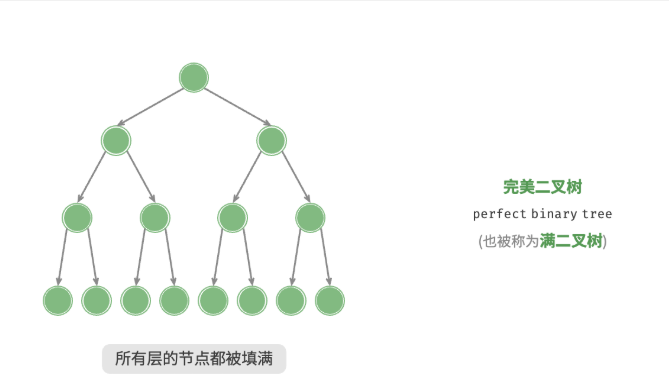
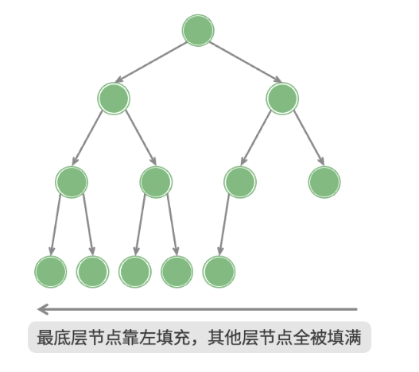
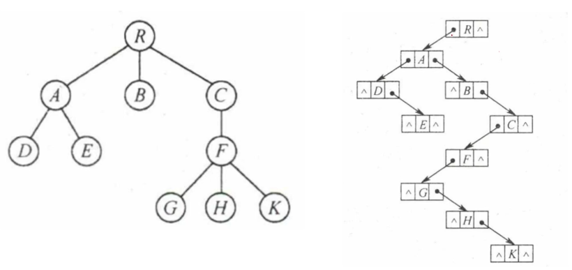
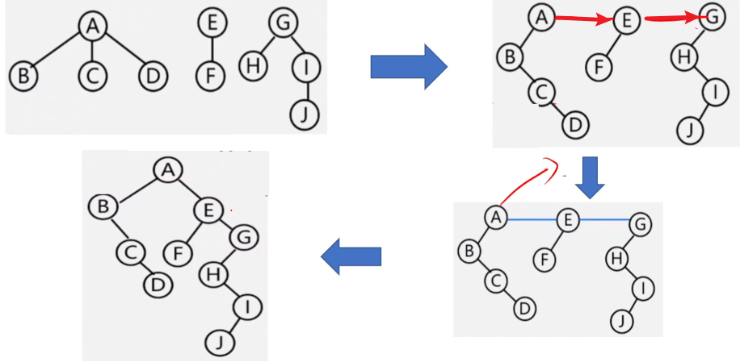

> [!summary] 本篇定位
> 讨论树和二叉树的基本概念、存储结构、遍历、线索化、哈夫曼树以及树、森林和二叉树之间的转换。二叉搜索树、AVL 树、红黑树和 B 树的查找操作见 [[05_查找]]。

# 1. 树的基本概念

树是 $n$ 个结点的有限集合。树中有且仅有一个根结点，其余结点分成互不相交的子树。

| 概念 | 含义 |
|---|---|
| 根结点 | 没有父结点的结点 |
| 叶结点 | 没有孩子的结点，度为 0 |
| 分支结点 | 至少有一个孩子的结点，也叫非叶结点 |
| 结点的度 | 该结点孩子的数量 |
| 结点的层 | 根结点通常为第 1 层 |
| 结点的深度 | 从根到该结点的路径长度，或按题目约定计层数 |
| 树的高度 | 根到最远叶结点的最长路径长度，或树的层数 |
| 森林 | 若干棵互不相交的树的集合 |

> [!warning] 高度和深度的两种约定
> 有的教材按边数计，叶结点高度为 0。也有题目按结点层数计，叶结点高度为 1。平衡因子使用左右高度之差时，两种约定的差值相同，但计算具体高度时必须遵循题目定义。

根结点是否为分支结点只取决于它是否有孩子。只有一个根结点的树中，根结点同时也是叶结点，不是分支结点。

## 1.1 树的性质

- 含有 $n$ 个结点的树有 $n-1$ 条边。
- 树中所有结点的度数之和等于边数。
- 非空二叉树中，设度为 $0、1、2$ 的结点数分别为 $n_0,n_1,n_2$，则

$$
\boxed{n_0=n_2+1}
$$

证明：二叉树边数既为 $n-1$，又为 $n_1+2n_2$。代入 $n=n_0+n_1+n_2$ 即可得到结论。

# 2. 二叉树

二叉树是每个结点至多有两个孩子，且左右子树有明确次序的树。二叉树和度不超过 2 的树不是同一概念，二叉树区分左、右孩子。

## 2.1 常见二叉树





- **满二叉树**：除叶结点外每个结点都有两个孩子，所有叶结点在同一层。
- **完全二叉树**：除最后一层外各层满，最后一层的结点从左到右连续排列。
- **完满二叉树**：每个结点的度只能是 0 或 2，也叫严格二叉树或正则二叉树。

高度为 $h$ 的二叉树最多有：

$$
2^h-1
$$

个结点，其中根所在层为第 1 层。第 $k$ 层最多有 $2^{k-1}$ 个结点。

完全二叉树按数组存储时，若根下标为 0：

$$
left(i)=2i+1,\qquad right(i)=2i+2
$$

若根下标为 1：

$$
left(i)=2i,\qquad right(i)=2i+1
$$

## 2.2 二叉树的存储

二叉链表结点：

```cpp
struct TreeNode {
    int val;
    TreeNode* left;
    TreeNode* right;
};
```

完全二叉树适合顺序存储。一般二叉树适合二叉链表，空指针可以进一步用于线索化。

# 3. 树与森林的表示和转换

## 3.1 树的存储方式

常见方法有：

1. 双亲表示法：每个结点保存父结点下标。
2. 孩子表示法：每个结点保存所有孩子的链表。
3. 孩子兄弟表示法：每个结点保存第一个孩子和下一个兄弟。

孩子兄弟表示法也叫左孩子右兄弟表示法：

- `firstChild` 指向第一个孩子。
- `nextSibling` 指向下一个兄弟。



## 3.2 转换规则

- 树转二叉树：第一个孩子连左指针，后续兄弟沿右指针连接。
- 森林转二叉树：先把每棵树转为二叉树，再把各棵树的根按森林次序沿右指针连接。
- 二叉树转树或森林：按左孩子右兄弟关系恢复孩子和兄弟。



转换后的二叉树中，原树的兄弟关系会变成右孩子关系，因此不能把普通二叉树的左右关系直接解释为原树的父子关系。

树转二叉树时，若原树有 $m$ 个结点、$n$ 个叶结点，则转换后二叉树中无右孩子的结点数为：

$$
\boxed{m-n+1}
$$

其中每个非叶结点的最后一个孩子在转换后无右孩子，原树根结点也无右兄弟。

## 3.3 树和森林的遍历对应

- 树的先根遍历对应转换后二叉树的先序遍历。
- 树的后根遍历对应转换后二叉树的中序遍历。
- 森林的先根遍历对应转换后二叉树的先序遍历。
- 森林的后根遍历对应转换后二叉树的中序遍历。

# 4. 二叉树遍历

## 4.1 四种遍历

| 遍历 | 访问顺序 |
|---|---|
| 先序 | 根、左、右 |
| 中序 | 左、根、右 |
| 后序 | 左、右、根 |
| 层序 | 按层从上到下，通常使用队列 |

先序和后序可以唯一确定根的位置：先序第一个结点是根，后序最后一个结点是根。得到根后，在中序序列中划分左右子树，再递归处理。

若只给先序或后序序列，通常不能唯一确定二叉树结构。若给先序和中序，或后序和中序，并且结点关键字互不相同，则可以唯一确定。

## 4.2 递归遍历模板

```cpp
void preorder(TreeNode* root) {
    if (!root) return;
    visit(root);
    preorder(root->left);
    preorder(root->right);
}

void inorder(TreeNode* root) {
    if (!root) return;
    inorder(root->left);
    visit(root);
    inorder(root->right);
}

void postorder(TreeNode* root) {
    if (!root) return;
    postorder(root->left);
    postorder(root->right);
    visit(root);
}
```

递归调用本质上使用系统栈。用显式栈可以把递归过程改写为迭代过程，层序遍历则使用队列。

# 5. 线索二叉树

线索二叉树利用二叉链表中的空指针保存遍历序列中的前驱或后继。

- 若没有左孩子，左指针可以指向直接前驱。
- 若没有右孩子，右指针可以指向直接后继。
- 通过 `lTag`、`rTag` 区分指针指向孩子还是线索。

在线索二叉树中，含有 $N$ 个结点的普通二叉树共有 $2N$ 个指针域，非空孩子指针为 $N-1$ 个，因此空指针数为：

$$
2N-(N-1)=N+1
$$

若全部空指针都用于线索，则线索数为 $N+1$。

# 6. 哈夫曼树与 WPL

## 6.1 带权路径长度

叶结点权值为 $w_i$，从根到该叶结点的路径长度为 $l_i$，则树的带权路径长度为：

$$
\boxed{WPL=\sum_{i=1}^{n}w_i l_i}
$$

这里的路径长度按 **边数** 计算，只统计叶结点，不统计非叶结点。

哈夫曼树是在所有带权叶结点二叉树中 WPL 最小的树。它也用于构造最优前缀编码。

## 6.2 哈夫曼树构造

1. 把每个权值作为一个结点放入最小堆。
2. 取出权值最小的两个结点合并。
3. 新结点权值为两者之和，并重新放入最小堆。
4. 重复直到只剩一个根结点。

每次合并产生的新结点权值之和等于最终 WPL，可用于快速计算。

例：权值 `1, 2, 3, 5`：

```text
1 + 2 = 3
3 + 3 = 6
5 + 6 = 11
```

因此：

$$
WPL=3+6+11=20
$$

哈夫曼编码从根出发，向左记 `0`，向右记 `1`。由于叶结点没有祖先叶结点，得到的编码具有前缀无歧义性。

## 6.3 m 叉哈夫曼树

严格 $m$ 叉树的每个非叶结点有 $m$ 个孩子。若原始叶结点数为 $n$，它必须满足：

$$
u=(n-1)\bmod(m-1)=0
$$

原因是设叶结点数为 $n_0$、非叶结点数为 $n_1$，则：

$$
mn_1=n_0+n_1-1
$$

所以：

$$
\boxed{n_0=(m-1)n_1+1}
$$

若 $u = 0$，则不需要补充虚叶节点，否则需要补充 $m-u-1$ 个权为 0 的虚叶节点。

之后每次取最小的 $m$ 个结点合并。虚叶结点权值为 0，不增加 WPL，只用于满足树的结构条件。

# 7. 森林转换高度题

森林转换为二叉树时，各棵树的根结点沿右指针连接，因此森林中第 $i$ 棵树的根会额外增加 $i-1$ 层的兄弟链偏移。若题目只给出每棵树的结点数，并允许选择各树的形状和次序，通常先求每棵树转换后可能达到的最小高度，再让高度较大的树优先排列。

在按层数计高、并按完全展开的最优形状估计时，一棵含 $n$ 个结点的树转换后的最小高度可按：

$$
h_i=\lceil\log_2 n\rceil+1
$$

计算，森林整体高度取：

$$
H=\max_i(h_i+i-1)
$$

例如结点数为 `7、5、4、3、2` 的五棵树，单棵转换高度分别可取 `4、4、3、3、2`。按高度从大到小排列后，整体高度为 `6`。具体题目若给出树的形状，应直接按左孩子右兄弟关系画出转换结果，不能只套结点数公式。

# 8. 典型结论与易错点

1. 二叉树结点数和边数关系为边数 $=$ 结点数 $-1$。
2. 计算 WPL 时使用边数，且只计算叶结点。
3. 树、森林转换为二叉树时，右指针表示兄弟关系。
4. 根结点不一定是分支结点，只有根结点的树中根结点是叶结点。
5. “满二叉树”“完全二叉树”“完满二叉树”概念不同，做题时不能混用。
6. 卡特兰数可用于计算 $n$ 个结点的不同二叉树结构数：

$$
C_n=\frac{1}{n+1}\binom{2n}{n}
$$

# 9. 典型代码与题型

## 9.1 求二叉树的 WPL

```cpp
int wpl(TreeNode* root, int depth = 0)
{
    if (!root) return 0;
    if (!root->left && !root->right)
    {
        return root->weight * depth;
    }
    return wpl(root->left, depth + 1) + wpl(root->right, depth + 1);
}
```

若题目按结点层数而不是边数定义路径长度，调用时可以从 `depth = 1` 开始。哈夫曼树的 WPL 也可以直接把每次合并产生的新权值相加。

## 9.2 孩子兄弟表示法的深度

在孩子兄弟表示法中，向下访问第一个孩子时深度加 1，沿右指针访问兄弟时深度不变：

```cpp
int tree_height(TreeNode* node, int depth = 1)
{
    if (!node) return depth - 1;
    int child_height   = tree_height(node->firstChild, depth + 1);
    int sibling_height = tree_height(node->nextSibling, depth);
    return max(child_height, sibling_height);
}
```

这也是处理家谱树、统计最深一代和计算后代数量时的关键。递归返回阶段先处理孩子，再计算当前结点，底层实现使用的是栈。
