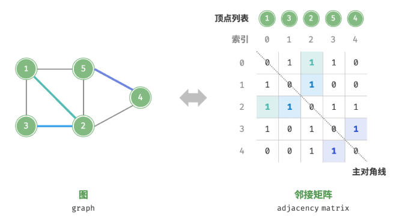
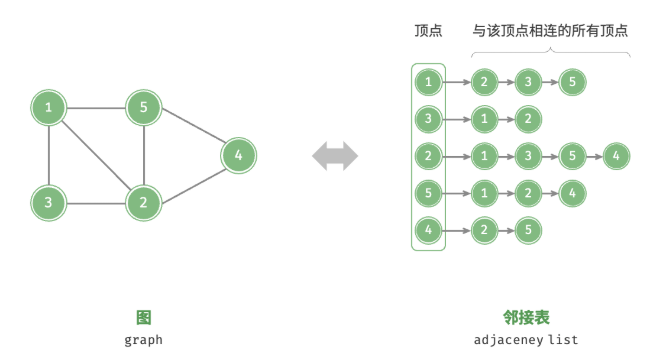
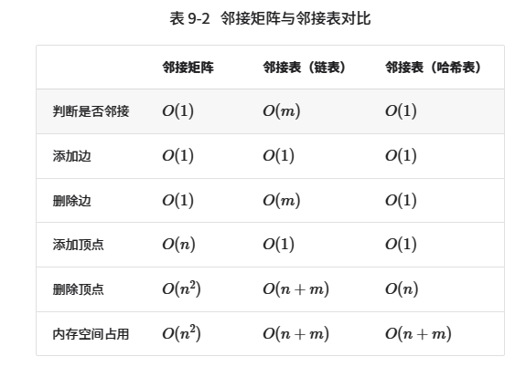
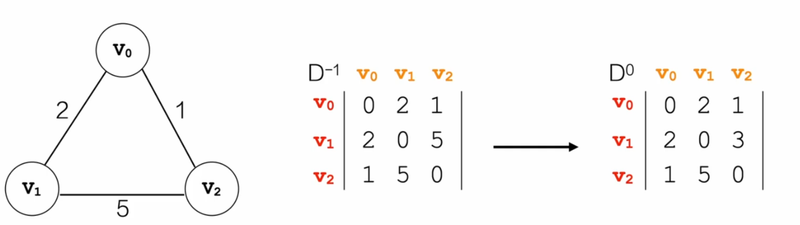
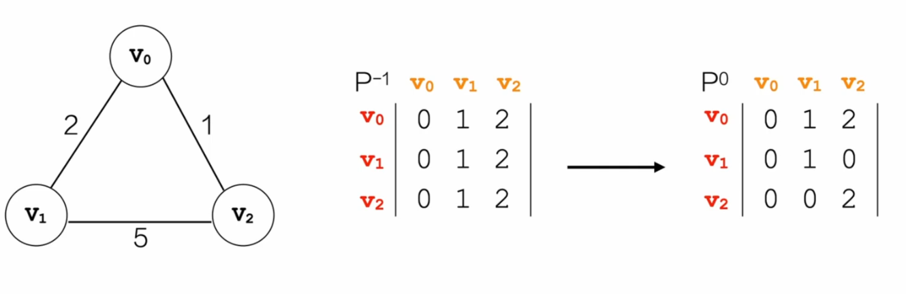
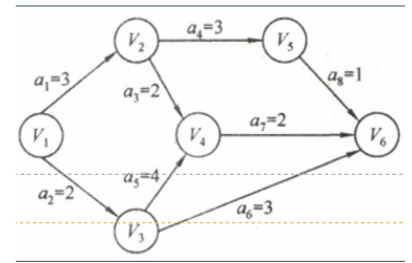
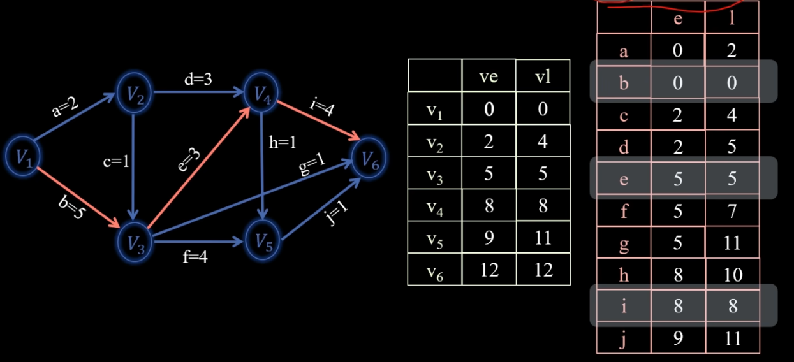
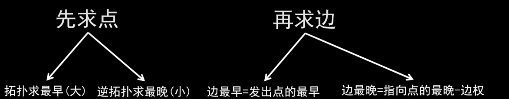
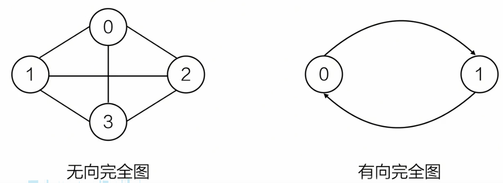
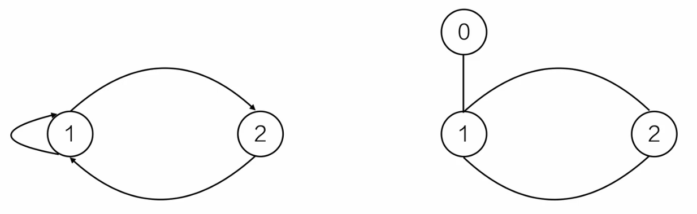

# 1.基础知识点

**注意：对于图这种数据结构，不允许没有顶点，但边集可以为空。**

## 1.1 图的存储结构

有三种方式：`邻接矩阵`，`邻接表（链表）`，`邻接表（哈希表）`





注意：在做题时，需要知道邻接表中`data`域存储的应该是连同顶点在数组中对应的 **索引** ，而不是像图示中连接的是顶点值。

设图中共有`n`个顶点和`m`条边，表 9-2 对比了邻接矩阵和邻接表的时间效率和空间效率。


观察表 9-2 ，似乎邻接表（哈希表）的时间效率与空间效率最优。但实际上，在邻接矩阵中操作边的效率更高，只需一次数组访问或赋值操作即可。综合来看，邻接矩阵体现了“以空间换时间”的原则，而邻接表体现了“以时间换空间”的原则。

---

## 1.2 最小生成树

---

### 1.2.1 Prim （普里姆）算法（加点法）

先确定一点，依次加点（每次选择连接两点最短的那条路径）。

---

### 1.2.2 Kruskal （克鲁斯卡尔）算法（加边法）

先确定一边，依次加边（每次选择能联通顶点的那条最短路径）

---

## 1.3 最短路径

---

### 1.3.1 Dijkstra （迪杰斯特拉）算法

Dijkstra 算法用于解决 **单源路径最短** 问题，该算法本质是 **贪心** 策略。

```cpp
// 辅助函数：用于查找 distance 中最小的那个值，且对应的 visited 为 false
int chooose_index(vector<int> distance, vector<bool> visited, int size){
    int min_distance = INT_MAX;
    int min_position = -1;

    for(int i = 0; i < size; i++){
        if(distance[i] < min_distance && !visited[i]){
            min_distance = distance[i];
            min_position = i;
        }
    }

    return min_position;
}


/* 用数组实现 */
vector<int> dijkstra(int start, vector<vector<int>> adjMat) {
    int n = adjMat.size();

    // 下面三个数组的索引与 vertices 的索引相对应
    vector<int> distance(n, INT_MAX); // start （起点）到达每一个点的最短路径大小
    vector<bool> visited(n, false);   // 顶点是否已经访问过
    vector<int> path(n, -1);          // 路径：存放的是顶点的前驱顶点索引，倒着往回推出整个路径

    // 初始化起点
    for (int i = 0; i < n; i++) {
        distance[i] = adjMat[start][i];
    }

    visited[start] = true; // 在初始化 distance 的时候，vertices[0] 就访问过了
    distance[start] = 0;   // 可以不要，但是为了保证逻辑严密性，还是加上

    int next; // 接下来要访问的那个顶点
    // 这里初始化 i 为 1，因为在一开始（初始化 distance）的时候，就已经完成填写了从 第0个顶点 直接到其它顶点的最短路径
    for (int j = 1; j < n; j++) {
        next = choose_index(distance, visited, n);
        visited[next] = true;
        for (int k = 0; k < n; k++) {
            // 这里加上判断条件 adjMat[next][k] != INT_MAX 的原因是：num + INT_MAX 会溢出，同时 adjMat[next][k] == INT_MAX 表示的意思也是 next 处的顶点无法到达 k 处的顶点
            if (visited[k] == false && adjMat[next][k] != INT_MAX && distance[next] + adjMat[next][k] < distance[k]) {
            distance[k] = distance[next] + adjMat[next][k];
            path[k] = next;
            }
        }
    }

    // 优化下 path 数组输出（自己想想原因为什么有这步）
    for(int m = 1; m < n; m++){
        if(path[m] == -1){
            path[m] = start;
        }
    }

    return distance;
}
```

---

### 1.3.2 Floyd （弗洛伊德）算法

Floyd 算法用于解决 **所有点与点之间的最短路径** 问题，该算法本质是 **动态规划** 策略。



$D$表示$distance$的意思，$D^0$表示经过$V_0$中转到达下一个顶点，比如$D^0[V_1][V_2]$表示的就是$V_1$顶点经过$V_0$中转后，到达$V_2$。自然，$D^{-1}$表示的就是没有经过中转。也就是说在实现代码时，我们会维护一个 **二维的$distance$数组** ，用于存储顶点到其它顶点之间的权值（路径长度）。

这里定义：$j$是起始顶点，$k$是终止顶点，$i$是中转顶点。

$$
if \ \  D^{-1}[1][2] > D^{-1}[1][0] + D^{-1}[0][2]
$$

$$
so: \ \ D^0[1][2] = D^{-1}[1][0] + D^{-1}[0][2]
$$

$$
deduce: \ D^i[j][k] = D^{i-1}[j][i] + D^{i-1}[i][k]
$$



$P$表示$path$的意思，$P^0$表示经过$V_0$中转到达下一个顶点，意思和$D$数组的含义类似。同样，我们也会维护一个 **二维的$path$数组** ，但是这个数组存储的值的含义就是 **终点的前驱顶点（$P$的上标，中转节点）** 。比如$P^0$中，$P[V_1][V_2] = 0$。 

$$
if \ \  D^{-1}[1][2] > D^{-1}[1][0] + D^{-1}[0][2]
$$

$$
so： \ \ P^0[1][2] = P^{-1}[1][0]
$$
$$
deduce: \ P^i[j][k] = P^{i-1}[j][i]
$$

```cpp
vector<vector<int>> floyd(vector<vector<int>> adjMat){
    int n = adjMat.size();
    vector<vector<int>> distance(n, vector<int>(n, INT_MAX));   // distance 数组，存放距离
    vector<vector<int>> path(n, vector<int>(n, -1));            // path 数组，存放前驱顶点

    // 初始化 distance 数组和 path 数组
    // j: 起始顶点，k: 终止顶点
    for(int j = 0; j < n; j++){
        for(int k = 0; k< n; k++){
            distance[j][k] = adjMat[j][k];
            path[j][k] = k;
        }
    }

    // i: 中转顶点，j: 起始顶点，k: 终止顶点 （i, j, k 都表示顶点在 vertices 数组中的索引）
    // 第一层循环：索引从 [0, n - 1] 依次作为中转顶点
    for(int i = 0; i < n; i++){
    
        // 第二层和第三层循环构成二维数组，然后“填空”即可
        for(int j = 0; j < n; j++){
            for(int k = 0; k < n; k++){
                // 若 直达 > 中转，更新 distance 和 path ; distance[j][i] 和 distance[i][k] 都为 INT_MAX 的话，表示不可达
                if(distance[j][i] != INT_MAX && distance[i][k] != INT_MAX && distance[j][k] < distance[j][i] + distance[i][k]){
                    distance[j][k] = distance[j][i] + distance[i][k];
                    path[j][k] = path[j][i];
                }
            }
        }
    }

    return distance;
}
```


---

## 1.4 拓扑排序

用有图来描述一入工程或系统的进行过程。
一个工程可以分为若于个子工程，只要完成了这些子工程（活动），就可以导致整人工程的完成。
1. `AOV`网（`Activity On Vertices`）：用顶点表示活动的网络
2. `AOE`网（`Activity On Edges`）：用边表示活动的网络
**`AOV`网是顶点表示活动的网，它只描述了活动之间的约束关系，而`AOE`网是用有向边表示活动边上的权值表示活动持续的时间。**
`AOE`网是建立在`AOV`网基础之上（活动之间约束关系没有矛盾），再来分析完成整个工程至少需要多少时间，或者为缩短完成工程所需时间，应当加快那些活动等问题。

步骤：
1. 如果找得到任何一个入度为`0`的顶点`v`，则`step 2`，负责`step 4`;
2. 输出顶点`v`，并从图中删除该顶点以及与其相连的所有边；
3. 对改变后的图重复这一过程，转`step 1`；
4. 如果已经输出全部顶点，则结束；否则该有向图不是`DAG`（`Directed Acyclic Graph`，叫做有向无环图）。

---

## 1.5 关键路径

典型用途：“工程完成的最早时间是什么时候？”、“一个工程中哪些活动可以适当延迟，可以延迟多长时间，而不影响整个工期？”————非关键活动等。

- **`AOE`网：** 带权的有向无环图
- **顶点：** 事件或状态
- **弧（有向边）：** 活动及发生的先后关系
- **权：** 活动持续时间
- **起点：** 入度为`0`的点（只有一个）
- **终点：** 出度为`0`的点（只有一个）

如下图所示：


`AOE`网中 **没有入边** 的顶点称为 **始点** （或源点）， **没有出边** 的顶点称为 **终点** （或汇点）。其性质如下：
- 只有在某顶点所代表的事件发生后，从该顶点出发的各活动才能开始；
- 只有在进入某顶点的各活动都结束，该顶点所代表的事件才能发生。

**重要术语：**
- **关键路径：** 最耗时的那条路径。
- **关键活动：** 不能拖延的活动，**$最早开始时间 = 最晚开始时间 = 0$** 。活动其实就是指图的边，比如上图中$a_1$，$a_2$就是活动。
- **$ve$:** **事件** 的最早开始事件。
- **$vl$:** **事件** 的最晚开始时间。
- **$e$:** **活动** 的最早开始时间。$e = ve$，$ve$是发出点的。
- **$l$:** **活动** 的最晚开始时间。$l = vl - activity$，$V_l$是指向点的。
- **时间余量：**$时间余量 = l - e$



如上图所示，以活动`d`为例，它的$e$为$V_2$的$ve$，即`2`；它的$l$为$V_4$的$vl$减去`d`的值，即`8-3=5`。

上图中的关键路径很显然就是`b`、`e`、`i`，当然，有时候关键路径可能有很多条。



---

# 2.常用结论

---

1. 无向图的度数与边数的关系：

    $$
    \sum_{v \in V} \deg(v) = 2E
    $$

    -$\deg(v)$表示顶点$v$的度数（即与其相连的边的数量）。
    -$E$表示图的 **边数** 。
    - 原因：因为每条边都会被两个端点计数一次。

对于有向图，所有顶点的出度与入度之和相等，弧（弧头和弧尾）的数量也相等。

---

2. 对于`AOE`网，若想缩短“工程工期”，如果该网有多条关键路径，需要 **所有关键路径上的活动时间同时减少，即选择缩短的活动必须涵盖在所有关键路径中** 。

---

3. 由于连通图中可能会存在权值相同的边，所以最小生成树是不唯一的，但是构造最小生成树的 **代价是唯一的** 。

----

4. 完全图（Complete Graph）：
   - 在 **无向图** 中，每一对不同的顶点之间都有一条**直接相连的边**。
   - 在 **有向图** 中，每一对不同的顶点之间都有**两个方向的边**（即双向连接）。



   - 一个 **无向完全图** 具有$n$个顶点，且每两个顶点之间都有一条边，边的总数为：
  $$
  E = \frac{n(n-1)}{2}
  $$
  这个公式来源于组合数$C_{n}^2$，即从$n$个点中任选 2 个点来形成一条边。
   - 一个 **有向完全图** 具有$n$个顶点，每两个顶点之间都有 **一对（2条）** 有向边，边的总数为：
  $$
  E = n(n-1)
  $$

---

5.$连通分量 = 图中一个独立的“最大连通块”$。若图本身是连通的，则整个图是唯一的连通分量；若图不连通，则被划分为多个连通分量。

---

6. 简单图与多重图：
   - 限制一：图中不能有从顶点到其自身的边；
   - 限制二：同一条边在图中不能出现两次或者两次以上。
   - 不满足以上两条限制的称为 **多重图** 。

    以上两个图都是多重图，注意：右边的图是无向图，所以`1-2`和`2-1`的性质一样，不满足限制二。

---

7. 在带权连通图中， **当任意一个环中所包含的边的权值均不相同时** ，其 **MST（最小生成树）** 是唯一的。也可以这样说：权值必须唯一（即图中每条边的权重互不相同），或者MST 过程中不存在等权边的选择冲突。

---

1. 无权图$G$用邻接矩阵存储，把邻接矩阵设为 **$A$** ，若该图有$n(\ n>=2\ )$个顶点，则 **$A^m \ (2<=m<=n)$** 中第$i$行第$j$列的非零元素的含义是该图中 **顶点$i$到顶点$j$之间的长度为$m$的数量** 。这个结论适用于无向图和有向图，因为矩阵乘法的定义不依赖于边的方向。若图是带权图，数值表示所有路径的权重乘积之和（通常没意义）。

---

# 3. 代码

## 3.1 图的遍历

### 3.1.1 BFS 遍历

邻接矩阵：
```cpp
void bfs(int start){
    vector<int> visited(vertices.size(), false);
    queue<int> q;
    q.push(start);
    visited[start] = true;

    cout << "BFS 遍历：";
    while(!q.empty()){
        int index = q.front();
        q.pop();

        cout << vertices[index] << " ";

        for(int i = 0; i < vertices.size(); i++){
            // 如果顶点没有访问过，且与 index 对应的顶点连接
            if(!visited[i] && adjMat[index][i] == 1){
                q.push(i);
                visited[i] = true;
            }
        }
    }

    cout << endl;
}
```

邻接链表：
```cpp
void bfs(int start){
    vector<int> visited(vertices.size(), false);
    queue<int> q;
    q.push(start);
    visited[start] = true;

    cout << "BFS 遍历：";
    while(!q.empty()){
        int index = q.front();
        q.pop();

        cout << vertices[index] << " ";

        Vertex *next_vertex = adjList[index]->next;
        while(next_vertex){
            // get_index() 方法用于找到目标元素的索引
            int next_index = get_index(next_vertex->val);
            if(!visited[next_index]){
                q.push(next_index);
                visited[next_index] = true;
            }
            next_vertex = next_vertex->next;
        }
    }

    cout << endl;
}
```

#### 易错点

`BFS` 中一个顶点从 **入队** 到 **出队** 之间存在时间窗，若把 `visited[...] = true` 放在出队之后，就会出现 **同一顶点重复入队、重复输出**。

**错误写法**（标记晚于判重）：

```cpp
while(!q.empty()){
    int index = q.front();
    visited[index] = true;   // ❌ 出队才标记
    q.pop();

    cout << vertices[index] << " ";

    for(int i = 0; i < vertices.size(); i++){
        if(!visited[i] && adjMat[index][i] == 1){
            q.push(i);       // ❌ 入队时不标记
        }
    }
}
```

以三角形图 $K_3$（边 $1-2$、$1-3$、$2-3$）为例，`bfs(1)` 的执行过程：

| 时刻 | 动作 | 此刻 `visited` | 结果 |
| --- | --- | --- | --- |
| $t_1$ | 弹出顶点 $1$ | $[T,F,F]$ | 邻居 $2$、$3$ 均未访问 → 都入队 |
| $t_2$ | 弹出顶点 $2$ | $[T,T,F]$ | 邻居 $3$ 的 `visited` **仍是 `false`** → $3$ 再次入队 |
| $t_3$ | 弹出顶点 $3$（第一份） | $[T,T,T]$ | 输出 $3$ |
| $t_4$ | 弹出顶点 $3$（第二份） | $[T,T,T]$ | 又输出一次 $3$ ❌ |

输出 `1 2 3 3`，正确结果应为 `1 2 3`。问题出在时间窗：

$$
t_1\,(\text{3 入队}) \;<\; t_2\,(\text{3 被再次判重}) \;<\; t_3\,(\text{3 出队并标记})
$$

$t_3$ 之前 `visited[3]` 一直是 `false`，而 $2$ 在 $t_2$ 时就已经需要判重了。

**为什么 `DFS` 没有这个问题：** `DFS` 同一时刻只有一条活跃路径，顶点被发现后立刻进入递归体、立刻被标记，不存在“已入栈但还没执行到”的窗口期。**`BFS` 里 `push` 不等于 `visit`。**

**`visited` 的语义差别：**

| 标记时机 | `visited = true` 表示 | 后果 |
| --- | --- | --- |
| 出队时 | 「已经处理完」 | 队列中可能存在多个“待处理”的同名顶点 → 重复 |
| 入队时 | 「已经进入待处理集合」 | 每个顶点最多入队一次 |

**修法 A（推荐）：入队即标记**

```cpp
if(!visited[i] && adjMat[index][i] == 1){
    visited[i] = true;   // ✅ 门口登记
    q.push(i);
}
```

**修法 B：出队时补守卫**

```cpp
int index = q.front(); q.pop();
if(visited[index]) continue;   // 过滤重复副本（结果正确但队列里有冗余副本）
visited[index] = true;
```

修法 B 结果正确，但最坏情况下总入队次数可达 $O(m)$ 而非 $O(n)$，空间与常数变差，标准写法用 **A**。

> **一句话：判重与标记必须发生在同一个原子动作里——“入队的同时标记”。**

### 3.1.2 DFS 遍历

邻接矩阵：
```cpp
void dfs_recursive(int index, vector<int> &visited){
    cout << vertices[index] << " ";
    visited[index] = true;

    for(int i = 0; i < vertices.size(); i++){
        if(!visited[i] && adjMat[index][i] == 1){
            dfs_recursive(i, visited);
        }
    }
}

void dfs(int start){
    vector<int> visited(vertices.size(), false);
    cout << "DFS 遍历：";
    dfs_recursive(start);

    cout << endl;
}
```

邻接链表：
```cpp
void dfs_recursive(int index, vector<int> &visited){
    cout << vertices[index] << " ";
    visited[index] = true;

    Vertex *next_vertex = adjList[index]->next;
    while(next_vertex){
        int next_index = get_index(next_vertex->val)
        if(!visited[next_vertex]){
            dfs(next_index, visited);
        }
        next_vertex = next_vertex-->next;
    }
}

void dfs(int start){
    vector<int> visited(vertices.size(), false);
    cout << "DFS 遍历：";
    dfs_recursive(start);

    cout << endl;
}
```

### 3.1.3 对两种遍历的总结

`visited` 数组的作用是 **防止同一个顶点被重复到达**，这与边有没有方向无关。上面两种代码虽然是对 **无向图** 写的，但 **有向图同样必须维护 `visited`**。

#### 无向图：必须有

无向图的每条边 $\{u,v\}$ 都能双向通过，走到 $v$ 后必然能沿同一条边折返：

$$
u \to v \to u \to v \to \cdots
$$

不加 `visited` 会立刻无限递归（邻接链表中尤其明显），复杂度也无法保证。

#### 有向图：一般也必须有

有向图仅仅少了“沿同一条边立刻折返”这一种重复，其余重复全在：

1. **有向环** → 直接死循环

   $$1 \to 2 \to 3 \to 1 \to 2 \to 3 \to \cdots$$

2. **多路径汇合**（无环也挡不住）→ 重复遍历，指数级爆炸

   以 $k$ 层“菱形链”为例（每层的两个顶点都与下一层的两个顶点全连）：

   $$s \to \{a_1,b_1\} \to \{a_2,b_2\} \to \cdots \to t$$

   $s$ 到 $t$ 共有 $2^k$ 条路径，不加标记的 `DFS` 要把每条路径完整走一遍：

   $$T(k) = 2T(k-1) = O(2^k)$$

   而顶点数只有 $2k+2$。加了 `visited` 才是标准的 $O(n+m)$。**所以 `DAG` 上省 `visited` 不是“错”，而是把线性算法降级成指数算法**；`BFS` 同理会往队列里塞大量重复副本（见 §3.1.1 易错点）。

#### 可以省掉 `visited` 的唯一充分条件

若每个顶点的入度 $\le 1$（每个连通分量是以源点为根的有向树，即 arborescence），则源点到任意顶点的路径唯一，不会重复到达：

$$\forall v \ne \text{源点}:\quad \mathrm{indeg}(v) \le 1$$

一旦出现 $\mathrm{indeg} \ge 2$ 的汇合点或环，就必须标记。一般有向图几乎必然违反这一条件，因此 **工程上一律加 `visited`，不做特判**。

#### 进阶：有向图需要“两套标记”

无向图用两色（到过 / 没到过）就够；有向图在 **判环、`DFS` 版拓扑排序、`Tarjan` 求强连通分量** 时必须区分三种状态：

| 状态 | 含义 |
| --- | --- |
| 白：`color = 0` | 从未访问 |
| 灰：`color = 1` | 已进入递归栈，子树未走完 |
| 黑：`color = 2` | 子树全部走完 |

```cpp
// 三色 DFS 判环：返回 false 表示存在环
bool dfs(int u){
    color[u] = 1;                         // 灰：在栈上
    for (int v : adj[u]){
        if (color[v] == 1) return false;  // 撞回栈上的点 → 有环
        if (color[v] == 0 && !dfs(v)) return false;
    }
    color[u] = 2;                         // 黑：完成
    return true;
}
```

只用两色会把灰点和黑点都当成“访问过”直接跳过，**永远判不出环**。

## 3.2 邻接矩阵表示法的出度和入度

### 结论

邻接矩阵 `adjMat` 中 `adjMat[i][j] != ∞` 表示存在弧 $\langle i, j\rangle$（权重即 `adjMat[i][j]`）。因此：

- **出度**：第 $i$ 行非 $\infty$ 的**个数**，$\text{out}(i) = |\{\,j \mid A[i][j] \ne \infty\,\}|$
- **入度**：第 $j$ 列非 $\infty$ 的**个数**，$\text{in}(j) = |\{\,i \mid A[i][j] \ne \infty\,\}|$

注意是“个数”而不是那些权值本身；且 $A[i][i]$ 不应计入（简单图无自环）。

校验关系（两个和必然相等，可用于自检，但**抓不到下标写错的 bug**——下标错位时两个和依然都等于 $|E|$）：

$$\sum_{v}\text{out}(v) = \sum_{v}\text{in}(v) = |E|$$

无向图的邻接矩阵是对称阵，行与列相同，故出度 $=$ 入度 $= \deg(v)$，且 $\sum_v \deg(v) = 2|E|$（见 §2.1）。

### 判据取决于“无边”怎么存

三种约定混用就会全错，这是踩坑的主因：

| 场景 | 无边怎么存 | 正确判据 |
| --- | --- | --- |
| 无权图 | `0` | `adjMat[i][j] != 0` |
| 带权网（本笔记） | `INF = -1`，显示为 $\infty$ | `adjMat[i][j] != INF` |
| Dijkstra / Floyd | `INT_MAX` 或 $\infty$，**对角线常存 `0`** | `adjMat[i][j] != INF`，**且必须跳过 `i == j`** |

最后一行最隐蔽：Floyd 惯例下 $A[i][i] = 0$（自己到自己的距离），会被判据当成一条自环，导致每个顶点的出度、入度各多算 1。

### 示例

```text
      V0 V1 V2 V3 V4 V5 V6
 V0    ∞  1  ∞  ∞  ∞  1  1
 V1    ∞  ∞  ∞  ∞  ∞  ∞  ∞
 V2    1  ∞  ∞  1  ∞  ∞  ∞
 V3    ∞  ∞  ∞  ∞  ∞  1  ∞
 V4    ∞  ∞  ∞  ∞  ∞  ∞  ∞
 V5    ∞  ∞  ∞  ∞  1  ∞  ∞
 V6    ∞  ∞  ∞  ∞  1  ∞  ∞
```

以 $V_0$ 为例：`row[0]` 有 3 个非 $\infty$（指向 $V_1$、$V_5$、$V_6$），故出度为 3；`col[0]` 只有 1 个非 $\infty$（来自 $V_2$），故入度为 1。

全部顶点：出度 $(3,0,2,1,0,1,1)$，入度 $(1,1,0,1,2,2,1)$，二者之和均为 8，即 $|E| = 8$。

### 求出入度的代码

一趟扫描同时累加弧尾的出度与弧头的入度，判据与累加下标天然对齐，不会出现“判据读 $[i][j]$、结果却写回 $[j]$”的错位：

```cpp
const int INF = -1;   // 与上表约定一致，避免裸写 -1

void get_degree(const vector<vector<int>>& adjMat,
                vector<int>& vecIndegree, vector<int>& vecOutdegree)
{
    int n = adjMat.size();   // 取行数，比 adjMat[0].size() 安全
    vecIndegree.assign(n, 0);
    vecOutdegree.assign(n, 0);

    for (int i = 0; i < n; ++i)   // i（行）是弧尾
    {
        for (int j = 0; j < n; ++j)   // j（列）是弧头
        {
            if (adjMat[i][j] != INF)   // 存在弧 i → j
            {
                ++vecOutdegree[i];   // 弧尾出度 +1
                ++vecIndegree[j];    // 弧头入度 +1
            }
        }
    }
}
```

### 应用：输出出度大于入度的顶点（`K` 顶点）

直接复用 `get_degree`，不再写第二套度数统计：

```cpp
int get_K(const vector<vector<int>>& adjMat, const vector<int>& vertices)
{
    vector<int> vecIndegree, vecOutdegree;
    get_degree(adjMat, vecIndegree, vecOutdegree);

    int K_vertex = 0;
    for (int i = 0; i < (int)vertices.size(); ++i)
    {
        if (vecOutdegree[i] > vecIndegree[i])
        {
            cout << vertices[i] << " ";
            ++K_vertex;
        }
    }
    cout << endl;

    return K_vertex;
}
```

## 3.3 拓扑排序

需要提前维护一个`indegree`数组，用于存放顶点的入度，`indegree`数组的索引应该与`vertices`数组的索引对应，即`indegree[i]`表示的是`vertices[i]`顶点的入度。

邻接矩阵：
```cpp
vector<int> topology(){
    vector<int> res;
    queue<int> q;
    // 把所有入度为 0 的顶点放到队列中
    for(int i = 0; i < vertices.szie(); i++){
        if(indegree[i] == 0){
            q.push(i);
        }
    }

    while(!q.empty()){
        int index = q.front();
        q.pop();
        res.push_back(vertices[index]);

        // index 对应顶点（src 顶点）,j 对应的是 dist 顶点
        for(int j = 0; j < vertices.size(); j++){
            if(adjMat[index][j] == 1){
                // 因为访问过了 src 顶点，所以要让这些与 src 顶点连接着的 dist 顶点的入度减一
                indegree[j]--;
                if(indegree[j] == 0){
                    q.push(j);
                }
            }
        }
    }

    return res;
}
```

邻接链表：
```cpp
vector<int> topology(){
    vector<int> res;
    queue<int> q;
    // 把所有入度为 0 的顶点放到队列中
    for(int i = 0; i < vertices.szie(); i++){
        if(indegree[i] == 0){
            q.push(i);
        }
    }

    while(!q.empty()){
        int index = q.front();
        q.pop();
        res.push_back(vertices[index]);

        // 记录当前顶点连接的下一个顶点
        Vertex *next_vertex = adjList[index]->next;
        // 从下一个顶点开始
        while(next_vertex){
            int next_index = get_index(next_vertex->val);
            indegree[next_index]--;
            if(indegree[next_index] == 0){
                q.push(next_index);
            }
            next_vertex = next_vertex->next;
        }
    }

    return res;
}
```

## 3.5 求无向图连通分量

本质上就是看通过 DFS 遍历来探寻有几个子图。因为 DFS 遍历一次，就会遍历完一个子图。也可以尝试用下 BFS 来求连通分量。
```cpp
/* dfs 遍历求连通分量 */
void dfs(vector<Vertex*> adjList, vector<int> vertices, vector<bool> &visited, int index){
    cout << vertices[index] << " ";
    visited[index] = true;

    Vertex* next_vertex = adjList[index]->next;
    while(next_vertex){
        int next_index = get_index(next_vertex->val);
        if(!visited[next_index]){
            dfs(adjList, vertices, visited, next_index);
        }
        next_vertex = next_vertex->next;
    }
}

void get_connected_components(vector<Vertex*> adjList, vector<int> vertices){
    vector<bool> visited(vertices.size(), false);

    for(int i = 0; i < vertices.size(); i++){
        // 看下还有哪些子图中的顶点没被遍历
        if(!visited[i]){
            dfs(adjList, vertices, visited, i);
            cout << endl;
        }
    }
}
```
