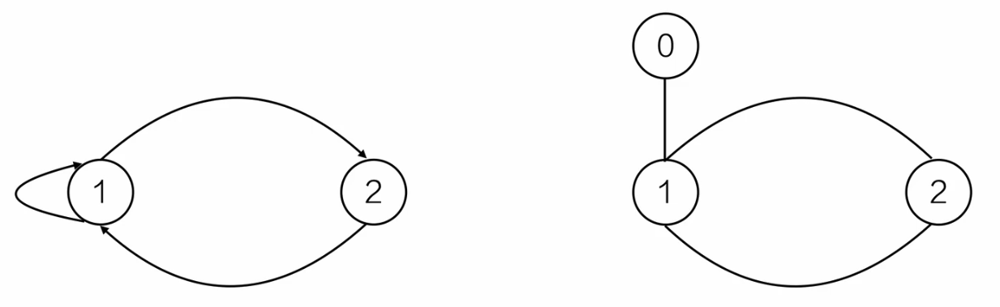
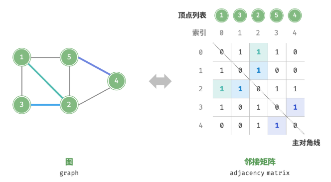
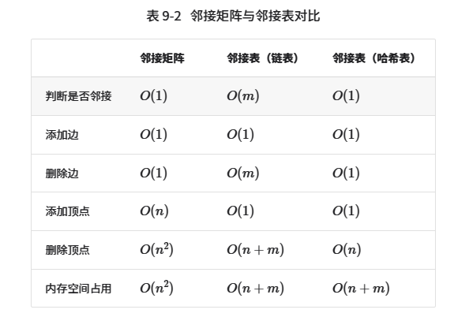
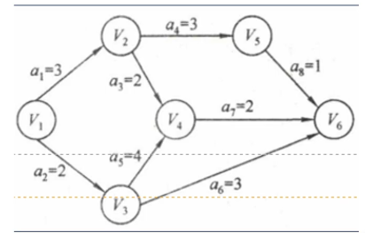
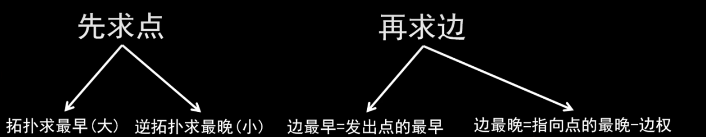

> [!summary] 本篇定位
> 讨论图的基本概念、存储结构、遍历、最小生成树、最短路径、拓扑排序和关键路径，并整理邻接矩阵中的度数统计与 BFS/DFS 易错点。

# 1. 图的基本概念

图 $G=(V,E)$ 由顶点集 $V$ 和边集 $E$ 组成。图至少有一个顶点，边集可以为空。

| 概念 | 含义 |
|---|---|
| 无向图 | 边没有方向，用 `{u,v}` 表示 |
| 有向图 | 边有方向，用 `⟨u,v⟩` 表示 |
| 权 | 边或弧上的数值 |
| 度 | 无向图中与顶点关联的边数 |
| 入度 | 有向图中指向该顶点的弧数 |
| 出度 | 有向图中从该顶点指出的弧数 |
| 路径 | 顶点和边交替组成的序列 |
| 回路 | 起点和终点相同的路径 |
| 连通分量 | 无向图中的极大连通子图 |
| DAG | 有向无环图 |

简单路径通常要求路径中的顶点不重复。回路的首尾顶点相同，因此按通常定义不属于简单路径，题目若使用“简单回路”则还要求除首尾外其他顶点不重复。

## 1.1 常见公式

无向图：

$$
\sum_{v\in V}\deg(v)=2|E|
$$

有向图：

$$
\sum_{v\in V}\operatorname{indeg}(v)=\sum_{v\in V}\operatorname{outdeg}(v)=|E|
$$

无向完全图有 $n$ 个顶点时：

$$
|E|=\frac{n(n-1)}2
$$

有向完全图通常每对顶点有两个方向的弧：

$$
|E|=n(n-1)
$$



简单图通常不含自环，也不含同一对顶点之间的多条边。违反任一限制的图可称为多重图。

# 2. 图的存储结构

## 2.1 邻接矩阵

邻接矩阵 `A[i][j]` 表示顶点 $i$ 到顶点 $j$ 是否存在边或弧，也可以保存边权。

- 无向图的邻接矩阵通常是对称矩阵。
- 有向图的邻接矩阵不一定对称。
- 判断有无边时，必须按照题目约定识别无边值，如 `0`、`-1` 或 `INF`。
- Dijkstra/Floyd 中对角线常设为 `0`，统计度数时不能把 `A[i][i]` 当成自环。

空间复杂度为 $O(|V|^2)$。判断两点是否相邻、修改一条边的时间复杂度为 $O(1)$，适合稠密图。



## 2.2 邻接表

邻接表为每个顶点保存其邻接顶点集合。空间复杂度为 $O(|V|+|E|)$，适合稀疏图。遍历某顶点的所有邻接点的总时间与边数相关。


邻接表结点的 `data` 域通常保存目标顶点在顶点数组中的索引，不能把顶点值和数组下标混为一谈。



| 操作 | 邻接矩阵 | 邻接表 |
|---|---:|---:|
| 空间 | $O(V^2)$ | $O(V+E)$ |
| 判断一条边 | $O(1)$ | 与邻接点数量有关 |
| 遍历某顶点邻接点 | $O(V)$ | $O(\deg(v))$ |
| 适合场景 | 稠密图 | 稀疏图 |

## 2.3 邻接矩阵统计入度和出度

若 `INF` 表示无边，则：

- 第 `i` 行非 `INF` 的个数是出度。
- 第 `j` 列非 `INF` 的个数是入度。
- 若对角线为 `0`，统计时跳过 `i == j`。

```cpp
void get_degree(const vector<vector<int>>& adjMat,
                vector<int>& indegree,
                vector<int>& outdegree) {
    int n = adjMat.size();
    indegree.assign(n, 0);
    outdegree.assign(n, 0);

    for (int i = 0; i < n; ++i) {
        for (int j = 0; j < n; ++j) {
            if (i != j && adjMat[i][j] != INF) {
                ++outdegree[i];
                ++indegree[j];
            }
        }
    }
}
```

# 3. 图的遍历

## 3.1 BFS

广度优先搜索使用队列，按距离从近到远访问顶点。无向图中从源点开始的 BFS 可以得到最短边数距离。

```cpp
void bfs(int start, const vector<vector<int>>& adj,
         vector<bool>& visited) {
    queue<int> q;
    visited[start] = true;
    q.push(start);

    while (!q.empty()) {
        int u = q.front();
        q.pop();
        visit(u);

        for (int v : adj[u]) {
            if (!visited[v]) {
                visited[v] = true;
                q.push(v);
            }
        }
    }
}
```

> [!warning] BFS 必须在入队时标记
> 一个顶点从入队到出队之间可能被其他顶点再次发现。若出队时才标记，顶点可能重复入队和重复输出。标准写法是判重和标记同时发生在入队处。

BFS 的时间复杂度为 $O(V+E)$，邻接矩阵实现通常为 $O(V^2)$。

## 3.2 DFS

深度优先搜索使用递归调用栈或显式栈，沿一条路径尽可能深入后回溯。

```cpp
void dfs(int u, const vector<vector<int>>& adj,
         vector<bool>& visited) {
    visited[u] = true;
    visit(u);

    for (int v : adj[u]) {
        if (!visited[v]) {
            dfs(v, adj, visited);
        }
    }
}
```

无向图必须使用 `visited`，否则会沿边反复折返。有向图也通常必须使用 `visited`，因为有向环和多路径汇合都会造成重复访问或死循环。

有向图判环时要区分三种状态：

| 状态 | 含义 |
|---|---|
| 白色 0 | 未访问 |
| 灰色 1 | 已进入递归栈但未完成 |
| 黑色 2 | 已完成 |

遇到指向灰色顶点的边，说明存在有向环。

## 3.3 连通分量

对无向图依次从每个未访问顶点开始 DFS 或 BFS。每次遍历得到一个连通分量，启动遍历的次数就是连通分量数。

# 4. 最小生成树

连通无向带权图的生成树包含全部顶点且有 $V-1$ 条边。最小生成树（MST）是权值总和最小的生成树。

等权边可能导致最小生成树不唯一，但所有最小生成树的代价相同。若图中所有边权互不相同，则 MST 唯一。

## 4.1 Prim 算法

Prim 是“加点法”：

1. 任取一个起点加入生成树集合。
2. 在一端已加入、另一端未加入的边中选权值最小者。
3. 把对应的新顶点加入集合。
4. 重复直到所有顶点加入。

使用邻接矩阵的朴素实现复杂度为 $O(V^2)$，使用优先队列和邻接表可达到 $O(E\log V)$。

## 4.2 Kruskal 算法

Kruskal 是“加边法”：

1. 将所有边按权值从小到大排序。
2. 依次考虑边，若加入后不会形成回路，则加入生成树。
3. 选够 $V-1$ 条边结束。

通常使用并查集判断两个端点是否已经连通，主要复杂度为排序复杂度 $O(E\log E)$。

# 5. 最短路径

## 5.1 Dijkstra

Dijkstra 求单源非负权最短路径，采用贪心策略。每次从未确定顶点中选当前距离最小者，并用它松弛邻接点。

核心状态：

- `dist[v]`：起点到 `v` 的当前最短距离。
- `visited[v]`：`v` 的最短距离是否已经确定。
- `prev[v]`：最短路径中 `v` 的前驱。

不能用于含负权边的图。邻接矩阵朴素实现为 $O(V^2)$，优先队列实现为 $O(E\log V)$。

## 5.2 Floyd

Floyd 求所有顶点对之间的最短路径，采用动态规划。令 $D^{(k)}[i][j]$ 表示允许前 $k$ 个顶点作为中转点时的最短距离：

$$
D^{(k)}[i][j]=\min\left(D^{(k-1)}[i][j],D^{(k-1)}[i][k]+D^{(k-1)}[k][j]\right)
$$

```cpp
for (int k = 0; k < n; ++k) {
    for (int i = 0; i < n; ++i) {
        for (int j = 0; j < n; ++j) {
            if (dist[i][k] != INF && dist[k][j] != INF) {
                dist[i][j] = min(dist[i][j],
                                 dist[i][k] + dist[k][j]);
            }
        }
    }
}
```

Floyd 的时间复杂度为 $O(V^3)$，空间复杂度为 $O(V^2)$。若需要恢复路径，可以额外保存前驱或中转信息。


# 6. 拓扑排序与关键路径

## 6.1 AOV 网与拓扑排序

AOV 网是用顶点表示活动、用有向边表示活动先后约束的网络。拓扑序列要求每条有向边 $u\to v$ 中，$u$ 都出现在 $v$ 之前。

Kahn 算法：

1. 把所有入度为 0 的顶点加入队列。
2. 取出一个顶点并输出。
3. 删除其所有出边，对应邻接顶点入度减 1。
4. 新变为入度 0 的顶点入队。
5. 若输出顶点数少于 $V$，则图中存在回路。

有向图存在拓扑序列，当且仅当它是 DAG。

```cpp
vector<int> topological_sort(const vector<vector<int>>& adj,
                             vector<int> indegree) {
    queue<int> q;
    vector<int> order;

    for (int i = 0; i < adj.size(); ++i) {
        if (indegree[i] == 0) q.push(i);
    }

    while (!q.empty()) {
        int u = q.front();
        q.pop();
        order.push_back(u);

        for (int v : adj[u]) {
            if (--indegree[v] == 0) q.push(v);
        }
    }
    return order;
}
```

在 DAG 上，DFS 在递归返回时输出顶点，得到的是逆拓扑序列。因为对任意边 $u\to v$，`v` 会先完成并输出，`u` 后输出。将这种完成序列反转即可得到拓扑序列。

## 6.2 AOE 网与关键路径

AOE 网用边表示活动，用边权表示活动持续时间，用顶点表示事件。源点入度为 0，汇点出度为 0。

- `ve(v)`：事件最早发生时间。
- `vl(v)`：事件最迟发生时间。
- 活动 $a=(u,v)$，持续时间为 $w$。
- 活动最早开始时间：

$$
 e(a)=ve(u)
$$

- 活动最晚开始时间：

$$
 l(a)=vl(v)-w
$$

- 活动时间余量：

$$
 l(a)-e(a)
$$

时间余量为 0 的活动是关键活动。关键活动组成关键路径，关键路径决定工程总工期。



求关键路径通常先按拓扑序计算 `ve`，再按逆拓扑序计算 `vl`，最后计算每条活动的 `e`、`l`。若存在多条关键路径，缩短工期时必须缩短覆盖所有关键路径的活动。



# 7. 典型代码与题型

## 7.1 邻接矩阵版 BFS

```cpp
void bfs_matrix(int start, const vector<vector<int>>& adjMat,
                vector<bool>& visited) {
    queue<int> q;
    visited[start] = true;
    q.push(start);

    while (!q.empty()) {
        int u = q.front();
        q.pop();
        visit(u);

        for (int v = 0; v < adjMat.size(); ++v) {
            if (!visited[v] && adjMat[u][v] != INF) {
                visited[v] = true;
                q.push(v);
            }
        }
    }
}
```

邻接表版本只需把扫描整行改为遍历 `adj[u]`。若是无权图且用 `1` 表示存在边，判据应改成 `adjMat[u][v] == 1`，不能混用不同的无边约定。

## 7.2 Dijkstra 的松弛

```cpp
for (int count = 0; count < n; ++count) {
    int u = -1;
    for (int v = 0; v < n; ++v) {
        if (!used[v] && (u == -1 || dist[v] < dist[u])) {
            u = v;
        }
    }
    if (u == -1 || dist[u] == INF) break;
    used[u] = true;

    for (int v = 0; v < n; ++v) {
        if (!used[v] && weight[u][v] != INF &&
            dist[u] + weight[u][v] < dist[v]) {
            dist[v] = dist[u] + weight[u][v];
            prev[v] = u;
        }
    }
}
```

使用 `INF` 时必须先判断不可达，避免 `INF + weight` 溢出。Dijkstra 不能直接处理负权边。

## 7.3 关键路径计算框架

设活动边为 `u -> v`，持续时间为 `w`，可以按如下顺序计算：

1. 用拓扑序遍历，执行 `ve[v] = max(ve[v], ve[u] + w)`。
2. 将汇点最早时间作为工期，并逆拓扑初始化 `vl`。
3. 逆拓扑执行 `vl[u] = min(vl[u], vl[v] - w)`。
4. 对每条活动计算 `e = ve[u]`、`l = vl[v] - w`。
5. `e == l` 的活动属于关键活动。

# 8. 图论易错点

1. 稀疏图通常使用邻接表，稠密图可以使用邻接矩阵。
2. 邻接矩阵中的权值不是度数，度数统计的是满足“存在边”条件的元素个数。
3. BFS 在入队时标记，DFS 通常在首次进入递归时标记。
4. 拓扑序列存在说明有向图无环，但无环图的拓扑序列通常不唯一。
5. Dijkstra 要求边权非负，Floyd 可以处理负权边，但不能存在可影响结果的负权回路。
6. MST 的边数始终为 $V-1$，但 MST 的具体形状可能不唯一。
7. 图的邻接矩阵幂只适用于无权图的路径条数计数。$A^m[i][j]$ 表示长度为 $m$ 的步行数量。
