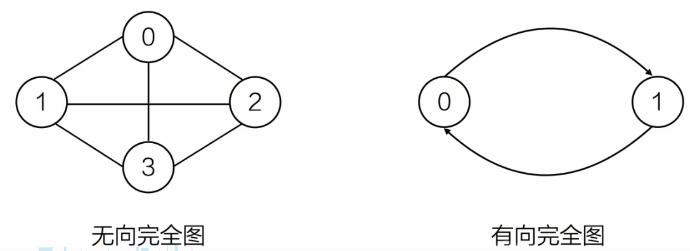
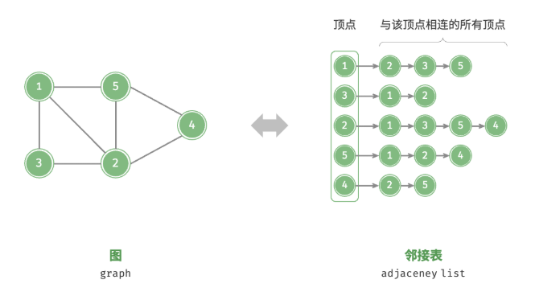
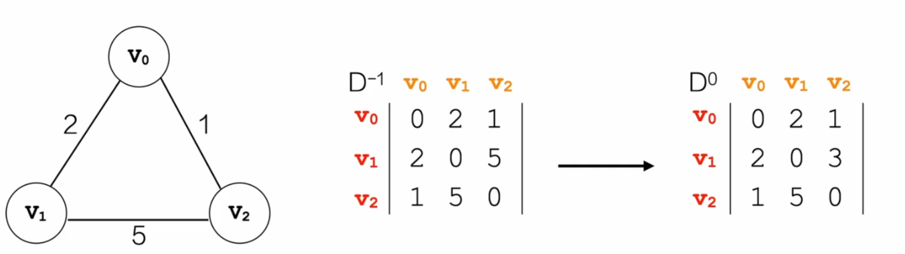
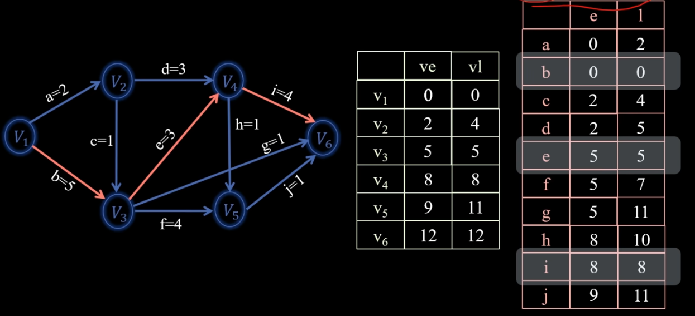

> [!summary] 本篇定位
> 讨论图的基本概念、存储结构、遍历、最小生成树、最短路径、拓扑排序和关键路径，并整理邻接矩阵中的度数统计与 BFS/DFS 易错点。

# 1. 图的基本概念

图 $G=(V,E)$ 由顶点集 $V$ 和边集 $E$ 组成。图至少有一个顶点，边集可以为空。

| 概念 | 含义 |
|---|---|
| 无向图 | 边没有方向，用 `{u,v}` 表示 |
| 有向图 | 边有方向，用 `⟨u,v⟩` 表示 |
| 权 | 边或弧上的数值 |
| 度 | 无向图中与顶点关联的边数 |
| 入度 | 有向图中指向该顶点的弧数 |
| 出度 | 有向图中从该顶点指出的弧数 |
| 路径 | 顶点和边交替组成的序列 |
| 回路 | 起点和终点相同的路径 |
| 连通分量 | 无向图中的极大连通子图 |
| DAG | 有向无环图 |

简单路径通常要求路径中的顶点不重复。回路的首尾顶点相同，因此按通常定义不属于简单路径，题目若使用“简单回路”则还要求除首尾外其他顶点不重复。

## 1.1 常见公式

无向图：

$$
\sum_{v\in V}\deg(v)=2|E|
$$

有向图：

$$
\sum_{v\in V}\operatorname{indeg}(v)=\sum_{v\in V}\operatorname{outdeg}(v)=|E|
$$

完全图（Complete Graph）：
   - 在 **无向图** 中，每一对不同的顶点之间都有一条**直接相连的边**。
   - 在 **有向图** 中，每一对不同的顶点之间都有**两个方向的边**（即双向连接）。



无向完全图有 $n$ 个顶点时：

$$
|E|=\frac{n(n-1)}2
$$

这个公式来源于组合数 $C_{n}^2$，即从 $n$ 个顶点中任选 2 个顶点来形成一条边。

有向完全图通常每对顶点有两个方向的弧，因此在无向完全图的边数基础上乘 2 即可：

$$
|E|=n(n-1)
$$


简单图通常不含自环，也不含同一对顶点之间的多条边。违反任一限制的图可称为多重图。

# 2. 图的存储结构

## 2.1 邻接矩阵

邻接矩阵 `A[i][j]` 表示顶点 $i$ 到顶点 $j$ 是否存在边或弧，也可以保存边权。

- 无向图的邻接矩阵通常是对称矩阵。
- 有向图的邻接矩阵不一定对称。
- 判断有无边时，必须按照题目约定识别无边值，如 `0`、`-1` 或 `INF`。
- Dijkstra/Floyd 中对角线常设为 `0`，统计度数时不能把 `A[i][i]` 当成自环。

空间复杂度为 $O(|V|^2)$。判断两点是否相邻、修改一条边的时间复杂度为 $O(1)$，适合稠密图。


## 2.2 邻接表

邻接表为每个顶点保存其邻接顶点集合。空间复杂度为 $O(|V|+|E|)$，适合稀疏图。遍历某顶点的所有邻接点的总时间与边数相关。



邻接表结点的 `data` 域通常保存目标顶点在顶点数组中的索引，不能把顶点值和数组下标混为一谈。


| 操作 | 邻接矩阵 | 邻接表 |
|---|---:|---:|
| 空间 | $O(V^2)$ | $O(V+E)$ |
| 判断一条边 | $O(1)$ | 与邻接点数量有关 |
| 遍历某顶点邻接点 | $O(V)$ | $O(\deg(v))$ |
| 适合场景 | 稠密图 | 稀疏图 |

## 2.3 邻接矩阵统计入度和出度

若 `INF` 表示无边，则：

- 第 `i` 行非 `INF` 的个数是出度。
- 第 `j` 列非 `INF` 的个数是入度。
- 若对角线为 `0`，统计时跳过 `i == j`。

```cpp
const int INF = -1;   // 与上表约定一致，避免裸写 -1

void get_degree(const vector<vector<int>>& adjMat,
                vector<int>& vecIndegree, vector<int>& vecOutdegree)
{
    int n = adjMat.size();   // 取行数，比 adjMat[0].size() 安全
    vecIndegree.assign(n, 0);
    vecOutdegree.assign(n, 0);

    for (int i = 0; i < n; ++i)   // i（行）是弧尾
    {
        for (int j = 0; j < n; ++j)   // j（列）是弧头
        {
            if (adjMat[i][j] != INF)   // 存在弧 i → j
            {
                ++vecOutdegree[i];   // 弧尾出度 +1
                ++vecIndegree[j];    // 弧头入度 +1
            }
        }
    }
}
```

# 3. 图的遍历

## 3.1 BFS

广度优先搜索使用队列，按距离从近到远访问顶点。无向图中从源点开始的 BFS 可以得到最短边数距离。

```cpp
void bfs(int start)
{
    vector<int> visited(vertices.size(), false);
    queue<int> q;
    q.push(start);
    visited[start] = true;

    cout << "BFS 遍历：";
    while (!q.empty())
    {
        int index = q.front();
        q.pop();

        cout << vertices[index] << " ";

        for (int i = 0; i < vertices.size(); i++)
        {
            // 如果顶点没有访问过，且与 index 对应的顶点连接
            if (!visited[i] && adjMat[index][i] == 1)
            {
                q.push(i);
                visited[i] = true;
            }
        }
    }
}
```

> [!warning] BFS 必须在入队时标记
> 一个顶点从入队到出队之间可能被其他顶点再次发现。若出队时才标记，顶点可能重复入队和重复输出。标准写法是判重和标记同时发生在入队处。

BFS 的时间复杂度为 $O(V+E)$，邻接矩阵实现通常为 $O(V^2)$。

## 3.2 DFS

深度优先搜索使用递归调用栈或显式栈，沿一条路径尽可能深入后回溯。

```cpp
void dfs_recursive(int index, vector<int>& visited)
{
    cout << vertices[index] << " ";
    visited[index] = true;

    for (int i = 0; i < vertices.size(); i++)
    {
        if (!visited[i] && adjMat[index][i] == 1)
        {
            dfs_recursive(i, visited);
        }
    }
}

void dfs(int start)
{
    vector<int> visited(vertices.size(), false);
    cout << "DFS 遍历：";
    dfs_recursive(start);
}
```

无向图必须使用 `visited`，否则会沿边反复折返。有向图也通常必须使用 `visited`，因为有向环和多路径汇合都会造成重复访问或死循环。

## 3.3 有向图判环

有向图判环时要区分三种状态：

| 状态 | 含义 |
|---|---|
| 白色 0 | 未访问 |
| 灰色 1 | 已进入递归栈但未完成 |
| 黑色 2 | 已完成 |

遇到指向灰色顶点的边，说明存在有向环。

## 3.4 连通分量

对无向图依次从每个未访问顶点开始 DFS 或 BFS。每次遍历得到一个连通分量，启动遍历的次数就是连通分量数。

# 4. 最小生成树

连通无向带权图的生成树包含全部顶点且有 $V-1$ 条边。最小生成树（MST）是权值总和最小的生成树。

等权边可能导致最小生成树不唯一，但所有最小生成树的代价相同。若图中所有边权互不相同，则 MST 唯一。

## 4.1 Prim 算法

Prim 是“加点法”：

1. 任取一个起点加入生成树集合。
2. 在一端已加入、另一端未加入的边中选权值最小者。
3. 把对应的新顶点加入集合。
4. 重复直到所有顶点加入。

使用邻接矩阵的朴素实现复杂度为 $O(V^2)$，使用优先队列和邻接表可达到 $O(E\log V)$。

## 4.2 Kruskal 算法

Kruskal 是“加边法”：

1. 将所有边按权值从小到大排序。
2. 依次考虑边，若加入后不会形成回路，则加入生成树。
3. 选够 $V-1$ 条边结束。

通常使用并查集判断两个端点是否已经连通，主要复杂度为排序复杂度 $O(E\log E)$。

# 5. 最短路径

## 5.1 Dijkstra

Dijkstra 求单源非负权最短路径，采用贪心策略。每次从未确定顶点中选当前距离最小者，并用它松弛邻接点。

核心状态：

- `dist[v]`：起点到 `v` 的当前最短距离。
- `visited[v]`：`v` 的最短距离是否已经确定。
- `prev[v]`：最短路径中 `v` 的前驱。

不能用于含负权边的图。邻接矩阵朴素实现为 $O(V^2)$，优先队列实现为 $O(E\log V)$。

```cpp
// 辅助函数：用于查找 distance 中最小的那个值，且对应的 visited 为 false
int chooose_index(vector<int> distance, vector<bool> visited, int size)
{
    int min_distance = INT_MAX;
    int min_position = -1;

    for (int i = 0; i < size; i++)
    {
        if (distance[i] < min_distance && !visited[i])
        {
            min_distance = distance[i];
            min_position = i;
        }
    }

    return min_position;
}

/* 用数组实现 */
vector<int> dijkstra(int start, vector<vector<int>> adjMat)
{
    int n = adjMat.size();

    // 下面三个数组的索引与 vertices 的索引相对应
    vector<int> distance(n, INT_MAX);  // start （起点）到达每一个点的最短路径大小
    vector<bool> visited(n, false);    // 顶点是否已经访问过
    vector<int> path(n, -1);           // 路径：存放的是顶点的前驱顶点索引，倒着往回推出整个路径

    // 初始化起点
    for (int i = 0; i < n; i++)
    {
        distance[i] = adjMat[start][i];
    }

    visited[start]  = true;  // 在初始化 distance 的时候，vertices[0] 就访问过了
    distance[start] = 0;     // 可以不要，但是为了保证逻辑严密性，还是加上

    int next;  // 接下来要访问的那个顶点
    // 这里初始化 i 为 1，因为在一开始（初始化 distance）的时候，就已经完成填写了从 第0个顶点 直接到其它顶点的最短路径
    for (int j = 1; j < n; j++)
    {
        next          = choose_index(distance, visited, n);
        visited[next] = true;
        for (int k = 0; k < n; k++)
        {
            // 这里加上判断条件 adjMat[next][k] != INT_MAX 的原因是：num + INT_MAX 会溢出，同时 adjMat[next][k] == INT_MAX 表示的意思也是 next 处的顶点无法到达 k 处的顶点
            if (visited[k] == false && adjMat[next][k] != INT_MAX && distance[next] + adjMat[next][k] < distance[k])
            {
                distance[k] = distance[next] + adjMat[next][k];
                path[k]     = next;
            }
        }
    }

    // 优化下 path 数组输出（自己想想原因为什么有这步）
    for (int m = 1; m < n; m++)
    {
        if (path[m] == -1)
        {
            path[m] = start;
        }
    }

    return distance;
}
```

## 5.2 Floyd

Floyd 求所有顶点对之间的最短路径，采用动态规划。令 $D^{(k)}[i][j]$ 表示允许前 $k$ 个顶点作为中转点时的最短距离：

$$
D^{(k)}[i][j]=\min\left(D^{(k-1)}[i][j],D^{(k-1)}[i][k]+D^{(k-1)}[k][j]\right)
$$



$D$ 表示 $distance$ 的意思，$D^0$ 表示经过 $V_0$ 中转到达下一个顶点，比如 $D^0[V_1][V_2]$ 表示的就是 $V_1$ 顶点经过 $V_0$ 中转后，到达 $V_2$。自然，$D^{-1}$ 表示的就是没有经过中转。也就是说在实现代码时，我们会维护一个 **二维的$distance$数组** ，用于存储顶点到其它顶点之间的权值（路径长度）。

这里定义：$j$ 是起始顶点，$k$ 是终止顶点，$i$ 是中转顶点。

$$
if \ \  D^{-1}[1][2] > D^{-1}[1][0] + D^{-1}[0][2]
$$

$$
so: \ \ D^0[1][2] = D^{-1}[1][0] + D^{-1}[0][2]
$$

$$
deduce: \ D^i[j][k] = D^{i-1}[j][i] + D^{i-1}[i][k]
$$


$P$ 表示 $path$ 的意思，$P^0$ 表示经过 $V_0$ 中转到达下一个顶点，意思和 $D$ 数组的含义类似。同样，我们也会维护一个 **二维的 $path$ 数组** ，但是这个数组存储的值的含义就是 **终点的前驱顶点（$P$的上标，中转节点）** 。比如 $P^0$ 中，$P[V_1][V_2] = 0$。 

$$
if \ \  D^{-1}[1][2] > D^{-1}[1][0] + D^{-1}[0][2]
$$

$$
so： \ \ P^0[1][2] = P^{-1}[1][0]
$$
$$
deduce: \ P^i[j][k] = P^{i-1}[j][i]
$$

```cpp
vector<vector<int>> floyd(vector<vector<int>> adjMat)
{
    int n = adjMat.size();
    vector<vector<int>> distance(n, vector<int>(n, INT_MAX));  // distance 数组，存放距离
    vector<vector<int>> path(n, vector<int>(n, -1));           // path 数组，存放前驱顶点

    // 初始化 distance 数组和 path 数组
    // j: 起始顶点，k: 终止顶点
    for (int j = 0; j < n; j++)
    {
        for (int k = 0; k < n; k++)
        {
            distance[j][k] = adjMat[j][k];
            path[j][k]     = k;
        }
    }

    // i: 中转顶点，j: 起始顶点，k: 终止顶点 （i, j, k 都表示顶点在 vertices 数组中的索引）
    // 第一层循环：索引从 [0, n - 1] 依次作为中转顶点
    for (int i = 0; i < n; i++)
    {

        // 第二层和第三层循环构成二维数组，然后“填空”即可
        for (int j = 0; j < n; j++)
        {
            for (int k = 0; k < n; k++)
            {
                // 若 直达 > 中转，更新 distance 和 path ; distance[j][i] 和 distance[i][k] 都为 INT_MAX 的话，表示不可达
                if (distance[j][i] != INT_MAX && distance[i][k] != INT_MAX &&
                    distance[j][k] < distance[j][i] + distance[i][k])
                {
                    distance[j][k] = distance[j][i] + distance[i][k];
                    path[j][k]     = path[j][i];
                }
            }
        }
    }

    return distance;
}
```

Floyd 的时间复杂度为 $O(V^3)$，空间复杂度为 $O(V^2)$。

# 6. 拓扑排序与关键路径

## 6.1 AOV 网与拓扑排序

AOV 网是用顶点表示活动、用有向边表示活动先后约束的网络。拓扑序列要求每条有向边 $u\to v$ 中，$u$ 都出现在 $v$ 之前。

Kahn 算法：

1. 把所有入度为 0 的顶点加入队列。
2. 取出一个顶点并输出。
3. 删除其所有出边，对应邻接顶点入度减 1。
4. 新变为入度 0 的顶点入队。
5. 若输出顶点数少于 $V$，则图中存在回路。

有向图存在拓扑序列，当且仅当它是 DAG。

```cpp
vector<int> topology(const vector<vector<int>>& adjMat, const vector<int>& vertices, vector<int> indegree)
{
    vector<int> order;
    queue<int> q;
    // 把所有入度为 0 的顶点放到队列中
    for (int i = 0; i < vertices.szie(); i++)
    {
        if (indegree[i] == 0)
        {
            q.push(i);
        }
    }

    while (!q.empty())
    {
        int index = q.front();
        q.pop();
        order.push_back(vertices[index]);

        // index 对应顶点（src 顶点）,j 对应的是 dist 顶点
        for (int j = 0; j < vertices.size(); j++)
        {
            if (adjMat[index][j] == 1)
            {
                // 因为访问过了 src 顶点，所以要让这些与 src 顶点连接着的 dist 顶点的入度减一
                indegree[j]--;
                if (indegree[j] == 0)
                {
                    q.push(j);
                }
            }
        }
    }

    return order;
}
```

在 DAG 上，DFS 在递归返回时输出顶点，得到的是逆拓扑序列。因为对任意边 $u\to v$，`v` 会先完成并输出，`u` 后输出。将这种完成序列反转即可得到拓扑序列。

## 6.2 AOE 网与关键路径

典型用途：“工程完成的最早时间是什么时候？”、“一个工程中哪些活动可以适当延迟，可以延迟多长时间，而不影响整个工期？”————非关键活动等。

- **AOE 网：** 带权的有向无环图
- **顶点：** 事件或状态
- **弧（有向边）：** 活动及发生的先后关系
- **权：** 活动持续时间
- **起点：** 入度为`0`的点（只有一个）
- **终点：** 出度为`0`的点（只有一个）

如下图所示：


`AOE`网中 **没有入边** 的顶点称为 **始点** （或源点）， **没有出边** 的顶点称为 **终点** （或汇点）。其性质如下：
- 只有在某顶点所代表的事件发生后，从该顶点出发的各活动才能开始；
- 只有在进入某顶点的各活动都结束，该顶点所代表的事件才能发生。

**重要术语：**
- **关键路径：** 最耗时的那条路径。
- **关键活动：** 不能拖延的活动，**$最早开始时间 = 最晚开始时间 = 0$** 。活动其实就是指图的边，比如上图中$a_1$，$a_2$就是活动。
- **$ve$:** **事件** 的最早开始事件。
- **$vl$:** **事件** 的最晚开始时间。
- **$e$:** **活动** 的最早开始时间。$e = ve$，$ve$是发出点的。
- **$l$:** **活动** 的最晚开始时间。$l = vl - activity$，$V_l$是指向点的。
- **时间余量：**$时间余量 = l - e$



如上图所示，以活动`d`为例，它的$e$为$V_2$的$ve$，即`2`；它的$l$为$V_4$的$vl$减去`d`的值，即`8-3=5`。

上图中的关键路径很显然就是`b`、`e`、`i`，当然，有时候关键路径可能有很多条。若存在多条关键路径，缩短工期时必须缩短覆盖所有关键路径的活动。

## 6.3 关键路径计算框架

设活动边为 `u -> v`，持续时间为 `w`，可以按如下顺序计算：

1. 用拓扑序遍历，执行 `ve[v] = max(ve[v], ve[u] + w)`。
2. 将汇点最早时间作为工期，并逆拓扑初始化 `vl`。
3. 逆拓扑执行 `vl[u] = min(vl[u], vl[v] - w)`。
4. 对每条活动计算 `e = ve[u]`、`l = vl[v] - w`。
5. `e == l` 的活动属于关键活动。

# 7. 图论易错点

1. 稀疏图通常使用邻接表，稠密图可以使用邻接矩阵。
2. 邻接矩阵中的权值不是度数，度数统计的是满足“存在边”条件的元素个数。
3. BFS 在入队时标记，DFS 通常在首次进入递归时标记。
4. 拓扑序列存在说明有向图无环，但无环图的拓扑序列通常不唯一。
5. Dijkstra 要求边权非负，Floyd 可以处理负权边，但不能存在可影响结果的负权回路。
6. MST 的边数始终为 $V-1$，但 MST 的具体形状可能不唯一。
7. 图的邻接矩阵幂只适用于无权图的路径条数计数。$A^m[i][j]$ 表示长度为 $m$ 的步行数量。
