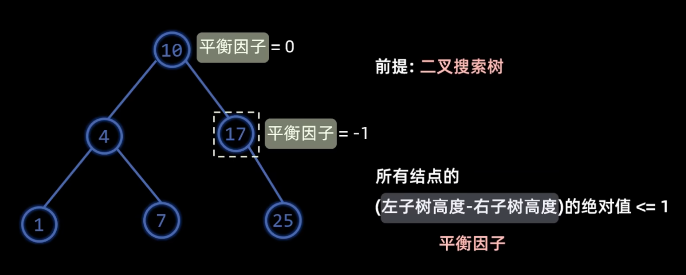
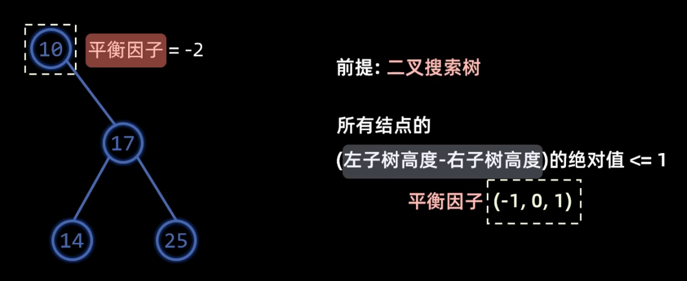
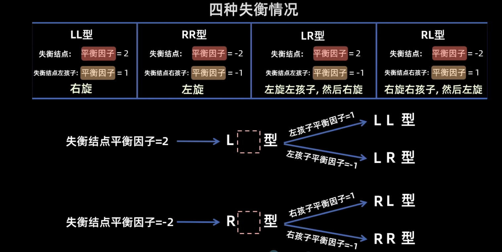
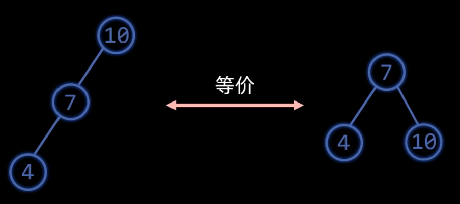
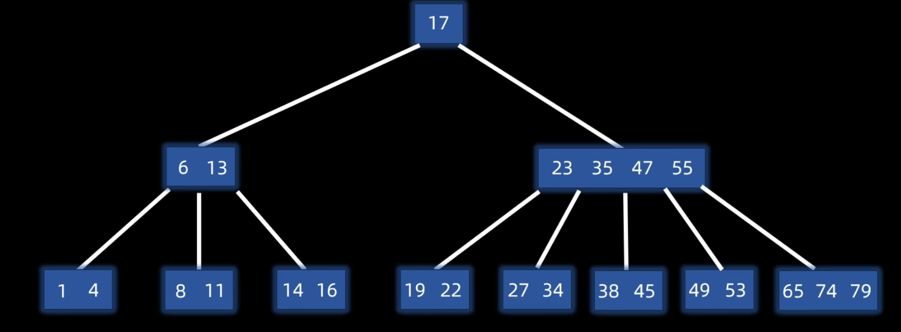
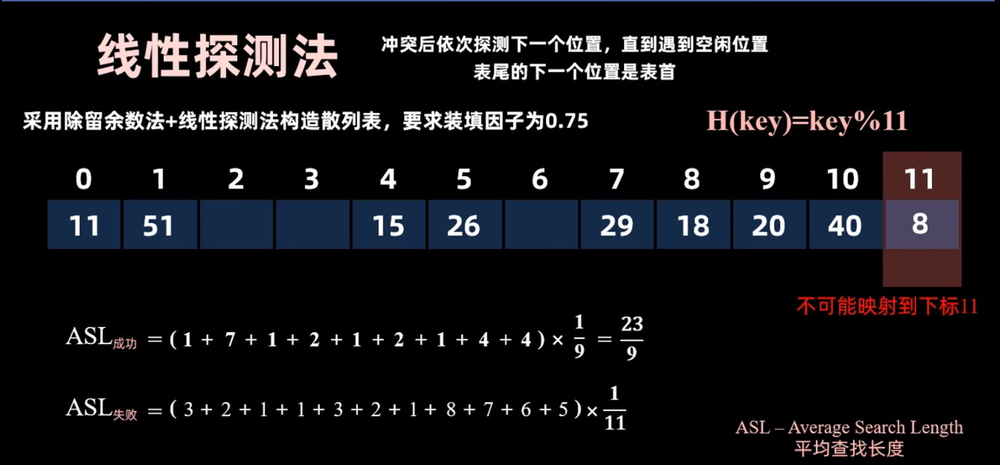
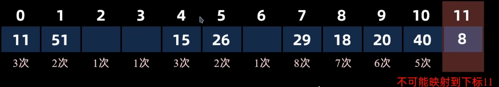

> [!summary] 本篇定位
> 讨论查找表、ASL、顺序查找、折半查找、分块查找、二叉搜索树、AVL 树、红黑树、B 树、散列表和 KMP。排序算法见 [[06_排序]]。

# 1. 查找表与 ASL

查找表按是否允许修改分为：

- **静态查找表**：只进行查询。
- **动态查找表**：还支持插入和删除。

平均查找长度（ASL）是关键字的平均比较次数：

$$
ASL=\sum_i p_i c_i
$$

其中 $p_i$ 是查找第 $i$ 个记录的概率，$c_i$ 是查找该记录所需的比较次数。等概率时就是各次比较次数的算术平均。

# 2. 线性查找

## 2.1 顺序查找

长度为 $n$ 的线性表从前向后查找：

- 成功 ASL：

$$
ASL_{success}=\frac{1+2+\cdots+n}{n}=\frac{n+1}{2}
$$

- 失败 ASL：需要比较全部 $n$ 个元素，因此

$$
ASL_{fail}=n
$$

## 2.2 哨兵查找

在表尾设置与目标值相等的哨兵，可以省略循环中的边界判断：

```cpp
int sequential_search(int arr[], int n, int target) {
    arr[n] = target;
    int i = 0;
    while (arr[i] != target) ++i;
    return i == n ? -1 : i;
}
```

哨兵要求数组有额外空间，且查找过程会修改表尾位置，实际使用时需确认这种修改是允许的。

# 3. 折半查找

折半查找要求顺序表有序，每次取查找区间中间位置进行比较。查找成功时区间缩小到包含目标的一半，查找失败时区间为空。

## 3.1 迭代实现

```cpp
int binary_search(const vector<int>& nums, int target) {
    int left = 0;
    int right = static_cast<int>(nums.size()) - 1;

    while (left <= right) {
        int mid = left + (right - left) / 2;
        if (nums[mid] == target) return mid;
        if (nums[mid] < target) left = mid + 1;
        else right = mid - 1;
    }
    return -1;
}
```

时间复杂度为 $O(\log n)$，空间复杂度为 $O(1)$。递归实现的额外空间取决于递归深度。

## 3.2 折半查找判定树

判定树的内部结点表示实际关键字，根结点所在层为第 1 层。若有序表有 $n$ 个元素，判定树高度为：

$$
\boxed{h=\lceil\log_2(n+1)\rceil}
$$

这是按普通折半划分构造、并按层数计高时的最大成功比较次数。成功 ASL 是所有内部结点所在层数的平均值：

$$
ASL_{success}=\frac{\sum_{i=1}^n depth_i}{n}
$$

失败查找对应 $n+1$ 个外部结点。若外部结点层数为 $d_i$，失败比较次数通常为 $d_i-1$：

$$
ASL_{fail}=\frac{\sum_{i=1}^{n+1}(d_i-1)}{n+1}
$$

> [!warning] 失败 ASL 的层数
> 外部结点代表进入空区间，最后一次比较仍然是与实际关键字比较。因此比较次数通常比外部结点层数少 1，要按照题目画出的判定树确认定义。

## 3.3 判断比较序列是否合法

给出折半查找中的关键字比较序列时，维护目标关键字可能所在的开区间：

1. 初始区间为 $(-\infty,+\infty)$。
2. 若下一次比较值大于当前值，说明目标值大于当前值，更新下界。
3. 若下一次比较值小于当前值，说明目标值小于当前值，更新上界。
4. 后续比较值必须落在此前约束的区间内。

例如序列 `500, 200, 450, 180`：

```text
比较 500，下一次是 200，目标 < 500
比较 200，下一次是 450，目标 > 200
比较 450，下一次是 180，目标 < 450
```

此时目标必须满足 $200<target<450$，但 180 已经不在这个区间中，所以该序列不可能出现。

# 4. 二叉搜索树 BST

二叉搜索树满足：

- 左子树所有关键字小于根关键字。
- 右子树所有关键字大于根关键字。
- 中序遍历结果严格递增，前提是题目不允许重复关键字。

若允许重复值，必须明确重复值放在左侧还是右侧，中序序列可能只要求非严格递增。

## 4.1 查找、插入与删除

查找从根开始，根据大小关系向左或向右移动。插入时沿查找路径走到空位置，再创建新结点。删除分三种情况：

1. 叶结点：直接删除。
2. 只有一个孩子：用孩子替代被删结点。
3. 有两个孩子：用右子树最小结点或左子树最大结点替换，再删除那个度不超过 1 的结点。

BST 操作的时间复杂度为 $O(h)$，其中 $h$ 是树高。平衡时为 $O(\log n)$，退化成链时为 $O(n)$。

## 4.2 验证 BST

不能只检查直接孩子，必须验证每个结点所在的上下界：

```cpp
bool is_bst(TreeNode* node, long long low, long long high) {
    if (!node) return true;
    if (node->val <= low || node->val >= high) return false;
    return is_bst(node->left, low, node->val) &&
           is_bst(node->right, node->val, high);
}
```

也可以中序遍历并检查序列是否严格递增。

# 5. AVL 树

AVL 树是严格平衡的二叉搜索树。对每个结点 $p$ 定义平衡因子：

$$
BF(p)=h(left)-h(right)
$$

AVL 树要求每个结点都满足：

$$
BF(p)\in\{-1,0,1\}
$$

平衡因子是每个结点各自的属性，不是整棵树只有一个平衡因子。

## 5.1 平衡因子与四种失衡





| 类型 | 路径方向 | 调整 |
|---|---|---|
| LL | 左、左 | 对失衡结点右旋 |
| RR | 右、右 | 对失衡结点左旋 |
| LR | 左、右 | 先对左孩子左旋，再对失衡结点右旋 |
| RL | 右、左 | 先对右孩子右旋，再对失衡结点左旋 |

判断类型时，从第一个失衡结点沿新插入结点方向观察两次路径。LR 和 RL 是双旋。

## 5.2 旋转注意事项






左旋时，旋转结点的右孩子上升，右孩子的左子树成为旋转结点的右子树。右旋对称处理。

插入后沿路径向上更新高度和平衡因子，发现失衡后进行相应旋转。删除可能使多个祖先结点继续失衡，需要继续向根检查。

# 6. 红黑树


红黑树是通过颜色约束保持高度为 $O(\log n)$ 的二叉搜索树。通常使用黑色 NIL 空结点表示所有空孩子。

## 6.1 五条性质

1. 每个结点非红即黑。
2. 根结点是黑色。
3. 所有 NIL 叶结点是黑色。
4. 红色结点不能有红色孩子。
5. 从任意结点到其所有后代 NIL 叶结点的每条路径包含相同数量的黑色结点。

由于红色结点不能连续出现，最长路径不会超过最短路径的两倍，红黑树高度满足 $O(\log n)$，查找、插入和删除的渐进复杂度均为 $O(\log n)$。

## 6.2 插入调整

新结点默认染成红色，因为这样不会直接改变黑高。

| 父结点颜色 | 叔结点颜色 | 处理 |
|---|---|---|
| 黑 | 任意 | 不需要调整 |
| 红 | 红 | 父、叔染黑，祖父染红，继续向上检查 |
| 红 | 黑 | 根据 LL、RR、LR、RL 旋转并变色 |

根结点最后必须为黑色。

## 6.3 删除概念

删除红色结点通常不会改变黑高。删除黑色结点可能造成某条路径少一个黑色结点，修复过程中常用“双重黑”描述这种暂时状态。修复主要根据兄弟结点颜色及其孩子颜色进行变色、旋转或合并处理。

# 7. B 树与 B+ 树

## 7.1 $m$ 阶 B 树的性质



$m$ 阶表示一个结点最多有 $m$ 个孩子，因此最多有 $m-1$ 个关键字。

- 根结点不是叶时，至少有 2 个孩子。
- 非根非叶结点至少有 $\lceil m/2\rceil$ 个孩子。
- 非根结点至少有 $\lceil m/2\rceil-1$ 个关键字。
- 每个结点内关键字有序。
- 所有叶结点在同一层。

B 树适合外存索引，因为一个结点可保存多个关键字，树高较低，能减少磁盘 I/O。

## 7.2 查找、插入与删除

查找先在当前结点内比较关键字，再选择对应子树。插入总是发生在叶结点，若关键字过多则分裂，中间关键字上升到父结点，可能向上连续分裂。

删除可能导致下溢：

1. 优先从有多余关键字的兄弟结点借关键字，借位要经过父结点。
2. 兄弟不能借时，将结点、兄弟和父结点分隔关键字合并。
3. 根结点下溢时，唯一孩子可成为新根，树高减 1。
4. 删除内部关键字时，可用前驱或后继替换，再转化为删除叶结点关键字。

## 7.3 B 树高度范围

设 $q=\lceil m/2\rceil$，高度按层数计算，关键字总数为 $n$，则：

$$
2q^{h-1}-1\le n\le m^h-1
$$

从而高度为 $O(\log_m n)$。

## 7.4 B+ 树

| 项目 | B 树 | B+ 树 |
|---|---|---|
| 记录位置 | 内部结点和叶结点都可保存 | 通常只在叶结点保存 |
| 内部结点 | 关键字和孩子指针 | 索引关键字和孩子指针 |
| 成功查找 | 可能在内部结点结束 | 通常到叶结点结束 |
| 叶结点 | 不要求链式连接 | 通常按序链接 |
| 范围查询 | 较弱 | 适合顺序扫描 |

# 8. 散列表

散列表通过散列函数把关键字映射到表地址。冲突处理方法包括开放定址法和链地址法。

## 8.1 ASL





- ASL 成功：对每个已存关键字计算实际探测次数，再求平均。
- ASL 失败：对每个可能的初始散列地址计算直到确定失败的探测次数，再求平均。

线性探测法中，遇到真正的空位置即可确定失败：

$$
ASL_{fail}=\frac{\sum_{i=0}^{m-1}L_i}{m}
$$

其中 $L_i$ 是从地址 $i$ 开始探测到第一个空位置的次数。

## 8.2 开放定址法的删除标记

开放定址法中，位置有三种状态：未使用、正常存放、已删除。

若直接把已删除位置置为空，会截断冲突元素的探测序列。例如 `10、17、24` 的初始散列地址相同，若删除中间位置的 `17` 并置空，查找 `24` 时会在空位置提前失败。

因此：

- 查找遇到真正空位置时可以停止。
- 查找遇到删除标记时必须继续探测。
- 插入时删除标记位置可以重新利用，但仍需确认后续位置不存在相同关键字。

# 9. KMP 字符串匹配

KMP 使用模式串的最长相等前后缀信息，避免主串指针回退。

- 前缀：以第一个字符开头且不包含最后一个字符的子串。
- 后缀：以最后一个字符结尾且不包含第一个字符的子串。
- `next[i]` 或前缀函数：模式串前缀 `pattern[0..i]` 的最长相等真前后缀长度。

```cpp
vector<int> prefix_function(const string& pattern) {
    vector<int> pi(pattern.size(), 0);
    for (int i = 1; i < pattern.size(); ++i) {
        int j = pi[i - 1];
        while (j > 0 && pattern[i] != pattern[j]) {
            j = pi[j - 1];
        }
        if (pattern[i] == pattern[j]) ++j;
        pi[i] = j;
    }
    return pi;
}
```

KMP 预处理和匹配的时间复杂度均为 $O(n+m)$，其中 $n$ 为主串长度，$m$ 为模式串长度。

# 10. 典型计算与易错题

## 10.1 折半查找判定树高度

判定树按层数计高时：

| 关键字数量 $n$ | 高度 |
|---:|---:|
| 1 | 1 |
| 2、3 | 2 |
| 4 至 7 | 3 |
| 8 至 15 | 4 |

因此高度为 $h$ 时最多容纳 $2^h-1$ 个关键字，反推即可得到 $h=\lceil\log_2(n+1)\rceil$。如果题目把失败结点或空指针也纳入树高，必须按题目画出的判定树重新计数。

## 10.2 AVL 插入示例

依次插入 `1,2,3,4,5,6,7`，按 AVL 规则调整后可得到：

```text
        2
       / \\
      1   4
         / \\
        3   6
           / \\
          5   7
```

按 $BF=h(left)-h(right)$ 计算，分支结点 `2、4、6` 的平衡因子依次为 `-1、-1、0`。因此平衡因子为 0 的分支结点有 1 个。这个题型的关键是每次插入后都要继续向上检查，不能只调整第一次发生失衡的局部。

## 10.3 线性探测的 ASL 失败

例如表长为 7，最终连续占用地址 `0、1、2、3`，地址 `4、5、6` 为空，则从每个初始地址开始查找失败的探测次数为：

```text
5, 4, 3, 2, 1, 1, 1
```

所以：

$$
ASL_{fail}=\frac{5+4+3+2+1+1+1}{7}=\frac{17}{7}
$$

失败查找的平均对象是所有可能的初始散列地址，不是已经存放的关键字。

# 11. 查找方法比较

| 方法 | 要求 | 成功 ASL/复杂度 | 失败 ASL/特点 |
|---|---|---|---|
| 顺序查找 | 无序也可 | $(n+1)/2$ | $n$ |
| 折半查找 | 有序顺序表 | 判定树内部结点层数平均值 | 外部结点层数减 1 的平均值 |
| BST | 二叉搜索树 | $O(h)$ | 退化时 $O(n)$ |
| AVL/红黑树 | 平衡搜索树 | $O(\log n)$ | 动态更新效率稳定 |
| 散列表 | 设计散列函数 | 取决于装填因子和冲突 | 按探测序列计算 |
| B/B+ 树 | 多路有序索引 | $O(\log_m n)$ 层访问 | 适合外存和范围查询 |
