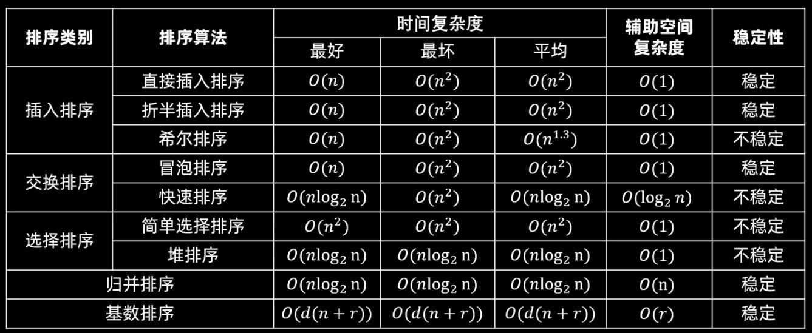

> [!summary] 本篇定位
> 讨论内部排序、外部排序、常见排序算法的核心过程、复杂度、稳定性和适用场景。排序算法的选择通常取决于数据规模、是否需要稳定性、是否允许额外空间以及数据是否适合外存处理。

# 1. 排序基础

排序是将关键字序列调整为非递减或非递增顺序的过程。

- **内部排序**：全部数据可以装入内存。
- **外部排序**：数据量太大，需要借助外存，常用多路归并。
- **稳定排序**：关键字相等的记录排序后相对次序保持不变。
- **不稳定排序**：相等关键字的相对次序可能改变。
- **原地排序**：只使用 $O(1)$ 级别的额外辅助空间，递归栈和少量变量通常另计。



# 2. 插入类排序

## 2.1 直接插入排序

将当前元素插入前面已经有序的子序列。

```cpp
void insertion_sort(vector<int>& nums) {
    for (int i = 1; i < nums.size(); ++i) {
        int value = nums[i];
        int j = i - 1;
        while (j >= 0 && nums[j] > value) {
            nums[j + 1] = nums[j];
            --j;
        }
        nums[j + 1] = value;
    }
}
```

| 最好 | 平均 | 最坏 | 空间 | 稳定性 |
|---:|---:|---:|---:|---|
| $O(n)$ | $O(n^2)$ | $O(n^2)$ | $O(1)$ | 稳定 |

适合规模较小或基本有序的数据。

## 2.2 折半插入排序

用折半查找确定插入位置，再移动元素腾出空间。比较次数减少，但移动次数仍可能为 $O(n^2)$，因此平均和最坏时间复杂度仍为 $O(n^2)$。通常保持稳定时应将相等元素之后作为插入位置。

## 2.3 希尔排序

希尔排序先按增量将元素分组进行插入排序，再逐渐减小增量直到 1。它是不稳定排序，复杂度依赖于增量序列，通常优于直接插入排序但没有统一的简单精确上界。

# 3. 交换类排序

## 3.1 冒泡排序

每一趟将相邻逆序元素交换，把较大元素移动到序列末尾。若某趟没有发生交换可以提前结束。

```cpp
void bubble_sort(vector<int>& nums) {
    for (int i = 0; i + 1 < nums.size(); ++i) {
        bool swapped = false;
        for (int j = 0; j + 1 < nums.size() - i; ++j) {
            if (nums[j] > nums[j + 1]) {
                swap(nums[j], nums[j + 1]);
                swapped = true;
            }
        }
        if (!swapped) break;
    }
}
```

最好时间复杂度为 $O(n)$，平均和最坏为 $O(n^2)$，空间复杂度为 $O(1)$，稳定。

## 3.2 快速排序

快速排序选择基准，将序列划分为小于和大于基准的两部分，再递归排序两部分。

```cpp
int partition(vector<int>& nums, int left, int right)
{
    int pivot = nums[left];
    int i     = left;
    int j     = right;

    while (i < j)
    {
        while (i < j && nums[j] >= pivot)
        {
            --j;
        }
        while (i < j && nums[i] <= pivot)
        {
            ++i;
        }
        swap(nums[i], nums[j]);
    }
    swap(nums[left], nums[i]);
    return i;
}

void quick_sort(vector<int>& nums, int left, int right)
{
    if (left >= right) return;
    int pivot = partition(nums, left, right);
    quick_sort(nums, left, pivot - 1);
    quick_sort(nums, pivot + 1, right);
}
```

| 最好 | 平均 | 最坏 | 空间 | 稳定性 |
|---:|---:|---:|---:|---|
| $O(n\log n)$ | $O(n\log n)$ | $O(n^2)$ | 平均 $O(\log n)$ | 不稳定 |

若每次基准都接近中位数，递归树较平衡。若每次基准都是当前最小或最大值，会退化为 $O(n^2)$。随机选择基准或三数取中可以降低退化概率。

# 4. 选择类排序

## 4.1 简单选择排序

每一趟从未排序部分选择最小元素，放到当前首位置。

- 最好、平均、最坏均为 $O(n^2)$。
- 空间复杂度为 $O(1)$。
- 通常不稳定。
- 交换次数较少，至多 $n-1$ 次。

## 4.2 堆排序

堆是一棵完全二叉树，满足大根堆或小根堆性质。升序排序通常建立大根堆，每次将堆顶最大值放到末尾，再调整剩余堆。

```cpp
/* 堆的长度为 n ，从节点 i 开始，从顶至底堆化 */
void siftDown(vector<int>& nums, int n, int i)
{
    while (true)
    {
        // 判断节点 i, l, r 中值最大的节点，记为 ma
        int l  = 2 * i + 1;
        int r  = 2 * i + 2;
        int ma = i;
        if (l < n && nums[l] > nums[ma]) ma = l;
        if (r < n && nums[r] > nums[ma]) ma = r;
        // 若节点 i 最大或索引 l, r 越界，则无须继续堆化，跳出
        if (ma == i)
        {
            break;
        }
        // 交换两节点
        swap(nums[i], nums[ma]);
        // 循环向下堆化
        i = ma;
    }
}

/* 堆排序 */
void heapSort(vector<int>& nums)
{
    // 建堆操作：堆化除叶节点以外的其他所有节点
    for (int i = nums.size() / 2 - 1; i >= 0; --i)
    {
        siftDown(nums, nums.size(), i);
    }
    // 从堆中提取最大元素，循环 n-1 轮
    for (int i = nums.size() - 1; i > 0; --i)
    {
        // 交换根节点与最右叶节点（交换首元素与尾元素）
        swap(nums[0], nums[i]);
        // 以根节点为起点，从顶至底进行堆化
        siftDown(nums, i, 0);
    }
}
```

建堆为 $O(n)$，排序阶段为 $O(n\log n)$，空间复杂度为 $O(1)$，不稳定。

# 5. 归并排序

归并排序采用分治法，先递归排序左右子序列，再把两个有序序列合并。

```cpp
void merge(vector<int>& nums, int left, int mid, int right)
{
    vector<int> temp;
    int i = left;     // 区间：[left, mid]
    int j = mid + 1;  // 区间：[mid+1, right]

    while (i <= mid && j <= right)
    {
        if (nums[i] <= nums[j])
        {
            temp.push_back(nums[i++]);
        }
        else
        {
            temp.push_back(nums[j++]);
        }
    }

    while (i <= mid)
    {
        temp.push_back(nums[i++]);
    }

    while (j <= right)
    {
        temp.push_back(nums[j++]);
    }

    for (int k = 0; k < temp.size(); ++k)
    {
        nums[left + k] = temp[k];
    }
}

void merge_sort(vector<int>& nums, int left, int right)
{
    if (left >= right) return;
    int mid = left + (right - left) / 2;
    merge_sort(nums, left, mid);
    merge_sort(nums, mid + 1, right);
    merge(nums, left, mid, right);
}
```

时间复杂度最好、平均、最坏均为 $O(n\log n)$，额外空间为 $O(n)$，使用 `<=` 优先取左侧元素时稳定。归并排序适合链表排序和外部排序。

# 6. 基数排序

基数排序不通过比较关键字排序，而是按个位、十位等位进行多趟稳定分配和收集。对 $n$ 个记录、$d$ 位关键字、每位有 $r$ 种取值时，常见复杂度为：

$$
O(d(n+r))
$$

它适合关键字位数有限、每一位可以进行稳定分配的数据。空间复杂度通常为 $O(n+r)$，稳定。

# 7. 排序算法对比

| 算法 | 最好 | 平均 | 最坏 | 辅助空间 | 稳定 |
|---|---:|---:|---:|---:|---|
| 直接插入 | $n$ | $n^2$ | $n^2$ | $1$ | 是 |
| 希尔 | 依增量序列 | 依增量序列 | 依增量序列 | $1$ | 否 |
| 冒泡 | $n$ | $n^2$ | $n^2$ | $1$ | 是 |
| 快速 | $n\log n$ | $n\log n$ | $n^2$ | 平均 $\log n$ | 否 |
| 简单选择 | $n^2$ | $n^2$ | $n^2$ | $1$ | 否 |
| 堆排序 | $n\log n$ | $n\log n$ | $n\log n$ | $1$ | 否 |
| 归并 | $n\log n$ | $n\log n$ | $n\log n$ | $n$ | 是 |
| 基数 | $d(n+r)$ | $d(n+r)$ | $d(n+r)$ | $n+r$ | 是 |

# 8. 外部排序

外部排序适用于文件不能一次装入内存的情况，通常分为：

1. 生成初始归并段。
2. 对初始归并段进行多路归并，直到形成一个有序文件。

设文件有 $n$ 个记录，内存工作区可容纳 $l$ 个记录，初始归并段数为：

$$
m=\left\lceil\frac nl\right\rceil
$$

进行 $k$ 路平衡归并时，归并趟数为：

$$
S=\lceil\log_k m\rceil
$$

每条记录在生成初始段和每一趟归并中大致各读写一次，因此总 I/O 次数近似为：

$$
2n(1+S)
$$

外部排序的主要优化方向是减少归并趟数。

## 8.1 败者树

$k$ 路归并每输出一个记录，朴素方法需要在 $k$ 个候选值中比较 $k-1$ 次。败者树只沿根到叶的路径调整，比较次数约为 $\lceil\log_2 k\rceil$，适合优化多路归并中的内部比较。

以 `k=4` 路归并为例，叶结点保存各归并段当前首元素，内部结点保存比较中的败者，根部额外保存当前胜者所在归并段。输出一个元素后，只需沿该归并段对应的叶到根路径重新比较，不需要重新比较全部 `k` 个首元素。

**易混点：`ls[0]` 不是树根**

- 树根（决赛那一场）本身仍是一个内部结点，它记录的是**决赛的败者**；决赛的**胜者**才被单独写入树外的额外槽位 `ls[0]`。即 `ls[0]` 存冠军所在段号，其余 `k-1` 个内部结点各存一场比赛的败者段号。
- 内部结点存的是**段号（下标）**而非数值，比较时需用段号去叶子数组取值。
- 某段取完后通常读入 $+\infty$ 哨兵，它永远比不赢；当 `ls[0]` 指向的段为 $+\infty$ 时归并结束。

```text
        ls[0] = 段1        ← 冠军槽位（在树外，不参与比较）
           │
        根 = 段3            ← 决赛败者
        /        \
   结点 = 段0   结点 = 段2
   /    \      /    \
段0(17) 段1(5)  段2(11) 段3(8)
```

败者树与胜者树的区别：胜者树的内部结点存胜者，更新时需访问兄弟结点才能重新比较；败者树存败者，新元素直接与路径上记录的败者比较即可，无需兄弟信息，因此每层只需一次比较。

## 8.2 置换选择排序

置换选择排序使用大小为 $l$ 的内存工作区生成初始归并段，初始段平均长度可以接近 $2l$，从而减少初始归并段数量。

基本步骤：

1. 从工作区选择当前最小记录输出。
2. 从输入文件补充一个记录。
3. 若新记录不小于刚输出记录，留在当前归并段；否则标记为下一段记录。
4. 当前工作区没有可属于当前段的记录时，开始生成下一段。

## 8.3 最佳归并树

$k$ 路归并的归并顺序可以看作构造 $k$ 叉哈夫曼树。初始归并段长度是叶结点权值，树的带权路径长度越小，总读写次数越少。

若初始段数量 $m$ 不满足：

$$
(m-1)\bmod(k-1)=0
$$

则补充权值为 0 的虚段，再按每次合并最小的 $k$ 个段构造最佳归并树。

# 9. 排序题的判断技巧

1. 快速排序每一趟至少能确定一个基准元素的最终位置。
2. 快速排序若基准接近中间位置，递归更平衡；若基准位于边界，容易退化。
3. 堆排序每次确定当前最大或最小元素，但不保持稳定性。
4. 归并排序的稳定性取决于合并时相等元素的取法，优先取左边元素可以保持稳定。
5. 外部排序重点考查初始归并段数、归并趟数、败者树和最佳归并树。
6. 选择排序、堆排序、快速排序通常不稳定，直接插入、冒泡、归并、基数排序通常可以稳定。
