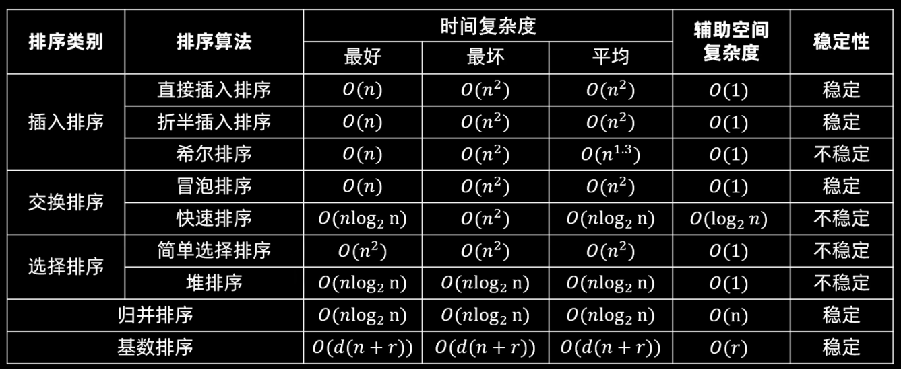

# 1.基本概念

各种排序方式对比：



---

# 2.排序算法代码实现

---

## 2.1 插入类排序

---

### 2.1.1 直接插入排序

```cpp
void insert_sort_directly(vector<int> &nums){
    for(int i = 1; i < nums.size(); i++){
        int tmp = nums[i];
        // i 前面的元素都是排好序的，从 i 前面的元素开始
        int j = i - 1;
        // 移动比 tmp 大的元素
        while(j >= 0 && nums[j] > tmp){
            nums[j + 1] = nums[j];
            j--;
        }
        nums[j + 1] = tmp;
    }
}
```

---

### 2.1.2 折半插入排序

```cpp
void insert_sort_binary(vector<int> &nums){
    for(int i = 1; i< nums.size(); i++){
         // 如果 nums[i] >= nums[i-1] ，直接去下一个数，因为前面的数都是有序的
        if(nums[i] >= nums[i - 1]){
            continue;
        }

        int tmp = nums[i];
        int right = i - 1;
        int left = 0;
        while(left <= right){
            int mid = left + (right - left) / 2;
            if(nums[mid] <= tmp){
                left = mid + 1;
            }else{
                right = mid - 1;
            }
        }

        int j = i;
        // 把从 left 开始的元素都往后移动，给 tmp 腾出空间
        while(j > left){
            nums[j] = nums[j - 1];
            j--;
        }

        // 插入 tmp，tmp 一定是插到 left 处
        nums[left] = tmp;
    }
}
```

---

### 2.1.3 希尔排序

```cpp
void shell_sort(vector<int> &nums){
    // 定义增量
    int increment = nums.size() / 2;
    while(increment > 0){
        for(int k = 0; k < increment; k++){
            for(int i = k + increment; i < nums.size(); i+= increment){
                int tmp = nums[i];
                int j = i - increment;
                while(j >= 0 && nums[j] > tmp){
                    nums[j + increment] = nums[j];
                    j -= increment;
                }

                nums[j + increment] = tmp;
            }
        }

        increment /= 2;
    }
}
```

---

## 2.2 交换类排序

---

### 2.2.1 冒泡排序

```cpp
void bubble_sort(vector<int> &nums){
    for(int i = 0; i < (int)nums.size() - 1; i++){
        bool swapped = false;
        // 第 i 趟结束后，末尾 i 个元素已经就位，只需扫到 size - i - 1
        for(int j = 0; j < (int)nums.size() - i - 1; j++){
            if(nums[j] > nums[j + 1]){
                swap(nums[j], nums[j + 1]);
                swapped = true;
            }
        }

        if(!swapped){
            break;
        }
    }
}
```

---

### 2.2.2 快速排序

```cpp
int get_pivot_index(vector<int> &nums, int left, int right){
    int i = left, j = right;    // 初始化左右指针
    // 把左边第一个数作为哨兵
    while(i < j){
        while(i < j && nums[j] >= nums[left]){
            j--;
        }
        while(i < j && nums[i] <= nums[left]){
            i++;
        }

        swap(nums[i], nums[j]);
    }

    swap(nums[left], nums[i]);

    return i;
}

void quick_sort(vector<int> &nums, int left, int right){
    if(left > right){
        return;
    }

    int pivot_index = get_pivot_index(nums, left, right);
    
    quick_sort(nums, left, pivot_index - 1);
    quick_sort(nums, pivot_index + 1, right);
}
```

---

## 2.3 选择类排序

---

### 2.3.1 简单选择排序

```cpp
void simply_select_sort(vector<int> &nums){
    for(int i = 0; i < nums.size(); i++){
        int min_index = i;
        for(int j = i + 1; j < nums.size(); j++){
            if(nums[j] < nums[min_index]){
                min_index = j;
            }
        }

        swap(nums[min_index], nums[i]);
    }
}
```

---

### 2.3.2 堆排序

```cpp
void sift_down(vector<int> &nums, int i, int end){
    while(true){
        int left_index = 2 * i + 1;
        int right_index = 2 * i + 2;
        int max_index = i;

        if(left_index < end && nums[left_index] > nums[max_index]){
            max_index = left_index;
        }
        if(right_index < end && nums[right_index] > nums[max_index]){
            max_index = right_index;
        }
        if(max_index == i){
            break;
        }

        swap(nums[max_index], nums[i]);
        i = max_index;
    }
}

void heap_sort(vector<int> &nums){
    for(int i = (nums.size() -  1 - 1) / 2; i >= 0; i--){
        sift_down(nums, i, nums.size());
    }

    for(int j = nums.size() - 1; j > 0; j--){
        swap(nums[j], nums[0]);
        sift_down(nums, 0, j);
    }
}
```

---

## 2.4 归并排序

```cpp
void merge(vector<int> &nums, int left, int mid, int right){
    vector<int> tmp(right - left + 1, 0);

    int i = left, j = mid + 1, k = 0;

    while(i <= mid && j <= right){
        if(nums[i] <= nums[j]){
            tmp[k++] = nums[i++];
        }else{
            tmp[k++] = nums[j++];
        }
    }

    // 复制剩余的左半部分
    while(i <= mid){
        tmp[k++] = nums[i++];
    }
    // 复制剩余的右半部分
    while(j <= right){
        tmp[k++] = nums[j++];
    }

    // 将临时数组拷回原数组
    for(int i = 0; i < tmp.size(); i++){
        nums[left + i] = tmp[i];
    }
}

void merge_sort(vector<int> &nums, int left, int right){
    if(left >= right){
        return;
    }

    int mid = left + (right - left) / 2;
    merge_sort(nums, left, mid);
    merge_sort(nums, mid + 1, right);

    merge(nums, left, mid, right);
}
```

---

## 2.5 基数排序


---

## 2.6 外部排序

外部排序通常采用归并排序，分为两个阶段：
1. 将整个初始文件分为多个初始归并段；
2. 将初始归并段进行归并，直至得到一个有序的完整文件。

### 2.6.1 基本框架与时间开销

外部排序的总时间 = **内部排序时间 + 外存读写时间 + 内部归并时间**，其中**外存读写**是瓶颈，因此优化方向是**减少归并趟数**。

设文件共 `n` 个记录，内存工作区能容纳 `l` 个记录，则：

- 初始归并段个数 `m = ⌈n / l⌉`；
- 做 `k` 路平衡归并，归并趟数 `S = ⌈log_k m⌉`；
- 每个记录每趟被**读一次、写一次**，总 I/O 次数 ≈ `2n × (1 + S)`（`1` 是生成初始归并段那一趟）。

> 因此：增大归并路数 `k` 或 减少初始归并段数 `m`（用置换-选择排序）都能减少 `S`。
> 但 `k` 不能无限增大：`k` 路归并需要 `k` 个输入缓冲区 + 1 个输出缓冲区，`k` 过大会使缓冲区变小、内外存交换次数反而增加。

### 2.6.2 手动模拟示例（2 路平衡归并）

设内存工作区只能容纳 4 个记录，待排 16 个记录：

```text
51 49 39 46 | 38 29 14 61 | 15 30 1 48 | 52 3 63 27
```

**第 1 步：生成初始归并段**（每次读 4 个进内存，内部排序后写出）

```text
R1: 39 46 49 51
R2: 14 29 38 61
R3:  1 15 30 48
R4:  3 27 52 63
```

**第 2 步：第 1 趟归并**（R1+R2、R3+R4 各自归并）

```text
R1': 14 29 38 39 46 49 51 61
R2':  1  3 15 27 30 48 52 63
```

**第 3 步：第 2 趟归并**（R1'+R2' 归并成一个段）

```text
 1  3 14 15 27 29 30 38 39 46 48 49 51 52 61 63
```

此时 `m = 4`，`S = ⌈log₂4⌉ = 2`，总 I/O ≈ `2 × 16 × (1 + 2) = 96` 次。

> 每趟归并的操作就是：`k` 个输入缓冲区各读入一个记录，选出最小的写出，写完的缓冲区再读下一个，直到某段读完。

### 2.6.3 败者树（优化内部归并的比较次数）

`k` 路归并每输出一个记录，朴素做法要比较 `k - 1` 次；**败者树**只需 `⌈log₂k⌉` 次，把“内部归并时间”从 `O(k)` 降到 `O(log k)`，从而允许 `k` 取得更大。

**性质**：叶子结点存放各归并段当前首元素，内部结点存放**比赛的败者**（较大的一方），`ls[0]` 存放**胜者**（当前最小元素所在段号）。

**建立**（`k = 4`，四个段当前首元素分别为 `段0=17, 段1=5, 段2=11, 段3=8`）：

```text
            ls[0]=段1(5)        ← 根：5 vs 8，胜者 5，败者 段3 记入根
           /          \
   A=段0(17)          B=段2(11)  ← A：段0 vs 段1，败者 段0
   /      \          /      \
段0(17)  段1(5)   段2(11)  段3(8)
```

**输出 5 后的更新**（从段1再读入 20，沿叶子到根的路径重比）：

1. `20` 与结点 A 记录的败者 `段0(17)` 比：`17 < 20`，胜者仍是 `段0`，A 改记败者 `段1(20)`；
2. `段0(17)` 与根记录的败者 `段3(8)` 比：`8 < 17`，胜者变为 `段3`，根改记败者 `段0(17)`，`ls[0] = 段3`；
3. 下一个输出 `8` ✔（此时四段首元素 17、20、11、8 中最小者确实是 8）。

继续：段3 读入下一个 `30` → 与 B 的败者 `段2(11)` 比，`11 < 30` 胜，B 记败者 `段3(30)`；`段2(11)` 与根的败者 `段0(17)` 比，`11 < 17` 胜，根记败者 `段0`，`ls[0] = 段2` → 下一个输出 `11` ✔。

> 关键点：**每次只需比较 `⌈log₂k⌉` 次**（沿路径一层比一次），而不是 `k - 1` 次。

### 2.6.4 置换-选择排序（减少初始归并段数 m）

上面用“内部排序”生成初始段，每段长度只能是 `l`。若改用**置换-选择排序**，初始归并段的平均长度为 `2l`，`m` 可减半。

**做法**（内存工作区容量 `l`，先装满）：

1. 从工作区选出**最小**记录输出到当前段，并记下该值；
2. 从输入文件补入一个新记录；
3. 若新记录 **≥** 刚输出的记录，它属于**当前段**；否则它属于**下一段**，暂留工作区不参与当前选择；
4. 重复直到工作区中已没有属于当前段的记录，当前段结束，开始新的一段。

**示例**（`l = 3`，输入 `51 49 39 46 38 29 …`）：

```text
工作区 {51,49,39} → 输出 39，补入 46 → 46 ≥ 39，属当前段
工作区 {51,49,46} → 输出 46，补入 38 → 38 < 46，留作下一段
工作区 {51,49,─}  → 输出 49，补入 29 → 29 < 49，留作下一段
工作区 {51,─,─}   → 输出 51 → 当前段结束（段1 = 39 46 49 51）
```

### 2.6.5 最佳归并树（`k` 路归并时如何组织归并顺序）

`k` 路归并的过程可以看成构建一棵 **`k` 叉哈夫曼树**（树带权路径长度 WPL 最小 ⇔ 总读写次数最少），初始归并段的长度就是叶子的权值。

- 若 `(m - 1) % (k - 1) == 0`，`m` 个叶子恰好能构成严格的 `k` 叉树，直接按哈夫曼算法构造；
- 否则需补充 **`(k - 1) - (m - 1) % (k - 1)` 个长度为 `0` 的虚段**（空归并段），凑够后才不会出现“某结点孩子不足 `k` 个”的情况。

**示例**（`k = 3`，`m = 8`）：`(8 - 1) % (3 - 1) = 1 ≠ 0`，需补 `(3-1) - 1 = 1` 个虚段，共 9 个叶子构成严格 3 叉树。

---

# 3.补充技巧

---

1. 题目会让判断哪个选项时第二次进行快速排序后的结果。首先需要知道：若快速排序选择的`pivot`是中间，那么第二趟排序后一定能得出`3`个或以上的正确元素位置；若快速排序选择的`pivot`是两边（最左边或最右边），那么第二趟排序后一定能得出`2`个或以上的正确元素位置。因此解题方式就是 **让选项与最终排好序的序列进行比对** 。


---