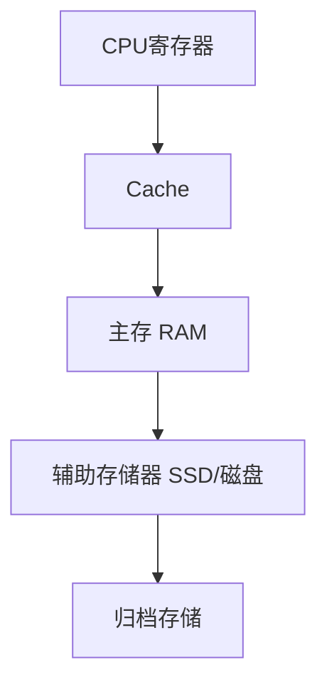
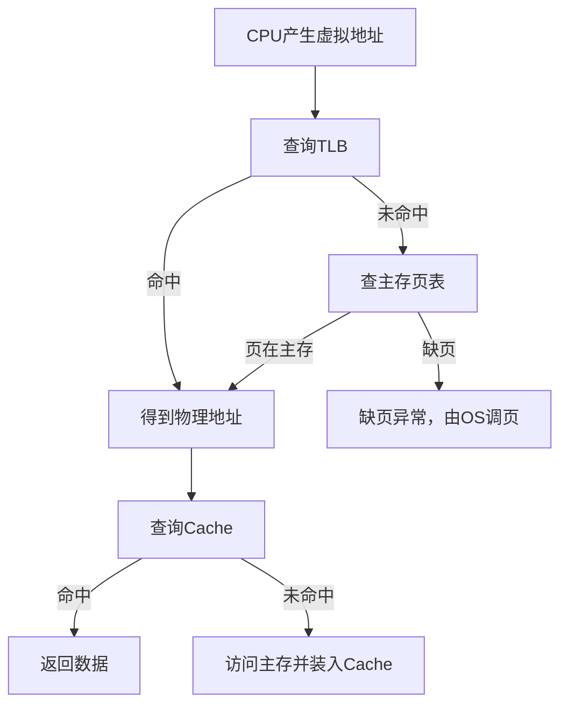

> [!summary] 本篇定位
> 讨论计算机存储系统的层次、主存组织、DRAM、Cache、虚拟存储器，以及存储容量和地址引脚的计算方法。
> 指令执行过程中 CPU 内部的数据通路见 [[03_中央处理器]]；总线传输与 I/O 见 [[04_总线和输入输出系统]]。

# 1. 存储系统概述

## 1.1 存储器的基本指标

| 指标 | 含义 |
|---|---|
| 存储容量 | 能保存的数据总量 |
| 存取时间 | 从发出访问请求到得到数据的时间 |
| 存储周期 | 同一存储体两次连续启动访问之间的最小时间间隔 |
| 存储带宽 | 单位时间能够传输的数据量 |

存取时间和存储周期不能混淆。存取时间只描述一次访问得到结果所需的时间；存储周期还包括存储器恢复到可以再次接受访问所需的时间，通常满足：

$$
T_{\text{cycle}}\geq T_{\text{access}}
$$

## 1.2 存储层次



越靠近 CPU 的存储器通常越快、容量越小、单位容量成本越高。存储层次利用程序的**时间局部性**和**空间局部性**，用较小的高速存储器保存近期或附近的数据。

| 层次 | 典型器件 | 访问速度 | 容量 | 典型特征 |
|---|---|---:|---:|---|
| CPU 内部 | 寄存器 | 最高 | 最小 | 直接参与指令执行 |
| 高速缓存 | SRAM | 很高 | 较小 | 保存主存数据副本 |
| 主存 | DRAM | 较高 | 较大 | 程序运行时的主要工作区 |
| 外存 | SSD、磁盘 | 较低 | 很大 | 非易失、长期保存 |

> [!warning] 分类维度不同
> RAM/ROM 按半导体存储器的读写与保持特性分类；主存/外存按存储层次中的作用和位置分类。不能把这两组概念简单一一对应。

# 2. RAM、ROM 与外存

## 2.1 RAM 与 ROM

| 类型 | 全称 | 典型特征 | 典型用途 |
|---|---|---|---|
| RAM | Random Access Memory | 通常可读写，DRAM 断电丢失 | 主存、工作数据 |
| ROM | Read-Only Memory | 传统上以读为主，通常非易失 | 固件、启动代码 |

现代 Flash、EEPROM 可以在特定条件下擦除和重新编程，因此“ROM”并不必然意味着物理上永远不能写入。

## 2.2 主存与外存

- **主存**：CPU 可以通过主存地址直接访问，通常由 RAM 构成；操作系统和正在运行的程序必须先进入主存才能被 CPU 正常执行。
- **外存**：磁盘、SSD 等非易失存储器，用于长期保存文件和程序，通常需要经过 I/O 过程装入主存。

> [!tip] 记忆
> RAM/ROM 回答“怎么保存和读写”；主存/外存回答“在存储层次中的位置和用途”。

# 3. 主存芯片的组织与计算

## 3.1 芯片规格的含义

规格

$$
C=N\times W\text{ bit}
$$

通常表示芯片有 $N$ 个存储单元，每个存储单元输出 $W$ 位。例如 $4K \times 4bit$ 表示有 $2^{12}$ 个存储单元，每个单元 $4 bit$。换算为字节时再除以 $8$。

## 3.2 数据引脚与地址引脚

数据引脚由芯片一次输出的数据位宽决定：

$$
\boxed{N_{DQ}=W}
$$

若芯片有 $N=2^n$ 个可寻址存储单元，则逻辑上需要 $n$ 位地址：

$$
\boxed{n=\log_2N}
$$

对于普通 SRAM，地址通常一次性输入，因此地址引脚大致为 $n$ 根。对于典型 DRAM，行地址与列地址分时复用同一组引脚。若行地址有 $r$ 位、列地址有 $c$ 位，且 $r+c=n$，则：

$$
\boxed{N_{A}=\max(r,c)}
$$

行列等分时：

$$
N_A=\left\lceil\frac{n}{2}\right\rceil
$$

> [!warning] 逻辑地址位数不等于 DRAM 地址引脚数
> 例如 $8192\times8192\times8$ bit 芯片需要 $13+13=26$ 位行列逻辑地址，但行列地址复用后通常只有 $13$ 根地址引脚，分两次输入行地址和列地址。`RAS`、`CAS`、`WE` 等是控制信号，不计入地址引脚。

## 3.3 DRAM 芯片示例

对 $8192\times8192\times8$ bit：

$$
8192=2^{13}
$$

单芯片容量为：

$$
2^{13}\times2^{13}\times8\text{ bit}=2^{29}\text{ bit}=2^{26}\text{ B}=64\text{ MB}
$$

- 数据引脚：$8$ 根。
- 行地址：$13$ 位。
- 列地址：$13$ 位。
- 复用后的地址引脚：$13$ 根。
- 一行的容量：

$$
8192\times8\text{ bit}=65536\text{ bit}=8\text{ KB}
$$

## 3.4 存储芯片扩展

### 位扩展

芯片的存储单元数量不变，并联多片以增加数据位宽。例如，用两片 $4K\times4$ 芯片组成 $4K\times8$ 存储器：

- 两片共享地址线、片选和读写控制线。
- 一片连接低 4 位数据线，另一片连接高 4 位数据线。
- 两片共同响应一个地址。

### 字扩展

芯片的数据位宽不变，通过增加芯片组扩大存储单元数量。高位地址经译码器产生片选信号，选择其中一组芯片。

### 示例：用 $4K\times4$ 芯片组成 $16$ KB

每片容量为：

$$
4K\times4\text{ bit}=16K\text{ bit}=2\text{ KB}
$$

需要：

$$
\frac{16\text{ KB}}{2\text{ KB}}=8\text{ 片}
$$

两片并联组成一组 $4K\times8$，共需要 $4$ 组。按字节编址时，每组内部需要 $12$ 根地址线，另外 $2$ 根高位地址线经 $2$-to-$4$ 译码器选择四组。

> [!warning] 地址编号必须看题目约定
> 若题目把 $A_0$ 明确规定为高位地址、$A_{15}$ 为低位地址，不能直接套用“低位编号为芯片内部地址”的习惯，应按题目定义重新判断。

# 4. DRAM 的存储单元与刷新

## 4.1 DRAM 的基本结构

DRAM 的典型存储单元为 `1T1C`：一个晶体管和一个电容。电容上的电荷表示数据，但电容会漏电，因此数据不能永久保持。

典型 DRAM 阵列按行、列组织：

```text
行地址 --行译码器--> 被选中的一整行
                         │
                    位线与感应放大器
                         │
列地址 --列译码器--> 选择其中的列
```

## 4.2 读写与行缓冲

激活一行后，该行的数据被感应放大器检测并放大，感应放大器同时承担恢复电荷的作用。因此，DRAM 的行缓冲区可以看作当前被激活的一整行数据。

若每行有 $C$ 列、每列输出 $W$ 位，则行缓冲容量为：

$$
\boxed{C_{\text{row buffer}}=C\times W\text{ bit}}
$$

这也是“行命中”访问较快的原因：同一行中的后续列访问不必重新激活另一行。

## 4.3 刷新过程

1. 选择需要刷新的行。
2. 位线与存储单元连接，感应放大器检测原有电荷。
3. 感应放大器放大并恢复该行各单元的电荷。
4. 按规定刷新周期遍历所有行。

刷新通常按**行**进行，而不是逐个 bit 进行。

| 刷新方式 | 做法 | 主要特点 |
|---|---|---|
| 集中刷新 | 集中一段时间刷新所有行 | 死区集中且较长 |
| 分散刷新 | 每个存取周期附带刷新一行 | 单次周期变长 |
| 异步刷新 | 在刷新周期内分散安排各行刷新 | 减少长时间连续阻塞 |

# 5. 多模块存储器

## 5.1 基本概念

多模块存储器把主存划分为多个能够独立启动访问的存储模块，目标是提高连续访问的带宽。它常见的两种组织方式是：

1. **单体多字存储器**：一个存储体一次读出多个连续字。
2. **多体交叉存储器**：多个存储体交替或并行提供数据。

### 单体多字

一个存储单元中组织多个机器字，一次访问得到 $m$ 个字。若机器字长为 $w$ bit，则一次内部读出宽度为：

$$
W=mw
$$

当连续访问落在同一组字内时效率高；跨组或只使用其中一个字时，部分读出数据可能未被利用。

### 多体交叉

若共有 $m$ 个模块，地址 $A$ 对应的模块号和模块内地址取决于编址方式。

## 5.2 高位交叉与低位交叉

设每个模块有 $L$ 个可编址单元。

**高位交叉：**

$$
\text{模块号}=\left\lfloor\frac{A}{L}\right\rfloor,
\qquad
\text{模块内地址}=A\bmod L
$$

连续地址集中在同一模块的一段区域中。

**低位交叉：**

$$
\text{模块号}=A\bmod m,
\qquad
\text{模块内地址}=\left\lfloor\frac{A}{m}\right\rfloor
$$

当 $m=2^k$ 时，地址最低 $k$ 位直接选择模块。连续地址轮流落到不同模块，适合连续访问。

| 对比 | 高位交叉 | 低位交叉 |
|---|---|---|
| 选择模块的地址部分 | 高位 | 低位 |
| 连续地址分布 | 集中到一个模块区间 | 轮流分到不同模块 |
| 连续访问带宽 | 通常较低 | 通常较高 |
| 典型用途 | 容量组织、区域划分 | 连续访问的交叉流水 |

## 5.3 交叉、并行与位扩展的区别

- **位扩展**：多片芯片共同提供同一个数据字的不同 bit。
- **多体交叉**：地址分布在多个独立模块中，使模块可以交错工作。
- **单体多字**：单个模块一次访问读出多个连续字。

三者可以在同一存储系统中同时出现。多体交叉描述地址与模块的关系，本身不规定数据总线必须一次只接收一个模块的数据；若多个模块有独立数据通路，也可以同时提供数据。

> [!warning] 内存条题的判断
> 8 个 $\times8$ 芯片连接成 64 位总线，首先说明它们共同形成 64 位数据通路；这不自动等于单体多字，也不自动排除多体交叉。是否称为多模块交叉，要看题目采用的模块组织模型和地址分配方式。408 题常按“8 个 8 位模块低位交叉、组成 64 位传送”处理。

## 5.4 交叉访问的性能

设：

- 每个模块存储周期为 $T$；
- 总线传送一个字需要 $\tau$；
- 模块数为 $m$。

若要每隔 $\tau$ 启动一个新的模块访问，同一模块再次被访问时必须已经恢复：

$$
\boxed{m\tau\geq T}
$$

因此至少需要：

$$
\boxed{m\geq\left\lceil\frac{T}{\tau}\right\rceil}
$$

理想情况下，连续读取 $n$ 个字的时间为：

$$
T_{\text{交叉}}=T+(n-1)\tau
$$

单模块逐次访问约为：

$$
T_{\text{single}}=nT
$$

同一模块在恢复前再次被请求会发生**访存冲突**。对 $m$ 体低位交叉存储器，常用：

$$
\text{模块号}=A\bmod m
$$

然后结合访问时刻判断是否冲突。

# 6. Cache

## 6.1 Cache 的作用

Cache 是主存数据的高速副本。CPU 访问地址时，先查 Cache：

- 命中：直接从 Cache 得到数据。
- 未命中：从下一级存储器调入包含该地址的块，再完成访问。

Cache 利用：

- **时间局部性**：刚访问的数据可能很快再次访问。
- **空间局部性**：访问某地址后，附近地址也可能很快被访问。

## 6.2 Cache 行的字段

一个典型 Cache 行可抽象为：

| 字段 | 作用 |
|---|---|
| 有效位 $V$ | 表明该行是否有可用数据 |
| 标记位 Tag | 标识当前数据来自哪个主存块 |
| 数据区 Data | 保存主存块的副本 |
| 脏位 $D$ | 写回法中表示数据是否被修改但尚未写回 |
| 替换状态位 | 记录 LRU、FIFO 等替换信息 |

命中通常要求：

$$
V=1\quad\text{且}\quad Tag_{\text{address}}=Tag_{\text{cache}}
$$

脏位主要在**写回法**中使用；直接映射 Cache 不需要在多个候选行中选择替换对象，因此通常不需要替换算法位。

## 6.3 地址划分

若主存地址为 $A$，块大小为 $B$ 个可编址单元，则：

$$
\text{主存块号}=\left\lfloor\frac{A}{B}\right\rfloor
$$

$$
\text{块内偏移}=A\bmod B
$$

直接映射 Cache 中，若有 $L$ 行：

$$
\text{Cache行号}=\text{主存块号}\bmod L
$$

当 $B=2^b$、$L=2^l$ 时：

- 块内偏移占 $b$ 位。
- 行号占 $l$ 位。
- 其余高位为 Tag。

组相联映射中，Cache 行号部分改为组号；全相联映射没有组号字段。

## 6.4 写策略

| 策略 | 写命中 | 写不命中 | 特点 |
|---|---|---|---|
| 写直达 | 同时更新 Cache 与主存 | 写入主存，是否装入 Cache 取决于具体策略 | 一致性简单，主存写流量大 |
| 写回 | 只更新 Cache，置脏 | 通常先替换脏块再装入 | 写流量小，需要脏位 |

## 6.5 Cache、TLB 与页表

- **TLB**：页表项的高速缓存，完成虚拟页号到物理页框号的快速转换。
- **Cache**：主存数据块的高速缓存。
- **页命中**：页面在主存中，不发生缺页。

典型访问过程：



在通常的 408 简化模型中：

$$
\text{Page miss}\Rightarrow\text{TLB miss}
$$

$$
\text{Page miss}\Rightarrow\text{Cache miss}
$$

但反向不成立：TLB 未命中只表示需要查页表，Cache 未命中只表示需要访问主存。

## 6.6 TLB 组相联计算

若 TLB 有 $E$ 个表项，采用 $K$ 路组相联，则组数为：

$$
S=\frac{E}{K}
$$

组号位数：

$$
\log_2S
$$

虚拟页号 VPN 拆分为 Tag 和组号时，若组号取低位：

$$
\text{组号}=VPN\bmod S
$$

$$
Tag=\left\lfloor\frac{VPN}{S}\right\rfloor
$$

例如，虚拟地址 16 位、页大小 $256B=2^8B$，则 VPN 为 8 位。16 项、4 路组相联时有 4 组，组号 2 位、Tag 6 位。页号 22 的二进制为 `00010110`，所以 Tag 为 `05H`，组号为 `2`。

# 7. 常用容量与跨边界公式

## 7.1 地址位数

按字节编址，地址空间为 $2^n$ Byte 时，需要：

$$
\boxed{n=\log_2(\text{地址空间字节数})}
$$

实际安装容量和地址空间可以不同。例如主存地址空间为 $64$ MB，但实际安装 $32$ MB，按字节编址的地址寄存器仍至少需要 $26$ 位，因为地址空间为 $2^{26}$ 个字节地址。

## 7.2 跨存储字读取

若一次最多传送 $W$ Byte，变量长度为 $L$ Byte，起始地址对 $W$ 取模的余数为 $r$，则需要的传送次数为：

$$
\boxed{N=\left\lceil\frac{r+L}{W}\right\rceil}
$$

例如，32 位总线一次传送 $4$ Byte，$double$ 占 $8$ Byte，起始地址对 4 的余数为 2：

$$
N=\left\lceil\frac{2+8}{4}\right\rceil=3
$$

> [!summary] 本篇核心
> 1. 芯片容量由“存储单元数 × 单元位宽”决定。
> 2. DRAM 行列地址复用，地址引脚通常取行、列地址位数的较大者。
> 3. 单体多字是一次取多个字，多体交叉是多个存储体交错工作，位扩展是增加数据位宽。
> 4. Cache 用 Tag、有效位和数据区判断命中，写回法还需要脏位。
> 5. TLB 缓存页表项，Cache 缓存主存数据，缺页时通常二者都不能命中。
