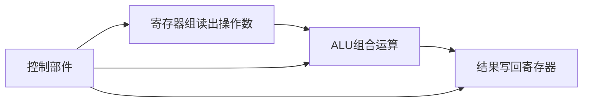

> [!summary] 本篇定位
> 讨论 CPU 的基本组成、数据通路、寄存器与标志位、微程序控制器、指令流水线及处理器性能。
> 指令格式和寻址方式见 [[02_指令系统]]；中断、总线和 DMA 见 [[04_总线和输入输出系统]]。

# 1. CPU 的组成

## 1.1 运算器与控制器

经典模型中：

$$
\boxed{CPU=运算器+控制器}
$$

- **运算器**：完成算术运算、逻辑运算和数据加工。
- **控制器**：译码指令，产生控制信号，协调各部件按时序工作。

从实现角度看，CPU 常分为：

- **数据通路（Datapath）**：数据的传送、存储和运算路径。
- **控制部件（Control Unit）**：产生控制信号，决定数据通路如何工作。

> [!warning] 两种分类不要混淆
> 运算器/控制器是按功能划分；组合逻辑/时序逻辑是按电路是否保存状态划分。数据通路通常包含两类电路，而控制部件不等于数据通路。

## 1.2 数据通路中的电路

| 类型 | 特点 | 典型部件 |
|---|---|---|
| 组合逻辑 | 输出只由当前输入和控制信号决定 | ALU、加法器、多路选择器 |
| 时序逻辑 | 输出与内部保存的状态有关 | PC、通用寄存器、流水线寄存器 |

一条加法指令可以抽象为：



## 1.3 流水线数据通路

典型流水线数据通路包括：

- PC 和取指部件。
- 指令存储器、数据存储器。
- 通用寄存器组。
- ALU、加法器和多路选择器。
- 各级流水线寄存器：IF/ID、ID/EX、EX/MEM、MEM/WB。

严格区分时，生成控制信号的控制部件属于控制器，不属于数据通路本身；数据通路在控制信号作用下完成数据处理。

# 2. CPU 中的重要寄存器

## 2.1 MAR 与 MDR

| 寄存器 | 全称 | 作用 |
|---|---|---|
| MAR | Memory Address Register，存储器地址寄存器 | 保存当前要访问的主存地址 |
| MDR | Memory Data Register，存储器数据寄存器 | 暂存从主存读出的数据或将写入主存的数据 |

读主存：

$$
MAR\leftarrow A
$$

$$
MDR\leftarrow M[MAR]
$$

$$
CPU寄存器\leftarrow MDR
$$

写主存：

$$
MAR\leftarrow A,\qquad MDR\leftarrow D
$$

$$
M[MAR]\leftarrow MDR
$$

MAR 的位数取决于需要表示的主存地址空间；MDR 的位数通常与数据总线或存储器数据通路宽度有关。

## 2.2 PSW 与状态标志

PSW（Program Status Word，程序状态字）保存处理器当前状态，常包含：

- 条件码和运算结果标志。
- 中断允许位、优先级或屏蔽状态。
- 处理器工作模式和特权状态。

中断现场通常至少涉及 PC、PSW，以及中断服务程序可能使用的通用寄存器。PC 保存返回位置，PSW 保存原处理器状态。

## 2.3 CF、ZF、SF、OF

| 标志 | 名称 | 判断依据 |
|---|---|---|
| CF | Carry Flag | 无符号加法进位或减法借位 |
| ZF | Zero Flag | 结果是否为 0 |
| SF | Sign Flag | 结果最高位 |
| OF | Overflow Flag | 有符号结果是否超出补码范围 |

### ZF 与 SF

$$
ZF=
\begin{cases}
1,&R=0\\
0,&R\neq0
\end{cases}
$$

$$
SF=R\text{ 的最高位}
$$

### OF

补码加法中，若两个加数同号而结果异号，则溢出。也可以用：

$$
\boxed{OF=C_{n-1}\oplus C_n}
$$

其中 $C_{n-1}$ 是进入符号位的进位，$C_n$ 是从符号位产生的进位。双符号位法与之等价：结果的两个符号位不同，发生溢出。

### CF

在常见补码加减法器中，若 `Sub=0` 表示加法、`Sub=1` 表示减法，`Cout` 为最高位输出进位，则：

$$
\boxed{CF=Sub\oplus Cout}
$$

该式依赖于题目采用的减法器结构和 CF 定义。概念上仍应记住：CF 关注无符号进位/借位，OF 关注有符号溢出。

# 3. 运算结果与数值表示

## 3.1 补码溢出

$n$ 位补码的表示范围为：

$$
-2^{n-1}\leq x\leq2^{n-1}-1
$$

补码加法发生有符号溢出的条件是：两个加数同号，而结果与它们异号。等价判断方法有：

- 最高位进位与次高位进位不同。
- 双符号位结果不同。
- 对加法使用：

$$
OF=C_{n-1}\oplus C_n
$$

例如，4 位补码中：

$$
0101+0100=1001
$$

数学结果为 $5+4=9$，超出 $[-8,7]$，因此发生溢出。结果 `1001` 只是固定 4 位截断后的位模式。

> [!warning] CF 与 OF 不同
> CF 关注无符号进位/借位；OF 关注有符号数是否超出补码范围。二者可以一个为 1、另一个为 0。

## 3.2 浮点数溢出

浮点数可表示为：

$$
N=M\times2^E
$$

浮点加减通常经过：

$$
对阶\rightarrow尾数运算\rightarrow规格化\rightarrow检查阶码
$$

最终检查规格化后的阶码：

- 阶码超过最大允许值：上溢，数值过大。
- 阶码低于最小允许值：下溢，数值过小、接近零。

尾数运算产生进位并不等于浮点溢出，因为规格化可能通过调整尾数和阶码消除它；最终是否溢出取决于阶码是否越界。

## 3.3 异或与整数类型转换

异或不是减法，也不是普通加法，而是**不考虑进位的二进制加法**：

| $A$ | $B$ | $A\oplus B$ |
|---:|---:|---:|
| 0 | 0 | 0 |
| 0 | 1 | 1 |
| 1 | 0 | 1 |
| 1 | 1 | 0 |

常用性质：

$$
A\oplus A=0,\qquad A\oplus0=A
$$

在 C 语言中，较短的有符号整数转换为较长的有符号整数时进行符号扩展；有符号整数转换为 $n$ 位无符号整数时按模 $2^n$ 取值。

例如，32 位系统中：

```c
short si = -32767;
unsigned int ui = si;
```

先将 `short` 符号扩展为 32 位 `int`，再按模 $2^{32}$ 转为无符号数：

$$
ui=(-32767)\bmod2^{32}
=2^{32}-32767
=2^{32}-2^{15}+1
$$

# 4. 微程序控制器

## 4.1 机器指令、微程序与微指令

在微程序控制器中，层次关系为：

$$
\boxed{机器指令\rightarrow微程序\rightarrow微指令\rightarrow微命令}
$$

- **机器指令**：ISA 对软件提供的指令。
- **微程序**：实现一条机器指令的微指令序列。
- **微指令**：控制器一个时钟周期发出的控制信号集合。
- **微命令**：控制某个具体微操作的信号。

一条机器指令通常对应一个微程序，但并非所有现代处理器都采用微程序控制，也不一定每条指令都由多条微指令实现。

## 4.2 微指令编码方式

### 直接编码

每个微命令对应一个控制位，控制位为 1 表示发出该微命令。

- 优点：控制简单、速度快、并行性强。
- 缺点：微指令字长长。

### 字段直接编码

把相互排斥的一组微命令放在同一字段，用编码表示其中一个选择；不同字段可同时译码，从而实现字段间并行。

若一组有 $q$ 个互斥微命令，至少需要：

$$
\lceil\log_2(q+1)\rceil
$$

位，额外的状态通常用于“不发出该组命令”。

### 字段间接编码

编码还需要依赖其他字段或经过多级译码，微指令可能更短，但控制和译码更复杂、速度可能更慢。不同教材的具体术语略有差异，应以指定教材为准。

## 4.3 水平型与垂直型微指令

| 对比 | 水平型 | 垂直型 |
|---|---|---|
| 编码 | 直接或较直接控制 | 采用较多编码 |
| 字长 | 较长 | 较短 |
| 并行性 | 较强 | 通常较弱 |
| 译码 | 少 | 多 |
| 控制速度 | 通常较快 | 通常较慢 |

记忆：**水平型长、快、并行性强；垂直型短、慢、编码多。**

## 4.4 下地址字段法

采用下地址字段法时，当前微指令直接给出下一条微指令在控制存储器中的地址：

$$
CMAR\leftarrow\text{当前微指令的下地址字段}
$$

若控制存储器中共有 $N$ 条需要编址的微指令，则下地址字段至少为：

$$
\boxed{n=\lceil\log_2N\rceil}
$$

例如，32 条机器指令，每条对应平均 4 条微指令，公共取指微程序有 2 条：

$$
N=2+32\times4=130
$$

$$
\lceil\log_2 130\rceil=8
$$

不能只按机器指令数量计算，因为下地址字段寻址的是微指令，而不是机器指令。

# 5. 指令流水线

## 5.1 基本思想

流水线将一条指令划分为多个阶段，使多条指令的不同阶段在时间上重叠。经典五级流水线为：

| 阶段 | 名称 | 主要任务 |
|---|---|---|
| IF | Instruction Fetch | 取指令 |
| ID | Instruction Decode | 译码、读寄存器 |
| EX | Execute | ALU 运算、计算地址 |
| MEM | Memory | 访问数据存储器 |
| WB | Write Back | 结果写回寄存器 |

理想情况下，$k$ 段流水线执行 $n$ 条指令，每段耗时 $\Delta t$：

$$
T_{\text{pipe}}=(k+n-1)\Delta t
$$

非流水执行：

$$
T_{\text{nonpipe}}=nk\Delta t
$$

理想加速比：

$$
S=\frac{nk}{k+n-1}
$$

当 $n\to\infty$ 时，$S\to k$。

## 5.2 延迟、吞吐率与 CPI

- **延迟**：一条指令从进入流水线到完成所需的时间。
- **吞吐率**：单位时间完成的指令数。
- **CPI**：平均每条指令消耗的时钟周期数。

五段流水线中，一条指令的延迟仍可能是 5 个周期，但流水线稳定后可以每周期完成一条指令。对有限条指令，填充和排空会使总周期数大于指令数；理想长程序的平均 CPI 才趋近于 1：

$$
CPI_{\text{ideal}}=\lim_{n\to\infty}\frac{k+n-1}{n}=1
$$

因此，“每周期完成一条指令”描述的是吞吐率，不等于每条指令从开始到结束只需一个周期。

## 5.3 流水线冒险

| 类型 | 原因 | 典型解决方法 |
|---|---|---|
| 结构冒险 | 多条指令争用同一硬件资源 | 增加资源、分离指令和数据 Cache、暂停 |
| 数据冒险 | 指令间存在数据依赖 | 前推、暂停、编译器调度 |
| 控制冒险 | 分支使下一条指令地址不确定 | 分支预测、延迟分支、尽早判断、清空 |

数据相关类型：

- RAW：写后读，经典顺序五级流水线最主要。
- WAR：读后写，常见于乱序执行。
- WAW：写后写，常见于乱序执行。

### Load-use 冒险

```asm
lw  R1, 0(R2)
add R3, R1, R4
```

`lw` 从主存取出的数据通常在 MEM 阶段末才产生，而紧邻的 `add` 在下一周期 EX 开始时就需要该数据。旁路只能传递已经产生的数据，不能让尚未完成访存的数据提前出现，因此经典五级流水线通常需要插入一个气泡：

$$
\text{load-use}\Rightarrow\text{旁路}+\text{通常暂停 1 个周期}
$$

## 5.4 单周期、多周期与流水线数据通路

| 数据通路 | 单条指令执行方式 | 典型 CPI |
|---|---|---:|
| 单周期 | 每条指令一个时钟周期完成 | $1$ |
| 多周期 | 一条指令分多个周期完成 | 通常 $>1$ |
| 流水线 | 多条指令阶段重叠 | 理想长程序趋近 $1$，有填充、停顿和冲突时大于 1 |

## 5.5 CPI、IPC 与 MIPS

若各类指令按执行条数占比为 $p_i$，CPI 为 $CPI_i$：

$$
CPI_{avg}=\sum_i p_iCPI_i
$$

$$
IPC_{avg}=\frac{1}{CPI_{avg}}
$$

主频为 $f$ Hz 时：

$$
MIPS=\frac{f}{CPI_{avg}\times10^6}
$$

不能按指令比例直接平均各类 IPC，因为：

$$
\sum_i p_i\frac1{CPI_i}\neq\frac1{\sum_i p_iCPI_i}
$$

## 5.6 超流水线、超标量与 VLIW

| 技术 | 核心思路 | 并行性来源 |
|---|---|---|
| 超流水线 | 把流水段进一步细分，缩短时钟周期 | 更高时钟频率 |
| 超标量/多发射 | 一个周期发射多条指令，增加执行部件 | 硬件动态或半动态调度 |
| 超长指令字 VLIW | 编译器把可并行操作打包到一条长指令 | 编译器静态调度 |

超流水线关注“一个周期多短”，超标量关注“一个周期发射几条”，VLIW 关注“编译器如何把操作打包”。三者可以结合使用。

> [!summary] 本篇核心
> 1. CPU 可从功能上分为运算器和控制器，从实现上分为数据通路和控制部件。
> 2. MAR 管地址，MDR 管数据；PSW 保存处理器状态。
> 3. CF 看无符号进位/借位，OF 看有符号溢出。
> 4. 微程序由微指令组成，下地址字段要能编址所有微指令。
> 5. 流水线提高吞吐率；CPI、延迟和吞吐率必须分开理解。
