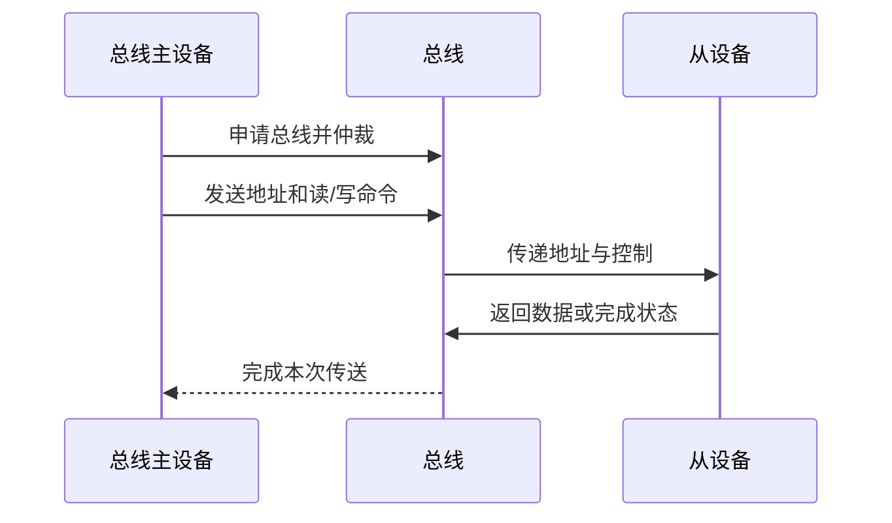
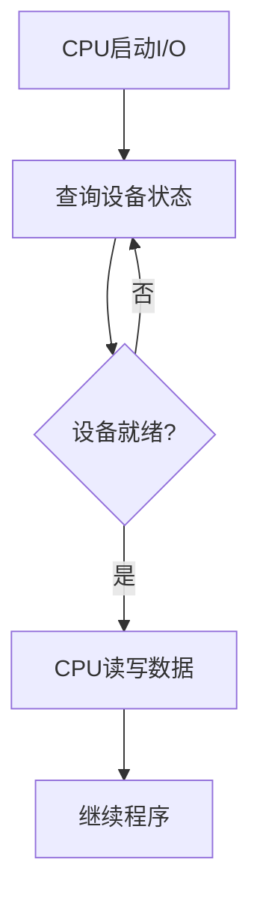
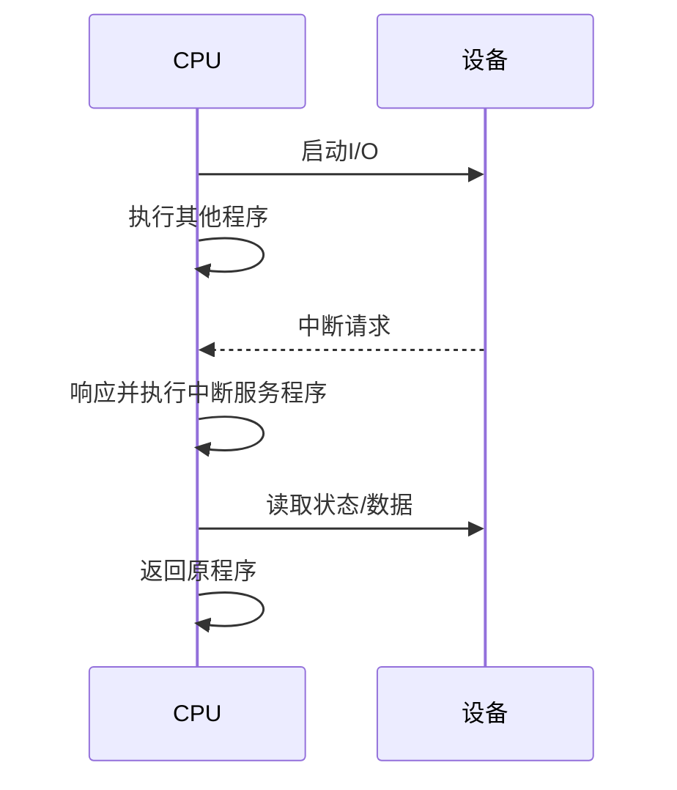
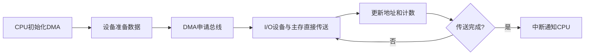

> [!summary] 本篇定位
> 讨论系统总线、总线事务、中断系统、I/O 数据传送方式和 DMA。
> CPU 内部的数据通路和流水线见 [[03_中央处理器]]；存储器本身的组织见 [[01_存储系统]]。

# 1. 系统总线

## 1.1 三类总线

| 总线 | 传送内容 | 典型方向 | 典型信号 |
|---|---|---|---|
| 数据总线 | 指令、操作数和结果 | 通常双向 | 读写数据 |
| 地址总线 | 存储器或 I/O 地址 | 通常由主设备发出 | 地址码 |
| 控制总线 | 控制和状态信息 | 可能双向 | 读、写、就绪、中断请求 |

CPU 读取主存的一次基本过程是：

1. CPU 将目标地址送到地址总线。
2. CPU 在控制总线上发出读命令。
3. 主存根据地址取出数据。
4. 数据通过数据总线送回 CPU。

地址总线宽度为 $n$ 位时，若按字节编址且没有其他限制，最多可表示：

$$
2^n\text{ 个字节地址}
$$

数据总线宽度为 $m$ 位时，一次总线传送的最大数据宽度通常为 $m$ 位，但它不一定等于 CPU 字长。

## 1.2 总线事务

总线事务是一次完整的信息传送过程，通常可包含：

常见事务：

- 读事务。
- 写事务。
- 突发读写事务：一次给出起始地址后，连续传输多个数据单元，减少重复寻址开销。

总线事务描述一次完整传送；总线周期描述协议中的一个时序周期。简单传统总线中二者可能接近，但现代总线中一次事务可以包含多个传输周期。

# 2. 中断系统

## 2.1 中断与异常

- **中断**：通常来自当前指令执行流程之外的设备、定时器等事件。
- **异常**：通常由 CPU 或 MMU 在执行当前指令过程中检测到的特殊情况，例如非法指令、除零、缺页。

检测或请求接收主要由硬件完成；具体服务通常由硬件和软件协同完成，操作系统中断服务程序负责设备处理、调页等工作。

## 2.2 外部中断

| 类型 | 是否受普通关中断影响 | 典型用途 |
|---|---|---|
| NMI 不可屏蔽中断 | 通常不受影响 | 电源故障、严重硬件错误 |
| 可屏蔽中断 | 可由中断允许位或屏蔽字禁止 | 普通 I/O、定时器事件 |

可屏蔽中断请求有效并不表示 CPU 立即响应，还要满足：

- CPU 处于允许中断状态。
- 请求没有被屏蔽。
- 当前指令执行到适合响应的边界。
- 响应优先级和当前处理状态允许。

## 2.3 中断源识别与判优

**软件查询法：** CPU 响应公共中断请求后，按规定顺序查询设备状态寄存器，确定提出请求的设备。

- 硬件简单。
- 查询速度受设备数量和查询顺序影响。
- 查询顺序可以体现优先级。

**硬件判优法：** 由优先级电路、中断控制器或菊花链根据请求信号确定中断源和优先次序。

- 响应快。
- 硬件较复杂。
- 优先级通常由硬件结构或控制器配置决定。

> [!warning] “中断判优必须由硬件完成”并不总是成立
> 若题目问“必须由硬件完成”，软件查询法说明中断源识别/判优不一定必须由硬件完成。经典 I/O 题常因此把“中断判优”排除在唯一硬件必做项之外。

## 2.4 中断向量

中断向量是指向中断服务程序入口地址的信息。中断向量表建立中断类型号到服务程序入口的映射：

$$
\text{VectorTable}[i]=\text{ISR}_i\text{ 的入口地址}
$$

若中断向量表首地址为 $V$，每项占 $s$ Byte，中断类型号为 $i$，则：

$$
V_i=V+i\times s
$$

中断类型号是“是哪一种中断”的编号；中断向量是根据编号查到的入口地址或地址指针。

# 3. 中断响应与中断处理

## 3.1 中断响应阶段

在经典 408 模型中，中断响应阶段可理解为 CPU 执行中断隐指令的过程：

$$
\boxed{关中断\rightarrow保存断点\rightarrow引出中断服务程序}
$$

1. **关中断**：暂时禁止可屏蔽中断，避免响应过程被打断。
2. **保存断点**：保存被中断程序下一条待执行指令的地址，通常是 PC。
3. **引出中断服务程序**：根据中断源或中断向量将入口地址送入 PC。

保存断点与保护现场必须区分：断点是返回位置，现场还包括通用寄存器、PSW 等状态。

## 3.2 中断服务程序执行

典型步骤：

$$
\boxed{保护现场\rightarrow开中断（可选）\rightarrow设备服务\rightarrow恢复现场\rightarrow中断返回}
$$

- **保护现场**：保存中断服务程序将要使用并需要恢复的寄存器和状态。
- **开中断**：允许符合处理优先级的更高优先级中断嵌套。
- **设备服务**：读取设备状态/数据、清除请求、完成 I/O 后续处理。
- **恢复现场**：恢复保存的寄存器和状态。
- **中断返回**：恢复断点，回到被中断程序。

在经典教材模型中，保存断点通常由硬件在中断响应阶段完成；保存通用寄存器通常由软件在服务程序中完成。实际体系结构可能自动保存更多或更少的状态，应以具体架构为准。

## 3.3 中断响应优先级与处理优先级

| 类型 | 解决的问题 | 典型决定者 |
|---|---|---|
| 响应优先级 | 多个请求同时到达时先响应谁 | 经典模型中多由硬件固定或控制器决定 |
| 处理优先级 | 当前服务程序能否被谁打断 | 屏蔽字、优先级阈值和软件策略 |

两者可以不同。例如：

- A 的响应优先级高于 B，所以 A、B 同时请求时先响应 A。
- B 的处理优先级高于 A，所以 CPU 处理 A 时，B 仍可能嵌套打断 A。

响应优先级高不必然意味着处理优先级高。

# 4. I/O 数据传送方式

## 4.1 程序直接控制方式

也称程序查询或轮询方式。

CPU 主动检查设备状态，设备就绪后由 CPU 执行指令搬运数据。

- 硬件简单。
- CPU 可能长时间等待。
- CPU 利用率低，适合简单、低速 I/O。

## 4.2 程序中断方式

设备准备好或操作完成后主动请求中断，CPU 在中断服务程序中搬运数据。

- CPU 不必持续轮询。
- 数据通常仍由 CPU 逐次搬运。
- 每次中断有响应、保存现场和返回开销。

## 4.3 DMA 方式

DMA（Direct Memory Access）允许 I/O 设备和主存直接交换数据，CPU 不逐个执行搬运指令。

DMA 典型过程：

1. CPU 初始化 DMA 控制器：设置主存起始地址、传输方向和数据量。
2. 设备准备好后，DMA 控制器申请总线并参与仲裁。
3. DMA 控制器控制 I/O 设备与主存之间的数据传送，同时更新地址和计数器。
4. 传送完成后，DMA 控制器通常通过中断通知 CPU。

DMA 期间 CPU 仍可以执行不依赖总线的工作，但二者可能竞争总线和主存。常见总线使用方式：

- **停止 CPU 访存/成组传送**：DMA 连续占用总线一段时间。
- **周期窃取**：DMA 每次传送占用一个或几个总线周期。
- **交替访问**：CPU 与 DMA 按时序交替使用存储器。

## 4.4 三种方式对比

| 项目 | 程序直接控制 | 程序中断 | DMA |
|---|---|---|---|
| 谁发现设备就绪 | CPU 查询 | 设备发中断 | DMA 控制器与设备协同 |
| 谁搬运数据 | CPU | CPU | DMA 控制器组织 |
| CPU 是否逐个处理数据 | 是 | 通常是 | 否 |
| CPU 是否持续等待 | 常见 | 通常不需要 | 通常不需要 |
| 硬件复杂度 | 低 | 中 | 高 |
| 适用场景 | 简单、低速 | 中小规模、事件驱动 | 大批量、高速 |

> [!summary] 本篇核心
> 1. 数据总线传内容，地址总线找位置，控制总线下命令。
> 2. 中断响应负责关中断、保存断点、引出服务程序；中断处理负责保护现场和设备服务。
> 3. 响应优先级决定先响应谁，处理优先级决定谁能打断谁。
> 4. 程序查询由 CPU 主动查，中断方式由设备通知 CPU，DMA 由控制器组织设备与主存直接传送。
