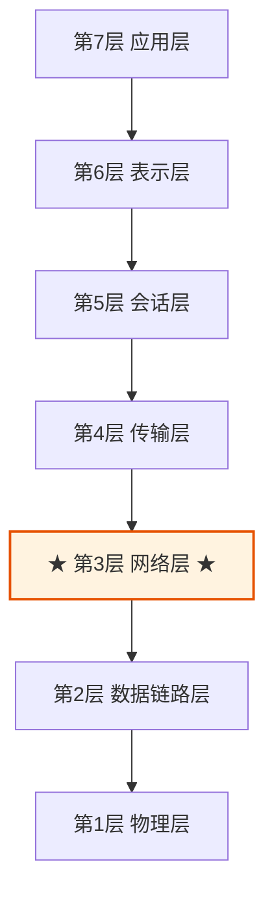
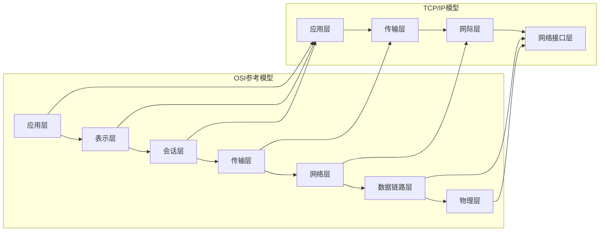
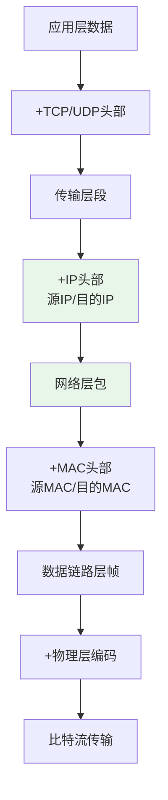
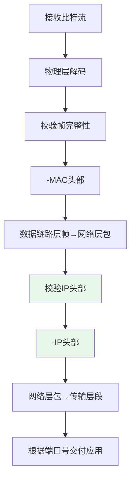

> [!summary] 本篇定位
> 承载**跨层公共知识**：分层模型、各层职责边界、数据封装与解封装。
> 各层专业笔记 [[01_物理层]]、[[02_数据链路层]]、[[03_网络层]]、[[04_传输层]]、[[05_应用层]] 均以本篇为前提，不再重复展开。

# 1 分层思想与 OSI 七层模型

## 1.1 为什么要分层

分层的本质是**把"端到端通信"这个复杂问题拆成若干可独立求解的子问题**，每层只暴露必要的服务接口（SAP），屏蔽下层实现细节。

| 收益 | 说明 |
| :--- | :--- |
| **问题分解** | 每层只解决一类问题，降低单层复杂度 |
| **独立演进** | 某一层技术换代不影响其他层（以太网 → Wi-Fi，IP 层无感知） |
| **标准化** | OSI 参考模型与 RFC 体系为跨厂商互操作提供共同语言 |

**分层带来的两个工程矛盾**（理解了这两点，才能理解 NAT、分片、代理这些"破坏分层"的设计）：

| 矛盾 | 具体表现 | 现实妥协 |
| :--- | :--- | :--- |
| **抽象泄漏** | 上层不得不感知下层细节 | IP 分片依赖链路 MTU、应用层感知 NAT 存在 |
| **端到端原则** | 网络应尽量简单，智能放在端点 | NAT 把状态放进网络 → 牺牲端到端透明性（见 [[03_网络层#7 网络地址转换（NAT）]]） |

## 1.2 OSI 七层模型架构



**层级功能速查表**：

| 层级 | 名称 | 核心功能 | 数据单元 | 典型协议 | 详细笔记 |
| :--- | :--- | :--- | :--- | :--- | :--- |
| 第7层 | 应用层 | 应用程序网络服务接口 | 报文（Message） | HTTP、FTP、DHCP | [[05_应用层]] |
| 第6层 | 表示层 | 数据格式转换、加密解密 | 报文（Message） | SSL/TLS、JPEG | — |
| 第5层 | 会话层 | 会话建立、管理与终止 | 报文（Message） | RPC、NetBIOS | — |
| 第4层 | 传输层 | 端到端通信、可靠/不可靠传输 | 段（Segment） | TCP、UDP | [[04_传输层]] |
| **第3层** | **网络层** | **逻辑寻址、路由选择** | **包（Packet）** | **IP、ICMP、ARP、OSPF** | [[03_网络层]] |
| 第2层 | 数据链路层 | 物理寻址、帧传输、差错检测 | 帧（Frame） | Ethernet、PPP | [[02_数据链路层]] |
| 第1层 | 物理层 | 比特流传输、物理介质规范 | 比特（Bit） | RJ-45、光纤 | [[01_物理层]] |

> [!tip] 记忆口诀
> - 自下而上：**物**理 → **链**路 → **网**络 → **传**输 → **会**话 → **表**示 → **应**用，取首字「**物链网传会表应**」
> - 自上而下英文：`All People Seem To Need Data Processing`
> - 只需死记一句：**网络层管寻址与路由，传输层管端到端，链路层管同一链路收发**

# 2 TCP/IP 四层与五层教学模型

教材通常给出两套简化模型，需注意它们的差异：

| OSI 七层模型 | TCP/IP 四层模型 | 五层教学模型 | 功能整合说明 |
| :--- | :--- | :--- | :--- |
| 应用层、表示层、会话层 | **应用层** | **应用层** | 高层协议统一归入应用层 |
| 传输层 | **传输层** | **传输层** | 端到端通信机制保持一致 |
| **网络层** | **网际层（Internet）** | **网络层** | 核心路由与寻址功能等价 |
| 数据链路层、物理层 | **网络接口层** | **数据链路层 + 物理层** | 四层模型不细分，五层模型拆开讲 |

- **四层模型**：描述**实际协议栈实现**（BSD Socket 视角）
- **五层模型**：专为**教学拆分**，把 Network Interface 拆回链路层与物理层，便于分别讲解
- 工程中"TCP/IP 四层"与"五层"混用是常态，只要明确说的是哪一层即可



# 3 数据封装与解封装过程

## 3.1 发送方封装流程



## 3.2 接收方解封装流程



## 3.3 各层添加的头部字段

| 层 | 添加的字段 | 关键作用 |
| :--- | :--- | :--- |
| 传输层 | 源端口、目的端口、序号/确认号 | 进程到进程的复用与可靠传输 |
| 网络层 | 源 IP、目的 IP、协议号、TTL、总长度 | 跨网络寻址、防环、标识上层协议 |
| 数据链路层 | 源 MAC、目的 MAC、类型、FCS | 同一链路的物理寻址与差错检测 |

> [!important] 封装的核心不对称
> - 每层只处理**本层头部**，对上层数据完全透明
> - **IP 首部的源/目的地址在整条路径上不变**（NAT 除外），而 **MAC 首部每跳都会被重写** —— 这是区分"端到端"与"点到点"的关键（见 [[04_传输层#2 端到端与点到点的分工]]）

# 4 各层职责边界与笔记索引

| 层 | 本层解决的核心问题 | 寻址依据 | 广播域/连接范围 | 详细笔记 |
| :--- | :--- | :--- | :--- | :--- |
| 应用层 | 业务语义、资源标识 | URL / 域名 | 进程 | [[05_应用层]] |
| 传输层 | 进程到进程的可靠/不可靠传输 | 端口号 | 端到端 | [[04_传输层]] |
| 网络层 | 跨网络寻址与路由 | IP 地址 | 主机到主机 | [[03_网络层]] |
| 数据链路层 | 同一链路内的帧传输与差错检测 | MAC 地址 | 同一广播域 | [[02_数据链路层]] |
| 物理层 | 比特流的物理传输 | 无寻址 | 同一冲突域 | [[01_物理层]] |

**一句话区分三个地址**：

```
IP 地址    → 定位"哪台主机"（跨网络，端到端不变）
MAC 地址   → 定位"哪块网卡"（同一链路，每跳改变）
端口号     → 定位"哪个进程"（同一主机内复用）
```

> [!tip] 复习路径建议
> 1. 先在本篇建立分层与封装的整体图景
> 2. 按 [[02_数据链路层]] → [[03_网络层]] → [[04_传输层]] → [[05_应用层]] 自下而上推进
> 3. 每层只看两件事：**用什么寻址**、**如何把数据交给下一层**
