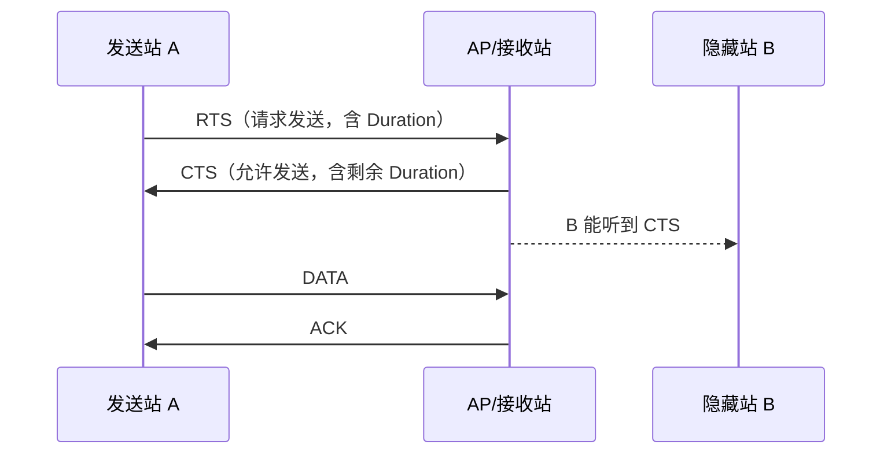

> [!summary] 本篇定位
> 讨论数据链路层如何把网络层分组封装为帧，并在一条链路或一个局域网内完成寻址、介质访问、差错控制和帧转发。
> ARP 的完整地址解析流程归入 [[03_网络层#4 地址解析协议（ARP）]]；物理信号、码元和信道容量见 [[01_物理层]]。

# 1 数据链路层的定位与功能

数据链路层负责相邻结点之间的帧传输，向网络层提供“下一跳可达”的链路服务。它不负责跨网络路由，也不负责端到端应用数据的可靠交付。

## 1.1 三项基本功能

| 功能 | 作用 | 典型机制 |
| :--- | :--- | :--- |
| **封装成帧** | 划分帧边界、添加链路层控制字段 | 以太网帧、PPP、HDLC |
| **链路寻址** | 标识当前链路上的发送方和接收方 | MAC 地址 |
| **差错控制** | 检测或纠正链路传输中的比特错误 | FCS/CRC、海明码 |
| **介质访问控制** | 多个站点共享介质时决定谁能发送 | CSMA/CD、CSMA/CA |

> [!warning] 链路层可靠性不是统一结论
> 传统以太网 MAC 通常只做 FCS 检错，错误帧直接丢弃；802.11 MAC 还提供 ACK 和链路层重传。是否可靠要结合具体链路协议判断。

## 1.2 与网络层的边界

```text
应用数据
   ↓ 传输层：端口、序号、可靠传输
   ↓ 网络层：源/目的 IP、路由与 TTL
   ↓ 数据链路层：源/目的 MAC、帧边界、FCS
   ↓ 物理层：编码后的比特信号
```

| 项目 | 数据链路层 | 网络层 |
| :--- | :--- | :--- |
| 通信范围 | 相邻结点、同一链路 | 主机到主机、跨网络 |
| 寻址 | MAC 地址 | IP 地址 |
| 数据单元 | 帧 | IP 分组 |
| 设备 | 网卡、网桥、二层交换机 | 路由器、三层交换机 |
| 地址变化 | MAC 每跳重写 | IP 通常端到端不变，NAT 除外 |

# 2 以太网与 MAC 地址

## 2.1 以太网 MAC 帧

```text
+------------+------------+------------+----------+----------------+------+
| 前导码/SFD | 目的 MAC   | 源 MAC     | 类型/长度| 数据与填充     | FCS  |
| 8 Byte     | 6 Byte     | 6 Byte     | 2 Byte   | 46~1500 Byte   | 4 B  |
+------------+------------+------------+----------+----------------+------+
```

| 字段 | 长度 | 作用 |
| :--- | :--- | :--- |
| 前导码与 SFD | 8 字节 | 时钟同步、帧起始定界，通常不计入 MAC 帧本身 |
| 目的 MAC | 6 字节 | 当前链路接收方 |
| 源 MAC | 6 字节 | 当前链路发送方 |
| 类型/长度 | 2 字节 | `0x0800` IPv4、`0x0806` ARP、`0x86DD` IPv6 |
| 数据 | 46～1500 字节 | 上层分组，不足 46 字节时填充 |
| FCS | 4 字节 | CRC-32，检测帧传输错误 |

传统以太网最短帧为 64 Byte（不含前导码和 SFD），由 14 Byte 首部、46 Byte 数据/填充和 4 Byte FCS 组成。数据字段最大 1500 Byte，即常说的以太网 MTU。

> [!important] 帧、MAC 帧和 IP 分组
> “帧”是数据链路层 PDU 的统称；以太网中通常就是 MAC 帧。IP 分组被封装在 MAC 帧的数据字段中，路由器每经过一跳都会拆除旧帧并重新封装新帧。

## 2.2 MAC 地址与帧类型

MAC 地址通常为 48 bit，理论地址空间为 $2^{48}$。它主要在本地二层网络中使用，不承担互联网级路由，因此不同广播域可以出现相同的 MAC 地址；但同一广播域中的重复 MAC 会导致交换机学习表抖动和通信异常。

| 帧类型 | 目的 MAC | 含义 |
| :--- | :--- | :--- |
| **单播** | 普通网卡地址 | 发给一个目标网卡 |
| **广播** | `FF:FF:FF:FF:FF:FF` | 发给当前广播域所有网卡 |
| **组播** | 组播地址 | 发给加入某组的网卡 |

ARP 请求和 DHCP Discover 常使用广播帧。ARP 解析的是当前链路的下一跳 MAC，跨网段时解析默认网关，详见 [[03_网络层#4.4 跨网段：ARP 解析的是网关 MAC（高频易错点）]]。

# 3 介质访问与链路协议

多个站点共享同一介质时，需要介质访问控制（MAC）决定谁能发送。IEEE 802 局域网通常把数据链路层分为 LLC 子层和 MAC 子层；MAC 子层处理介质访问、MAC 寻址和帧封装。

## 3.1 IEEE 802.3 与 IEEE 802.11

| 项目 | IEEE 802.3 | IEEE 802.11 |
| :--- | :--- | :--- |
| 网络类型 | 有线以太网 | 无线局域网 Wi-Fi |
| 介质 | 双绞线、光纤等 | 无线电波 |
| 典型访问控制 | 传统共享式使用 CSMA/CD；现代交换式全双工不需碰撞检测 | CSMA/CA，必要时 RTS/CTS |
| MAC 地址 | 48 bit | 48 bit |
| 帧特点 | 通常 2 个地址字段 | 最多 4 个地址字段 |

## 3.2 CSMA/CD 与最小帧长

CSMA/CD（载波监听多路访问/碰撞检测）用于传统共享式、半双工以太网：

1. 发送前监听信道。
2. 信道空闲后发送，并继续监听。
3. 发现碰撞后立即发送干扰信号，确保其他站点也知道碰撞。
4. 执行二进制指数退避，随机等待后重新发送。

发送方必须在最晚碰撞信号返回前仍处于发送状态，因此最小帧发送时间要覆盖最坏往返传播时延：

$$
\frac{L_{min}}{R}\geq2T_p
$$

临界情况下：

$$
\boxed{L_{min}=2RT_p}
$$

如果传播速度为 $v$、最远站点距离为 $D$：

$$
T_p=\frac{D}{v},\qquad L_{min}=2R\frac{D}{v}
$$

因此，在其他条件不变时：

$$
\boxed{\Delta D=\frac{v\Delta L_{min}}{2R}}
$$

最小帧长减少，允许的最大站点距离也减少。

### 二进制指数退避

第 $n$ 次碰撞后，令：

$$
k=\min(n,10),\qquad r\in[0,2^k-1]
$$

退避时间为：

$$
\boxed{T=r\times\text{争用期}}
$$

传统以太网的争用期为 512 bit 时间，即发送 512 bit 所需的时间。连续碰撞达到 16 次后放弃发送；随机范围指数增长到第 10 次后不再扩大。

> [!warning] 适用范围
> 现代交换式全双工以太网没有共享冲突信道，通常不使用 CSMA/CD。不要把 CSMA/CD 的最小帧长和所有以太网链路都机械等同。

## 3.3 CSMA/CA、RTS/CTS 与 NAV

无线局域网难以可靠地“检测碰撞”：发送端发射时自己的信号会淹没接收信号，且存在隐藏站。因此 802.11 主要采用 CSMA/CA：发送前监听，空闲后等待 DIFS 和随机退避，发送后由接收方在 SIFS 后回复 ACK。

### RTS/CTS 流程



- RTS 的接收地址是 AP，CTS 的接收地址是 A；它们不是严格意义上的广播帧。
- 无线信号具有广播式传播特点，其他能听到的站点可以读取控制帧中的 Duration。
- 收到 RTS 或 CTS 的站点根据 Duration 设置 **NAV（网络分配向量）**，在计时器归零前暂不竞争信道。
- 隐藏站可能听不到 A 的 RTS，却能听到 AP 的 CTS，因此仍能避让。

若题目问“隐藏站收到 CTS 后的 NAV”，计时起点是收到 CTS 的时刻，只计算 CTS 之后剩余的：

$$
\boxed{NAV=SIFS+T_{DATA}+SIFS+T_{ACK}}
$$

若题目从“开始发送数据帧”计时，则不计前面的 DIFS；数据发送完成后通常要计 SIFS，ACK 传输时间是否计入以题目条件为准。

## 3.4 802.11 地址字段

802.11 帧最多有 4 个地址字段。常见基础设施模式中，根据 `To DS` 和 `From DS` 解释地址：

| To DS | From DS | Address 1 | Address 2 | Address 3 |
| :---: | :---: | :--- | :--- | :--- |
| 0 | 0 | DA | SA | BSSID |
| 1 | 0 | AP/BSSID（RA） | SA（TA） | DA |
| 0 | 1 | DA（RA） | AP/BSSID（TA） | SA |
| 1 | 1 | RA | TA | DA/SA，通常另有 Address 4 |

- `To DS=1`：帧发往分配系统。
- `From DS=1`：帧来自分配系统。
- `RA/TA` 是当前无线链路的接收方/发送方。
- `DA/SA` 是最终目的/原始源地址。

标准常按 bit 0 开始编号，帧控制字段中的 `To DS` 为 bit 8、`From DS` 为 bit 9；部分教材按第 9、10 位称呼，需要看其编号从 0 还是从 1 开始。

## 3.5 HDLC 零比特填充

HDLC 使用 `01111110` 作为帧标志。为避免数据字段中出现同样的标志串，发送方在数据字段中每连续出现 5 个 `1` 就插入一个 `0`；接收方发现连续 5 个 `1` 后的填充 `0` 时将其删除。

```text
原数据：      01111110
填充后：      011111010
完整帧：      01111110  011111010  01111110
              起始标志    数据字段     结束标志
```

填充只作用于数据字段，不作用于帧标志。

# 4 差错检测、纠错与可靠传输

## 4.1 汉明距离

两个等长码字对应位不同的数量称为汉明距离。编码集的最小汉明距离为：

$$
\boxed{d_{min}=\min_{c_i\neq c_j}d(c_i,c_j)}
$$

若 $d_{min}$ 已知，则能够保证：

$$
\boxed{\text{检错不超过 }d_{min}-1\text{ 位}}
$$

$$
\boxed{\text{纠错不超过 }\left\lfloor\frac{d_{min}-1}{2}\right\rfloor\text{ 位}}
$$

若要求检测 $s$ 位错误并纠正 $t$ 位错误，必须满足：

$$
\boxed{d_{min}\geq s+t+1}
$$

## 4.2 海明码

海明码通过增加校验位定位单比特错误。原始数据有 $m$ 位、校验位有 $r$ 位时，需满足：

$$
\boxed{2^r\geq m+r+1}
$$

校验位放在位置 $1、2、4、8、\ldots$。位置编号的二进制中某一位为 1 的位置，由对应的校验位检查。接收方得到的校验综合按二进制解释后，就是错误位置。

- 普通海明码：可纠正 1 位错误。
- 增加全局校验位的扩展海明码：可实现 SECDED，即单错纠正、双错检测。

# 5 交换机、VLAN 与广播域

## 5.1 交换机自学习

交换机维护 MAC 地址到端口的映射表：

1. **学习源 MAC**：收到帧后记录“源 MAC → 入端口”，已有记录则刷新老化计时。
2. **查询目的 MAC**：根据目的 MAC 查找出口。
3. **转发、过滤或泛洪**：按查询结果处理。

| 目的 MAC 查询结果 | 行为 |
| :--- | :--- |
| 已知单播且出口不是入端口 | 只从对应端口转发 |
| 已知单播且出口等于入端口 | 过滤，不再转发 |
| 未知单播 | 除入端口外泛洪 |
| 广播 | 除入端口外泛洪到同一 VLAN |
| 组播 | 有组播表则按表转发，否则可能按广播处理 |

> [!tip] 核心口诀
> **源地址用于学习，目的地址用于转发。**

## 5.2 泛洪与广播

- **广播**描述帧的目的地址类型：目的 MAC 为 `FF:FF:FF:FF:FF:FF`。
- **泛洪**描述交换机的转发行为：不知道目的 MAC 所在端口时，把帧从除入端口外的多个端口发出。

广播帧通常会被泛洪，但泛洪帧不一定是广播帧；未知单播帧也会泛洪。

## 5.3 VLAN

VLAN（Virtual Local Area Network）把一个物理局域网划分为多个逻辑二层网络。

- 一个 VLAN 对应一个独立的二层广播域。
- 不同 VLAN 的广播帧相互隔离。
- VLAN 之间若要通信，需要路由器或三层交换机进行三层转发。

| 端口类型 | 作用 |
| :--- | :--- |
| **Access** | 通常连接终端，只属于一个 VLAN，终端通常发送无标签帧 |
| **Trunk** | 连接交换机、AP 或路由设备，承载多个 VLAN |

Trunk 常使用 IEEE 802.1Q，在帧中加入 VLAN Tag。VLAN ID 为 12 bit，理论上有 4096 个编号，通常 `0` 和 `4095` 保留，可用范围常写为 1～4094。

# 6 链路层设备与边界

| 设备 | 工作层级 | 核心功能 | 冲突域 | 广播域 |
| :--- | :--- | :--- | :--- | :--- |
| 中继器 | 物理层 | 信号再生 | 不隔离 | 不隔离 |
| 集线器 | 物理层 | 多端口中继、广播式转发 | 不隔离 | 不隔离 |
| 二层交换机 | 数据链路层 | MAC 学习、帧转发/过滤 | 通常每端口一个 | 同一 VLAN 内不隔离 |
| 三层交换机 | 网络层+链路层 | 二层交换与硬件路由 | 跨 VLAN 隔离 | 跨 VLAN 隔离 |
| 路由器 | 网络层 | IP 路由和分组转发 | 隔离 | 隔离 |

> [!summary] 本篇核心
> 1. 数据链路层负责帧、MAC、差错控制和介质访问；ARP 的完整流程见网络层。
> 2. 传统以太网用 CSMA/CD，802.11 用 CSMA/CA；最小帧长覆盖往返传播时间，NAV 记录无线信道的虚拟占用时间。
> 3. FCS/CRC 负责检错，汉明距离决定编码的检错和纠错能力，海明码可定位单比特错误。
> 4. 交换机根据源 MAC 学习、目的 MAC 转发；未知单播泛洪不等于广播。
> 5. VLAN 划分广播域，Access 连接终端，Trunk 承载多个 VLAN。
