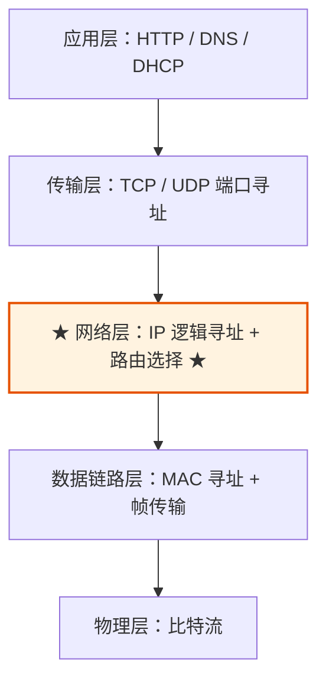
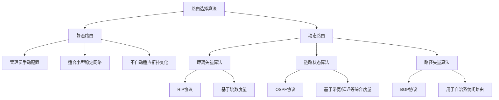
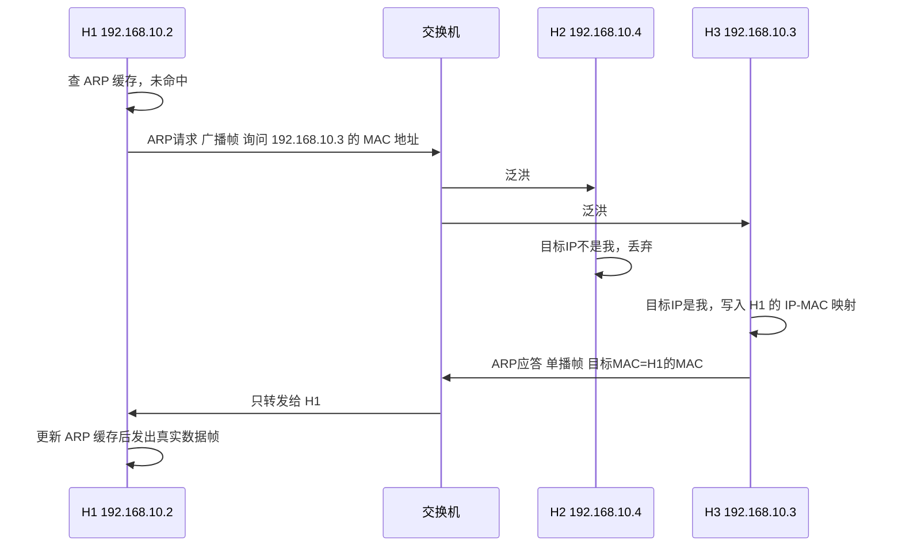
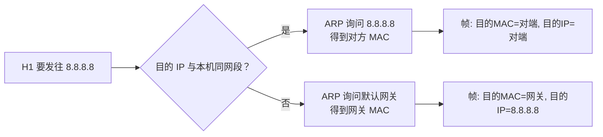
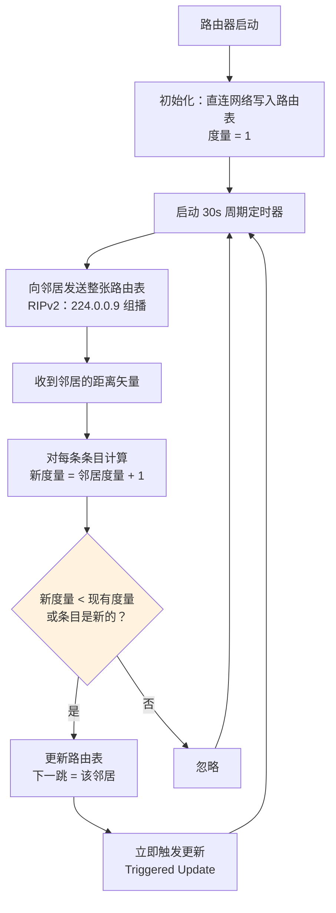
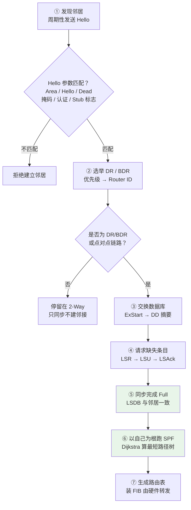
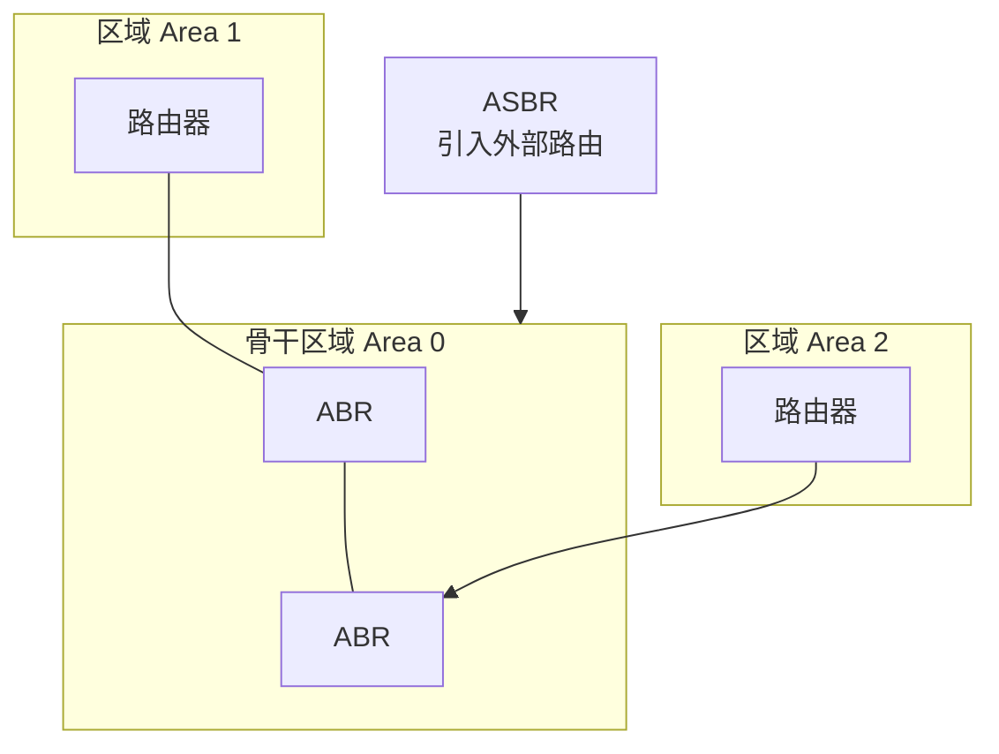
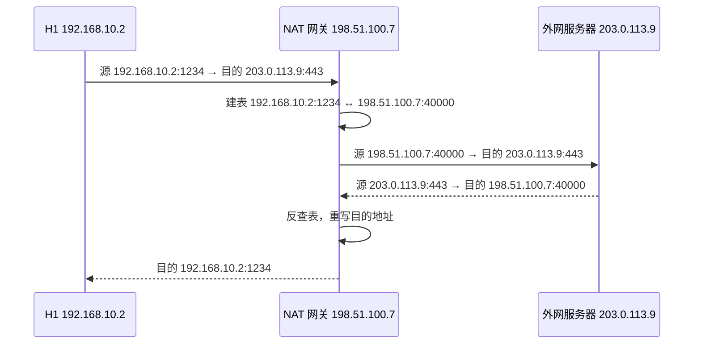
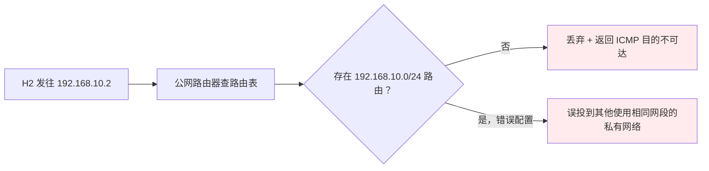
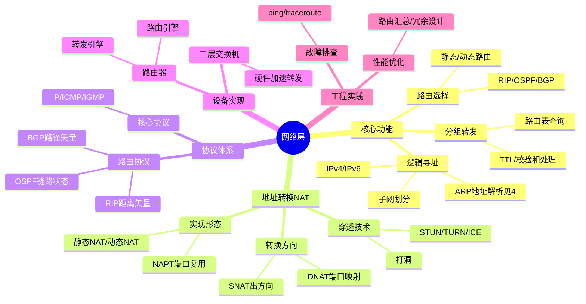

> [!info] 本篇范围
> 聚焦网络层自身机制：IP 逻辑寻址、路由选择与分组转发、路由协议运作流程、NAT。
> 分层模型与封装流程见 [[00_基础]]，地址解析协议 ARP 见本篇第 4 节，DHCP 见 [[05_应用层]]，端到端与点到点分工见 [[04_传输层]]。

本笔记系统梳理计算机网络中网络层（Network Layer）的核心功能、协议机制与工程实践。通过对比分析各层寻址方式、设备特性与协议交互，建立对网络层"逻辑寻址与路由选择"本质的深刻理解。

# 1 网络层在分层模型中的定位

网络层是 TCP/IP 模型中的**网际层（Internet Layer）**：向上为传输层提供"主机到主机"的尽力而为交付，向下屏蔽各种链路技术的差异。

> [!info] 分层模型与封装流程
> OSI 七层、TCP/IP 四层、五层模型对照，以及逐层加头/剥头的完整流程，见 [[00_基础#2 TCP/IP 四层与五层教学模型]] 与 [[00_基础#3 数据封装与解封装过程]]。

**网络层在协议栈中的位置**：



**本层要解决的三个问题**：

| 问题 | 机制 | 本篇章节 |
| :--- | :--- | :--- |
| 如何标识一台主机 | IP 地址（逻辑寻址、子网划分） | 2.1 |
| 数据包该往哪走 | 路由表 + 路由协议 | 2.2 / 5 |
| 每个包怎么被送出去 | 最长前缀匹配 + 逐跳转发 + ARP 解 MAC | 2.3 / 5.2 |

> [!tip] 一句话定位
> 数据链路层解决"**同一链路上**两台设备怎么通信"（用 MAC，见 [[02_数据链路层]]），网络层解决"**跨网络的两台主机**怎么通信"（用 IP）。

# 2 网络层核心功能详解

## 2.1 逻辑寻址机制

网络层通过逻辑地址（IP地址）实现跨网络的主机标识，与数据链路层的物理地址形成互补。

**地址类型对比**：

| 特性 | 逻辑地址（网络层） | 物理地址（数据链路层） |
| :--- | :--- | :--- |
| **地址类型** | 可配置的逻辑标识 | 固化的硬件标识 |
| **地址示例** | `192.168.1.100`（IPv4） | `00:1A:2B:3C:4D:5E`（MAC） |
| **地址长度** | IPv4: 32位 / IPv6: 128位 | 48位（6字节） |
| **作用范围** | 全局唯一（公网）或局部唯一（私网） | 局域网内唯一 |
| **可变性** | 可动态分配（DHCP） | 出厂固化，通常不可修改 |

**地址格式示例**：

```cpp
// IPv4地址结构（32位）
192.168.1.100
├─ 网络部分：192.168.1.0/24
└─ 主机部分：0.0.0.100

// IPv6地址结构（128位，压缩表示）
2001:0db8:85a3::8a2e:0370:7334
├─ 全局路由前缀：2001:0db8:85a3::/48
├─ 子网标识：::/64
└─ 接口标识：::8a2e:0370:7334
```

> [!note] 地址解析协议（ARP）
> ARP 负责将网络层的逻辑地址（IP）解析为数据链路的物理地址（MAC），是两层协同的唯一桥梁。
> 它只在**同一广播域**内工作，报文直接封装在以太网帧中；跨网段时解析的是**网关 MAC** 而非最终目的 MAC，完整流程见本篇 4。

## 2.2 路由选择策略

路由选择是网络层的核心决策过程，决定数据包从源到目的的最佳传输路径。

**路由表结构示例**：

```
目标网络        网关            子网掩码          接口        度量值
192.168.1.0     0.0.0.0         255.255.255.0     eth0        0
10.0.0.0        192.168.1.1     255.0.0.0         eth0        1
172.16.0.0      192.168.1.2     255.240.0.0       eth1        2
0.0.0.0         192.168.1.254   0.0.0.0           eth0        10  ← 默认路由
```

**路由算法分类**：



| 算法类型 | 代表协议 | 核心思想 | 适用场景 |
| :--- | :--- | :--- | :--- |
| **静态路由** | 手动配置 | 管理员预定义路径 | 小型网络、安全隔离环境 |
| **距离矢量** | RIP | 周期性交换路由表，选择跳数最少路径 | 小型自治系统 |
| **链路状态** | OSPF | 泛洪链路状态信息，构建全局拓扑图 | 中大型企业内部网络 |
| **路径矢量** | BGP | 基于策略的自治系统间路由选择 | 互联网骨干网 |

## 2.3 分组转发流程

分组转发是路由决策的执行阶段，将数据包从输入接口转发至输出接口。

**路由器转发处理流程**：


**关键字段处理**：

| 字段 | 处理动作 | 目的 |
| :--- | :--- | :--- |
| **TTL** | 每跳减1，归零则丢弃 | 防止路由环路导致无限转发 |
| **校验和** | 每跳重新计算 | 确保头部传输完整性 |
| **源/目的IP** | 保持不变（除非NAT） | 保证端到端通信语义 |
| **源/目的MAC** | 每跳重写 | 适配当前链路的物理寻址 |

# 3 网络层协议体系

## 3.1 核心协议功能对比

```
网络层协议族：
├── 核心协议
│   ├── IP（Internet Protocol）：无连接、不可靠的数据包传输
│   ├── ICMP（控制报文协议）：差错报告与网络诊断
│   └── IGMP（组管理协议）：组播组成员管理
│
├── 路由协议（运作流程详见 6）
│   ├── RIP（路由信息协议）：距离矢量，度量=跳数，小型网络     → 6.2
│   ├── OSPF（开放最短路径优先）：链路状态，度量=带宽，企业网   → 6.3
│   └── BGP（边界网关协议）：路径矢量，策略选路，互联网骨干     → 6.4
│
└── 辅助协议（地址解析，本篇 4 详解）
    ├── ARP（地址解析协议）：IP→MAC 映射，同一广播域内生效       → 4
    └── RARP（反向地址解析）：MAC→IP 映射，已废弃，由 DHCP 取代 → 05_应用层
```

**协议功能速查**：

| 协议 | 协议号 | 核心功能 | 典型应用 |
| :--- | :--- | :--- | :--- |
| **IP** | - | 逻辑寻址、分组转发 | 所有网络通信基础 |
| **ICMP** | 1 | 差错报告、连通性测试 | `ping`、`traceroute` |
| **IGMP** | 2 | 组播组成员管理 | 视频直播、在线会议 |
| **OSPF** | 89 | 内部网关路由计算 | 企业网络路由 |
| **BGP** | - | 自治系统间路由交换 | 互联网骨干路由 |

> [!note] ARP 与 DHCP 的归属
> - **ARP**：严格说它的报文封装在以太网帧里，但它是 IP 地址体系不可分割的一半 —— **没有 ARP，IP 数据报根本无法被封装成帧发出去**。既然 IP 概念在网络层引入，ARP 就在本篇详解（见 4）。
> - **DHCP**：只负责"地址怎么来"，基于 UDP 67/68 传输，属于**应用层**协议，详见 [[05_应用层#2 DHCP 动态主机配置协议]]。
> - 两句话分清：**网络层管"有了 IP 之后怎么找到对端 MAC"（ARP），应用层管"IP 从哪来"（DHCP）**。

## 3.2 封装位置与链路层协作

IP 数据报要真正发出去，必须交给链路层封装成帧。从网络层视角只需记住三件事：

| 动作 | 内容 |
| :--- | :--- |
| 添加 IP 首部 | 源/目的 IP、协议号、TTL、总长度、首部校验和 |
| 交给链路层 | 目的 MAC 由 ARP 解析，且解析的是**下一跳**而非最终目的地 |
| 每跳变化 | TTL 与首部校验和改变、MAC 重写；**IP 地址不变（NAT 除外）** |

> [!info] 完整封装/解封装流程图
> 逐层加头、逐层剥头的全过程见 [[00_基础#3 数据封装与解封装过程]]。

**协议号（IP 首部中标识上层协议）**：

| 上层协议 | 协议号 | 说明 |
| :--- | :--- | :--- |
| TCP | 6 | 面向连接 |
| UDP | 17 | 无连接 |
| IPsec ESP | 50 | 加密载荷，**无端口号**（NAT 难以处理，见 7.5） |

**MTU 约束**：以太网 MTU = 1500 字节，超出时由网络层分片；TCP 则通过 MSS 协商主动规避分片。IPv6 取消路由器分片，只允许源端分片并要求 PMTUD。

# 4 地址解析协议（ARP）

ARP 是 IP 地址体系的**配套解析组件**：IP 首部只填逻辑地址，而任何 IP 分组最终都要被链路层封装成帧，帧头必须填目的 MAC 地址。正是因为 IP 概念在网络层引入，"IP → MAC"的翻译也应当放在网络层一并讲清；帧结构、交换机如何泛洪等链路层机制见 [[02_数据链路层]]。

## 4.1 ARP 的归属层次

ARP 是介于数据链路层和网络层之间的协议。网络层把寻址抽象成 IP 地址，但**抽象必须落回物理介质**：IP 分组要在链路上真正发出去，必须封装成以太网帧，而**帧头必须填目的 MAC 地址**。网络层自己只认识 IP，于是需要一个"IP 地址 → MAC 地址"的翻译机制 —— 这就是 ARP 的职责：

```
已知：目的 IP 地址
求：  该 IP 对应的 MAC 地址
```

> [!important] ARP 只在一个广播域内工作
> ARP 请求是**广播帧**，广播无法穿过路由器。因此 ARP 解析的永远是**同一个网段内**的地址 —— 这也是"跨网段时 ARP 解析的是网关 MAC"的根本原因（见 4.4）。

## 4.2 ARP 报文格式

ARP 报文共 **28 字节**，直接封装在以太网帧中（EtherType = `0x0806`），**没有 IP 头、没有 UDP/TCP 头**。

| 字段 | 长度 | 典型值/说明 |
| :--- | :--- | :--- |
| 硬件类型 | 2 字节 | `1` = 以太网 |
| 协议类型 | 2 字节 | `0x0800` = IPv4 |
| 硬件地址长度 | 1 字节 | `6` |
| 协议地址长度 | 1 字节 | `4` |
| **操作码** | 2 字节 | `1`=ARP 请求，`2`=ARP 应答 |
| 发送方 MAC | 6 字节 | 请求方的 MAC |
| 发送方 IP | 4 字节 | 请求方的 IP |
| 目标 MAC | 6 字节 | 请求时填 `00:00:00:00:00:00`（未知） |
| 目标 IP | 4 字节 | 要解析的 IP |

## 4.3 同网段 ARP 完整流程

场景：H1 `192.168.10.2` 要与同网段的 H3 `192.168.10.3` 通信，H1 的 ARP 缓存中无记录。



**流程要点**：

| 步骤 | 帧类型 | 关键点 |
| :--- | :--- | :--- |
| 1. 查缓存 | — | 命中则直接封装，不再 ARP |
| 2. 广播请求 | 广播 | 所有主机都会收到并处理 |
| 3. 应答 | **单播** | 只有目标主机回应，且**同时学习对方的映射** |
| 4. 写缓存 | — | 动态表项老化后失效 |

> [!tip] 一次 ARP 解决双向
> H3 收到广播请求时，已经把"H1 的 IP ↔ H1 的 MAC"写入自己的缓存。所以 H3 的应答无需再发起 ARP —— **一次广播，双方各得一条记录**。

## 4.4 跨网段：ARP 解析的是网关 MAC（高频易错点）

场景：H1 `192.168.10.2` 访问外网 `8.8.8.8`。

| 项目 | 值 | 说明 |
| :--- | :--- | :--- |
| IP 头目的 IP | `8.8.8.8` | 端到端不变 |
| 以太网帧目的 MAC | **网关 `192.168.10.1` 的 MAC** | 而不是 8.8.8.8 的 MAC |
| ARP 请求询问的对象 | **`192.168.10.1`** | 只解析网关 |



> [!warning] 核心结论
> **数据包的目的 IP 永远是最终接收者，但目的 MAC 永远是"下一跳"**。
> 每经过一个路由器，目的 MAC 被重写为下一跳的 MAC，目的 IP 始终不变。这就是"端到端不变、点到点改变"的确切含义。

## 4.5 ARP 缓存与老化

```bash
# Linux：查看与管理邻居表
ip neigh show                      # 等价于 arp -a
ip neigh flush dev eth0             # 清空缓存

# 静态绑定（防欺骗、长期稳定拓扑）
ip neigh add 192.168.10.1 lladdr 00:11:22:33:44:55 dev eth0 nud permanent

# Windows
arp -a
netsh interface ipv4 show neighbors
```

| 状态 | 含义 | 典型老化时间（Linux） |
| :--- | :--- | :--- |
| REACHABLE | 近期确认可达 | 约 30 秒后转 STALE |
| STALE | 表项仍可用但未确认 | 保留至被回收 |
| DELAY / PROBE | 正在发探测确认 | 数秒 |
| FAILED / PERMANENT | 不可达 / 静态绑定 | 静态项永不老化 |

## 4.6 四种特殊 ARP

| 类型 | 机制 | 用途 |
| :--- | :--- | :--- |
| **免费 ARP**（Gratuitous ARP） | 主动广播"我的 IP 对应我的 MAC"，即使没人请求 | ①检测 IP 冲突（收到应答说明地址被占）②通告 MAC 变更（换网卡/虚拟机迁移）③VRRP/双机切换时刷新交换机与网关缓存 |
| **代理 ARP**（Proxy ARP） | 路由器代替其他网段的主机回应 ARP | 使主机误以为目标在同一网段；用于子网划分不当、IPsec/隧道场景 |
| **ARP 探测**（ARP Probe） | 分配 IP 前先发 3 次探测确认无人占用 | DHCP 服务器或系统启动时防地址冲突 |
| **RARP** | MAC → IP 的反向解析 | **已废弃**，由 BOOTP/DHCP 取代（见 [[05_应用层#2 DHCP 动态主机配置协议]]） |

## 4.7 ARP 欺骗与防护

**原理**：ARP 协议**无状态、无认证**，主机收到任何 ARP 应答都会覆盖缓存。攻击者持续发送伪造应答，即可把网关 IP 映射到自己的 MAC，实现中间人劫持。


| 防护手段 | 层级 | 说明 |
| :--- | :--- | :--- |
| 静态 ARP 绑定 | 主机 | 关键主机/网关写死，最可靠但难维护 |
| 交换机端口安全 + 动态 ARP 检测（DAI） | 交换机 | 依据 DHCP Snooping 表校验 ARP 报文合法性 |
| 端口隔离 / VLAN 划分 | 交换机 | 缩小广播域，减少可欺骗范围 |
| `arpwatch` / 流量监控 | 运维 | 发现 MAC-IP 映射异常变更 |

# 5 网络设备与路由器实现

## 5.1 设备工作层级对比

| 设备 | 工作层级 | 核心功能 | 寻址依据 | 典型应用场景 |
| :--- | :--- | :--- | :--- | :--- |
| **路由器** | **网络层** | 路由选择、分组转发、协议转换 | **IP地址** | 网络互联、边界网关 |
| 三层交换机 | 网络层+数据链路层 | 高速路由+局域网交换 | IP+MAC | 企业核心网络 |
| 防火墙 | 多层（3-7层） | 访问控制、流量过滤 | IP/端口/应用特征 | 网络安全边界 |
| 网关 | 应用层 | 协议转换、应用代理 | 应用层协议 | 异构网络互联 |

> [!note] 链路层与物理层设备见其他篇章
> 二层交换机、集线器、中继器的寻址方式与冲突域/广播域划分，见 [[02_数据链路层#4 链路层设备对比]] 与 [[01_物理层#4 物理层设备：中继器与集线器]]。
> 本节只保留**参与 IP 转发决策**的设备。

## 5.2 路由器工作原理详解

**路由器数据包处理七步法**：

```cpp
// 伪代码示意路由器转发逻辑
void router_forward(Packet* pkt) {
    // 1. 接收并校验
    if (!verify_checksum(pkt->header)) {
        drop_packet(pkt);
        return;
    }
    
    // 2. 提取目标IP
    IPAddress dest_ip = pkt->header.dest_ip;
    
    // 3. 路由表最长前缀匹配
    RouteEntry* entry = longest_prefix_match(routing_table, dest_ip);
    if (!entry) {
        send_icmp_unreachable(pkt);
        return;
    }
    
    // 4. TTL处理
    if (--pkt->header.ttl == 0) {
        send_icmp_time_exceeded(pkt);
        return;
    }
    
    // 5. 重新计算校验和
    pkt->header.checksum = calculate_checksum(pkt->header);
    
    // 6. 链路层重封装
    MACAddress next_hop_mac = arp_lookup(entry->next_hop_ip);
    Frame* frame = encapsulate_frame(pkt, next_hop_mac, entry->out_interface);
    
    // 7. 物理层发送
    transmit_frame(frame, entry->out_interface);
}
```

> [!tip] 最长前缀匹配原则
> 当路由表中存在多条匹配条目时，选择子网掩码最长（网络前缀最具体）的条目。例如目标`192.168.1.100`同时匹配`192.168.1.0/24`和`192.168.0.0/16`时，优先选择`/24`条目。

# 6 路由协议运作流程

路由表不是天生就有的：直连网段由接口配置自动生成，**非直连网段必须由路由协议学习**。本节按"距离矢量 → 链路状态 → 路径矢量"的顺序，讲清 RIP、OSPF、BGP 三种范式的运作流程。

> [!info] 控制平面与数据平面
> 路由协议工作在**控制平面**：负责算出"到各网络的最优下一跳"，产出**路由表（RIB）**。
> 转发过程工作在**数据平面**：把路由表的最优条目装进**转发表（FIB）**，由硬件按最长前缀匹配转发（见 2.3 / 5.2）。
> 一句话：**路由协议决定"路怎么走"，转发引擎负责"包怎么快"**。

## 6.1 路由协议的分类与设计目标

**按作用域分类**：

| 类别 | 全称 | 作用范围 | 代表协议 |
| :--- | :--- | :--- | :--- |
| **IGP** | Interior Gateway Protocol | 自治系统（AS）内部 | RIP、OSPF、IS-IS、EIGRP |
| **EGP** | Exterior Gateway Protocol | 自治系统之间 | **BGP** |

**按算法家族分类（本质区别）**：

| 家族 | 代表 | 邻居之间交换什么 | 计算算法 | 全局视野 |
| :--- | :--- | :--- | :--- | :--- |
| **距离矢量** | RIP、EIGRP | "我到各网络的**代价**"（整张表） | Bellman-Ford / 分布式 | 只有邻居 + 邻居的传闻 |
| **链路状态** | OSPF、IS-IS | "**我的直连链路状态**"（本地事实） | Dijkstra SPF | 全网拓扑（LSDB 一致） |
| **路径矢量** | BGP | "到某网络的**完整 AS 路径** + 策略属性" | 策略选路 | 全路径 + 商业策略 |

> [!tip] 三种范式的记忆锚点
> - 距离矢量：**听邻居说** —— "邻居说到 X 要 3 跳，那我就是 4 跳"
> - 链路状态：**自己算** —— 每人拿到同一份地图，各自从自己出发跑最短路
> - 路径矢量：**看履历** —— 不看距离看"经过哪些 AS"，防环与商业策略优先

**共同的设计目标与内在矛盾**：

| 目标 | 说明 | 与其他目标的冲突 |
| :--- | :--- | :--- |
| **正确性、无环** | 收敛后不能有环路 | 严格防环会拖慢收敛 |
| **收敛速度** | 拓扑变化后多久全网一致 | 快收敛 → 频繁更新 → 开销大 |
| **协议开销** | 报文占用的带宽/CPU/内存 | 全表周期通告开销大（RIP） |
| **可扩展性** | 支持的网络规模 | 规模大 → 必须分层（OSPF 区域、BGP AS） |
| **策略能力** | 能否按管理意图选路 | 策略越强，算法越复杂（BGP） |

## 6.2 RIP：距离矢量协议的运作流程

**核心思想**：每台路由器只知道自己直连网络，然后**周期性把整张路由表告诉邻居**，邻居据此"传闻式"推算出更远网络的可达性。

**度量与限制**：

| 项 | 值 | 含义 |
| :--- | :--- | :--- |
| 度量 | **跳数（Hop Count）** | 与带宽、延迟无关，只数经过的路由器数 |
| 直连网络 | 度量 = 1 | 经过 1 个路由器即 1 跳 |
| 最大跳数 | **15** | 16 表示**不可达** —— 靠这个上限把"计数到无穷"强行截断 |
| 适用规模 | 小型网络 | 直径超过 15 跳的网络无法使用 RIP |

**完整运作流程**：



**Bellman-Ford 的分布式形式**（RIP 的数学本质）：

```
D(x, y) = min over 邻居 v { cost(x, v) + D(v, y) }

x = 本路由器，y = 目标网络
D(v, y) = 邻居 v 通告给我的、它到 y 的距离
cost(x, v) = 到邻居的链路代价（RIP 中恒为 1）
```

**报文格式要点**：

| 项 | RIPv1 | RIPv2 |
| :--- | :--- | :--- |
| 传输 | UDP **520**，广播 `255.255.255.255` | UDP 520，组播 **`224.0.0.9`** |
| 子网掩码 | **不携带**（有类路由，不支持 VLSM/CIDR） | 携带掩码，支持 VLSM/CIDR |
| 认证 | 无 | 明文 / **MD5** |
| 单条路由长度 | 20 字节 | 20 字节（含掩码、下一跳、路由标记） |
| 单报文条目数 | 最多 **25** 条 | 24 条 + 1 条认证 |
| 报文结构 | 命令（1=Request，2=Response）+ 版本 + 路由条目 | 同左，条目字段扩展 |

**四个定时器的配合**（Cisco 取值，教材通用）：

| 定时器 | 默认值 | 作用 |
| :--- | :--- | :--- |
| **更新（Update）** | 30 s | 周期发送整表，即"心跳" |
| **失效（Invalid/Timeout）** | 180 s | 6 个更新周期未收到某路由 → 标记 16（不可达），进入抑制 |
| **抑制（Hold-down）** | 180 s | 期间**不接受**该网络的更优（更短）通告，抑制路由抖动 |
| **刷新（Flush）** | 240 s | 从路由表彻底删除 |

**路由环路问题与四种对策**（RIP 的经典考点）：

```
拓扑：A —— B —— C —— D(网络 N 直连)

N 断开后，C 告诉 B"我到 N 是 2 跳"，B 更新为 3 跳并告诉 A、C……
C 又从 B 学到 4 跳并通告给 B …… 度量一路涨到 16 才停 —— 这就是"计数到无穷"
```

| 对策 | 机制 | 局限 |
| :--- | :--- | :--- |
| **定义最大度量** | 15 跳封顶，16 = 不可达 | 只能截断，不能防环，收敛仍慢 |
| **水平分割（Split Horizon）** | 从某接口学到的路由，**不再从该接口通告回去** | 只解决两节点环路 |
| **毒性逆转（Poison Reverse）** | 从某接口学到的路由，从该接口通告回去时**度量置 16** | 多节点环路仍可能形成 |
| **触发更新（Triggered Update）** | 度量变化立即通告，不等 30s | 加剧报文突发，需抑制避免风暴 |
| **抑制时间（Hold-down）** | 失效后一段时间内拒绝更优通告 | 拖长收敛时间 |

> [!warning] RIP 收敛慢的根本原因
> 距离矢量协议只交换"结论"（我到 X 几跳），不交换"依据"（拓扑长什么样）。坏消息只能被邻居反复"加一跳"地传播，直到撞上 15 跳上限。**这就是链路状态协议要交换"本地事实"而非"结论"的原因。**

**配置与验证**：

```bash
# Cisco 风格：启用 RIPv2，只通告直连主网络
router rip
 version 2
 no auto-summary
 network 192.168.10.0

# 验证
show ip protocols          # 看定时器、邻居、当前通告的网段
show ip route              # 看以 R 开头的条目
debug ip rip               # 实时观察收发（生产环境慎用）
```

## 6.3 OSPF：链路状态协议的运作流程

**核心思想**：每台路由器把**自己的直连链路状态**泛洪给区域内所有路由器，最终所有人持有**完全一致的链路状态数据库（LSDB）**，然后各自以自己为根跑 Dijkstra，算出最短路径树。

**三张表**（排查 OSPF 问题必看）：

| 表 | 内容 | 查看命令 |
| :--- | :--- | :--- |
| **邻居表** | 谁和我建立了邻居/邻接，当前状态 | `show ip ospf neighbor` |
| **LSDB** | 全网的 LSA 集合（拓扑） | `show ip ospf database` |
| **路由表** | SPF 计算的结果 | `show ip route ospf` |

**五类报文**：

| 类型 | 名称 | 作用 |
| :--- | :--- | :--- |
| 1 | **Hello** | 发现、维持邻居；选举 DR/BDR |
| 2 | **DD**（Database Description） | 交换 LSDB 摘要（"我有这些 LSA"） |
| 3 | **LSR**（Link State Request） | 请求缺失的 LSA 详情 |
| 4 | **LSU**（Link State Update） | 携带完整 LSA，用于应答与泛洪 |
| 5 | **LSAck** | 确认收到 LSU（可靠泛洪） |

**封装与地址**：

| 项 | 值 |
| :--- | :--- |
| 封装位置 | **直接封装在 IP 中**（无 TCP/UDP 头），协议号 **89** |
| 组播地址 | `224.0.0.5`（AllSPF，所有 OSPF 路由器）、`224.0.0.6`（AllDR，仅 DR/BDR 监听） |
| TTL | **1** —— OSPF 报文不允许被路由器转发，只作用于本链路 |
| Hello / Dead 间隔 | 广播网络 10 s / 40 s；NBMA、点对多点 30 s / 120 s（Dead = 4 × Hello） |

**完整运作流程（五个阶段）**：



**邻居状态机**（`show ip ospf neighbor` 输出里会看到）：

| 状态 | 含义 |
| :--- | :--- |
| Down | 未收到任何 Hello |
| Init | 收到 Hello，但其中邻居列表没有自己（单向通信） |
| **2-Way** | 双方都看见对方（双向通信）→ 此时选举 DR/BDR |
| ExStart | 协商主从、确定 DD 序列号 |
| Exchange | 互发 DD 摘要 |
| Loading | 用 LSR 请求缺失的 LSA |
| **Full** | LSDB 完全同步，形成**邻接关系** |

> [!important] 邻居（Neighbor）≠ 邻接（Adjacency）
> 同一广播网络上有 n 台路由器，若两两建立 Full 邻接，需要 n(n-1)/2 条关系，LSA 泛洪量爆炸。
> 因此选举 **DR（指定路由器）** 与 **BDR（备份）**，所有非 DR/BDR 只与 DR/BDR 建立 **Full**，彼此停留在 **2-Way**。
> 选举规则：先比 **Hello 报文中的 DR 优先级**（默认 1，设为 0 表示不参选），再比 **Router ID（大者胜）**；**选举不抢占**，除非 DR 失效或重启 OSPF 进程（Wait 计时器 40 s 后才开选）。

**LSA 类型**（LSDB 里到底存了什么）：

| 类型 | 名称 | 生成者 | 描述内容 |
| :--- | :--- | :--- | :--- |
| 1 | Router LSA | 每台路由器 | 自己的直连链路与代价 |
| 2 | Network LSA | **DR** | 广播网段上有哪些路由器 |
| 3 | Summary LSA | **ABR** | 其他区域的网络汇总（区域间路由） |
| 4 | ASBR Summary | ABR | 指向 ASBR 的位置 |
| 5 | External LSA | **ASBR** | 引入的外部路由（如静态/其他协议） |
| 7 | NSSA External | NSSA 内的 ASBR | 只在 NSSA 区域内泛洪的外部路由 |

**LSA 的"新鲜度"判定**：序列号（线性递增）+ 老化时间（**每 1800 s 主动刷新一次，3600 s 未刷新则删除**）。三要素比较顺序：序列号 > 校验和 > 老化时间。

**SPF 计算与路由类型**：

```
接口代价 cost = 参考带宽 / 接口带宽，参考带宽默认 100 Mbps（10^8）

例：千兆口 cost = 10^8 / 10^9 = 0.1 → 取整为 1
    百兆口 cost = 1
    10M 口   cost = 10
```

| 路由类型 | 标记 | 产生方式 |
| :--- | :--- | :--- |
| 区域内 | **O** | Type 1/2 LSA 直接算出，代价最优 |
| 区域间 | **O IA** | 由 ABR 的 Type 3 LSA 汇总而来 |
| 外部 | **O E1 / O E2** | Type 5 LSA；**E2 默认**（代价不累加内部开销），E1 累加 |

**区域设计（OSPF 的可扩展性来源）**：



| 规则 | 说明 |
| :--- | :--- |
| 骨干区域 | 必须是 **Area 0**，其他区域只能通过它互通 |
| ABR | 区域边界路由器，同时连接骨干区域与其他区域，负责 Type 3 汇总 |
| ASBR | 自治系统边界路由器，把外部路由以 Type 5 注入 OSPF 域 |
| 非骨干区域必须直连 Area 0 | 否则需配置**虚连接（Virtual Link）** |
| 分区的收益 | ①限制 LSA 泛洪范围 ②缩小 LSDB ③降低 SPF 重算频率 |

> [!warning] OSPF 三个最常见的坑
> 1. **邻居卡在 2-Way**：广播网络上非 DR/BDR 的正常状态，不是故障；若点对点链路卡在 2-Way 才是问题。
> 2. **邻居卡在 ExStart/Exchange**：几乎都是 **MTU 不一致**（大包被丢弃），或 Router ID 冲突。
> 3. **邻居起不来但能 ping 通**：检查 **Area ID、Hello/Dead 间隔、认证、掩码（广播网络）、Stub 标志** 五项必须完全一致；再查是否被 ACL/防火墙拦了 `224.0.0.5`。

**配置与验证**：

```bash
# Cisco 风格：单区域 OSPF
router ospf 1
 router-id 1.1.1
 network 192.168.10.0 0.0.0.255 area 0

# 验证三连
show ip ospf neighbor        # 状态是否 Full
show ip ospf database        # LSDB 是否一致
show ip route ospf           # 是否学到 O / O IA 路由
```

## 6.4 BGP：路径矢量协议概述

BGP 是**唯一在用**的 AS 间路由协议，设计目标不是"最短路径"，而是**在商业策略约束下选择可接受路径**。

| 特性 | 说明 |
| :--- | :--- |
| 传输层 | **TCP 179** —— 复用 TCP 的重传与流控，避免自己实现可靠传输 |
| 更新方式 | **增量更新**（只发变化的路由），区别于 RIP 的全表周期通告 |
| 防环 | **AS_PATH**：收到含本 AS 号的路由直接丢弃（iBGP 内靠水平分割规则） |
| 两类会话 | **eBGP**（不同 AS，默认 TTL=1）、**iBGP**（同 AS，需全互联或路由反射器） |
| 会话状态 | Idle → Connect → Active → OpenSent → OpenConfirm → **Established** |

**选路顺序（简化，从高到低）**：Weight（本地）→ Local Preference → 本地起源 → **AS_PATH 最短** → Origin → MED → eBGP 优于 iBGP → IGP 度量最小 → Router ID 最小。

> [!note] 为什么 BGP 要用 TCP
> AS 之间的路由条目达百万级，需要**可靠、有序、可增量**的传输；同时需要**慢速、稳定的会话**（一条建立好的 TCP 长连接）来承载策略协商。用 TCP 让 BGP 专注"决策"而非"可靠传输"。
> 本篇仅作概述，配置与策略（Route-map、Prefix-list、Community）属于跨域路由专题。

## 6.5 三种协议对比与选型

| 维度 | RIP | OSPF | BGP |
| :--- | :--- | :--- | :--- |
| 算法家族 | 距离矢量 | 链路状态 | 路径矢量 |
| 度量 | 跳数（≤15） | 带宽（cost） | 策略属性 |
| 交换内容 | 整张路由表 | 本地链路状态（LSA） | 路径属性 |
| 传输 | UDP 520 | IP 协议号 89 | TCP 179 |
| 组播/广播 | `224.0.0.9` / 广播 | `224.0.0.5` / `224.0.0.6` | 单播 |
| 收敛速度 | 慢（分钟级） | 快（秒级） | 慢但稳定（策略优先） |
| 防环机制 | 最大跳数 + 水平分割 | 分区 + SPF 树天然无环 | AS_PATH |
| 可扩展性 | 差（≤15 跳） | 好（分区 + 汇总） | 极好（全球互联网） |
| 典型场景 | 实验、极小型网络 | 企业网、数据中心 | ISP 骨干、多线接入、云专线 |

> [!summary] 本节核心
> 1. **路由协议解决"路由表从哪来"**，属于控制平面；转发由 FIB + 最长前缀匹配完成，属于数据平面
> 2. **RIP**：距离矢量，只看跳数（≤15），30 s 全表通告，靠水平分割/毒性逆转/抑制时间对抗环路，收敛慢
> 3. **OSPF**：链路状态，泛洪 LSA 建立一致 LSDB，各自跑 Dijkstra；Hello 10 s、协议号 89、TTL=1；靠 **DR/BDR** 控制邻接数量，靠**区域**控制泛洪范围
> 4. **BGP**：路径矢量，TCP 179，靠 AS_PATH 防环、靠属性做**策略选路**，是"商业关系"而非"最短路径"的体现
> 5. 选型只记一句话：**小网络 RIP 可用、企业网用 OSPF、跨 AS 只能 BGP**

# 7 网络地址转换（NAT）

网络层本应提供端到端的透明传输，但 IPv4 地址空间的枯竭迫使互联网引入 NAT —— 一种**在转发路径上改写 IP 头部字段**的机制。理解 NAT 的关键不在于"地址被换掉了"，而在于 **"谁有资格建立一条通往内网的连接"**。

## 7.1 NAT 的动机与私有地址空间

| 私有地址类别 | 地址范围 | 前缀长度 | 可用地址数 |
| :--- | :--- | :--- | :--- |
| A 类 | `10.0.0.0` ~ `10.255.255.255` | `/8` | 约 1678 万 |
| B 类 | `172.16.0.0` ~ `172.31.255.255` | `/12` | 约 104 万 |
| C 类 | `192.168.0.0` ~ `192.168.255.255` | `/16` | 约 6.5 万 |
| 共享地址（RFC 6598） | `100.64.0.0` ~ `100.127.255.255` | `/10` | 约 419 万 |

引入 NAT 的三条动机：

1. **缓解地址枯竭**：多台内网主机复用少量公网地址
2. **隐藏内网拓扑**：外部只能看到网关地址（这是副作用，不等同于安全防护）
3. **便于重新编址**：更换 ISP 只需改网关 WAN 侧地址，内网不受影响

> [!important] 私有地址的"不可路由"是硬约束
> RFC1918 地址**不允许出现在全球互联网的路由表中**。任何公网路由器收到目的地址为 `192.168.10.2` 的 IP 分组时，都没有对应路由条目，只能丢弃并返回 `ICMP Destination Unreachable`。这不是配置问题，而是互联网的公共约定。

## 7.2 NAT 的三种实现形态

| 形态 | 转换关系 | 转换依据 | 典型场景 |
| :--- | :--- | :--- | :--- |
| **静态 NAT** | 1:1 固定绑定 | 仅 IP | 对外提供服务的服务器 |
| **动态 NAT（地址池）** | M:N 临时绑定 | 仅 IP | 早期企业出口 |
| **NAPT / PAT / NAT 重载** | M:1 多路复用 | IP + 传输层端口 | 家用路由器、绝大多数现网 |

核心结论：纯 IP 层 NAT 无法区分"同一个公网 IP 后面的多台内网主机"，因此**现网实际部署的几乎都是 NAPT（IP + 端口）**。教材与口语中所说的 "NAT"，通常指的就是 NAPT。

**方向术语（Linux iptables 体系）**：

| 术语 | 全称 | 改写字段 | 用途 |
| :--- | :--- | :--- | :--- |
| **SNAT** | Source NAT | 源 IP（+ 端口） | 内网访问外网（家用路由器默认行为） |
| **DNAT** | Destination NAT | 目的 IP（+ 端口） | 外网访问内网（端口映射 / 端口转发） |
| **MASQUERADE** | 动态 SNAT | 源 IP（+ 端口） | 出口地址不固定（PPPoE 拨号）时的 SNAT |

```bash
# SNAT：内网 192.168.10.0/24 出网时改写为公网地址
iptables -t nat -A POSTROUTING -s 192.168.10.0/24 -o eth0 -j MASQUERADE

# DNAT：外网访问 198.51.100.7:8080 时转发到内网 H1 的 80 端口
iptables -t nat -A PREROUTING -i eth0 -p tcp --dport 8080 \
         -j DNAT --to-destination 192.168.10.2:80
```

## 7.3 转换表与转发流程

NAT 设备内部维护一张**连接状态表（NAT 表 / conntrack）**：

| 内网侧（私有） | 外网侧（公网） | 状态 |
| :--- | :--- | :--- |
| `192.168.10.2:1234` | `198.51.100.7:40000` | ESTABLISHED |
| `192.168.10.3:1234` | `198.51.100.7:40001` | ESTABLISHED |
| `192.168.10.2:80`（静态） | `198.51.100.7:8080` | 预配置 |

注意前两行：两台内网主机使用了**相同的源端口 `1234`**，NAT 通过改写源端口（`40000` / `40001`）来区分不同会话 —— 这正是"端口复用"一词的由来。

**内网出方向的完整流程**：



> [!important] NAT 的核心不对称性
> **转换表项只能由内网主动发起的数据包创建。** 外网无法单方面"打开"一条通往内网的连接。NAT 设备不是路由器 —— 它没有"通往内网所有主机"的路由表，只有一张由出方向流量建立起来的状态表。

## 7.4 外网如何访问内网主机（关键问题）

场景：内网主机 H1 = `192.168.10.2`，NAT 网关公网地址 = `198.51.100.7`，外网主机 H2 = `203.0.113.9`。

> [!important] 结论
> H2 发出的 IP 分组中，**目的地址必须填 NAT 网关的公网地址 `198.51.100.7`（并配合目的端口）**，绝不能填 `192.168.10.2`。
> 准确地说，真正用于定位 H1 的是 `公网IP:端口` 这个二元组，它经 NAT 查表重写后，目的地才变成 `192.168.10.2`。

**为什么不能填 `192.168.10.2`**：



**外网可达内网的三条途径**：

| 途径 | 机制 | 前置条件 | 典型场景 |
| :--- | :--- | :--- | :--- |
| **静态端口映射（DNAT）** | 预配置 `公网IP:端口 → 内网IP:端口` | 管理员手工配置 + 拥有公网 IP | 自建 Web、NAS、SSH、游戏联机 |
| **内网先发起 + 响应** | NAT 表项已存在，外网仅做"回应" | 内网曾主动连过外网 | 所有 C/S 访问（浏览网页） |
| **动态请求映射** | 内网向网关申请开端口 | 网关支持 UPnP-IGD / NAT-PMP / PCP | BT 下载、局域网游戏 |

**静态端口映射的完整地址变化**：

```
H2 构造分组：  目的 IP = 198.51.100.7   目的端口 = 8080
                    ↓ NAT 查静态表 198.51.100.7:8080 ↔ 192.168.10.2:80
NAT 重写后：    目的 IP = 192.168.10.2  目的端口 = 80
                    ↓
H1 收到分组：   目的地址就是自己 192.168.10.2
```

**同一份逻辑通信在不同观察点的目的地址**：

| 观察点 | 目的 IP | 目的端口 | 发送方知道对方真实地址吗 |
| :--- | :--- | :--- | :--- |
| H2 发出时（公网侧） | `198.51.100.7` | `8080` | 只知道公网映射入口 |
| NAT 内部（转换后） | `192.168.10.2` | `80` | — |
| H1 收到时（内网侧） | `192.168.10.2` | `80` | 只能看到 H2 的公网地址 |

反向场景（内网先发起）同理：H2 回包时填的目的地址是 `198.51.100.7:40000` —— 即 NAT 的公网地址与 NAT 分配的端口，**H2 全程都不知道 `192.168.10.2` 的存在**，除非应用层自己告知。

## 7.5 NAT 的代价与限制

| 问题 | 说明 |
| :--- | :--- |
| **破坏端到端透明性** | 中间设备改写了传输层语义，违反分层原则 |
| **需要 ALG** | 应用层载荷携带 IP/端口时需应用层网关改写（FTP 主动模式、SIP、H.323） |
| **无端口协议难处理** | 纯 ICMP 需用 Identifier 字段映射；IPsec ESP（协议号 50）等无端口协议需特殊处理 |
| **被动连接不可达** | 内网主机无法作为服务端，P2P 必须依赖穿透技术 |
| **状态表资源与超时** | 表容量有限（会话数耗尽即丢包）；UDP 映射默认几十秒即超时 |
| **日志与溯源困难** | 多主机共享同一公网 IP，需依赖 NAT 日志才能定位到具体主机 |
| **故障定位复杂** | `traceroute` 在 NAT 处中断，抓包需在内外两侧同时进行 |

## 7.6 NAT 穿透与工程排查

**穿透三件套（WebRTC 体系）**：

| 技术 | 作用 | 局限 |
| :--- | :--- | :--- |
| **STUN** | 帮客户端发现自己的公网 `IP:端口` 映射 | 对称型 NAT 下映射不可预测，失效 |
| **TURN** | 由中继服务器转发流量，保证可达 | 消耗服务器带宽，延迟增加 |
| **ICE** | 综合以上，尝试全部候选路径择优 | 实现复杂 |

**打洞（Hole Punching）原理**：双方先各自把"发往对方的探测包"送出去，两条出方向流量使各自的 NAT 同时建立起指向对方公网映射的表项；随后对方真正发来的包就能命中这条已存在的表项 —— 用"主动出方向流量"绕开"不允许外部主动接入"的限制。前提是 NAT 的映射行为可预测（锥型 NAT）；对称型 NAT 下常失败，需回退到 TURN 中继。

**排查清单**：

```bash
# 1. 确认本机地址是否为私有地址（是则说明处于 NAT 内侧）
ip a                        # 或 ipconfig

# 2. 确认 WAN 口拿到的地址是否也是私有/共享地址
#    若为 10.x / 172.16-31.x / 192.168.x / 100.64-127.x
#    → 说明上层还有一层 CGNAT，在自己路由器上配端口映射无效

# 3. 查看 NAT 会话表
ss -tan                     # Linux
netstat -ano                # Windows
conntrack -L                # 网关上的 conntrack 表

# 4. 从外网侧验证映射是否生效
nc -vz 198.51.100.7 8080
```

> [!warning] 端口映射"配了却不生效"的常见原因
> 1. **上层还有 CGNAT**（WAN 口地址本身就是 `100.64.0.0/10`）—— 最常见
> 2. ISP 封禁低位端口（80 / 443 / 25）
> 3. 本机防火墙拦截（NAT 只做地址转换，不做放行）
> 4. 公网 IP 为动态地址且已变更（需配合 DDNS）
> 5. 映射的是 TCP，却用 UDP 去测试（协议不匹配）

## 7.7 NAT 与 IPv6

IPv6 地址空间充足，设计上**不需要靠 NAT 复用地址**，"每个设备一个全球可达地址"是其初衷。但现实中仍会出现：

| 现象 | 说明 |
| :--- | :--- |
| **NAT66 / NPTv6** | 多宿主或需隐藏内网前缀时的前缀转换，与地址空间需求无关 |
| **有状态防火墙** | 用防火墙状态表实现"内网可出、外网不可随意入"，取代 NAT 的隔离副作用 |
| **双栈环境** | IPv4 侧仍需 NAT，穿透逻辑不可省略 |

# 8 工程实践与故障排查

## 8.1 常见网络层故障诊断

| 故障现象 | 可能原因 | 排查命令 | 解决思路 |
| :--- | :--- | :--- | :--- |
| 无法访问外网 | 默认路由缺失 | `route print` / `ip route` | 添加默认网关 |
| 部分网站无法访问 | 路由环路/黑洞 | `traceroute 目标IP` | 检查中间路由配置 |
| 网络时通时断 | TTL过小/路由震荡 | `ping -t 目标IP` | 调整路由策略或链路质量 |
| 跨网段通信失败 | 子网掩码配置错误 | `ipconfig /all` | 修正网络/主机位划分 |
| 组播无法接收 | IGMP未启用/防火墙拦截 | `netsh interface ip show joins` | 启用组播协议或调整防火墙 |
| 能 ping 通网关，但访问同网段主机失败 | ARP 缓存污染 / 静态绑定错误 | `ip neigh show` / `arp -a` | 清缓存或修正绑定，见 4.5 |
| 主机拿不到 IP（169.254.x.x） | DHCP 失败（中继/作用域/端口安全） | `dhclient -v eth0`、`tcpdump -n port 67 or port 68` | 见 [[05_应用层#2.6 故障排查与安全]] |
| OSPF 邻居卡在 ExStart | MTU 不一致 / Router ID 冲突 | `show ip ospf neighbor`、`show ip ospf interface` | 统一 MTU、调整 router-id，见 6.3 |

## 8.2 路由配置最佳实践

```bash
# Linux系统路由配置示例
# 查看路由表
ip route show

# 添加静态路由
ip route add 10.0.0.0/8 via 192.168.1.1 dev eth0

# 设置默认网关
ip route add default via 192.168.1.254

# 启用IP转发（路由器模式）
echo 1 > /proc/sys/net/ipv4/ip_forward

# 持久化配置（Debian/Ubuntu）
# 编辑 /etc/network/interfaces 或 /etc/netplan/*.yaml
```

> [!warning] 安全配置建议
> 1. 禁用不必要的路由协议（如RIP v1明文传输）
> 2. 启用路由认证（如OSPF MD5认证）
> 3. 配置访问控制列表（ACL）限制路由更新源
> 4. 定期审计路由表，防止路由劫持

## 8.3 性能优化要点

| 优化方向 | 具体措施 | 预期效果 |
| :--- | :--- | :--- |
| **路由收敛** | 调整OSPF定时器、启用BGP快速外部切换 | 减少网络故障恢复时间 |
| **转发效率** | 启用硬件转发（如CEF）、优化路由表结构 | 提升数据包处理吞吐量 |
| **资源占用** | 路由汇总（Route Summarization）、过滤冗余路由 | 降低内存与带宽消耗 |
| **可靠性** | 配置冗余链路、启用等价多路径（ECMP） | 提升网络容错能力 |

# 9 核心概念总结

## 9.1 知识图谱



## 9.2 关键结论

1. **网络层本质**：通过逻辑地址（IP）实现跨网络的端到端通信，屏蔽底层链路差异
2. **路由核心**：基于路由表的"最长前缀匹配"决策机制，平衡效率与灵活性
3. **协议协同**：IP提供基础传输，ICMP/IGMP辅助管理，路由协议动态维护拓扑
4. **设备分工**：路由器专注网络层转发，交换机专注链路层交换，各司其职
5. **工程原则**：配置简洁性、收敛快速性、转发高效性、安全可靠性四者平衡
6. **NAT 本质**：以「公网 IP + 端口」作为内网主机的唯一对外标识，用边界状态表换取地址空间复用，代价是牺牲端到端透明性与被动可达性
7. **路由协议分野**：距离矢量（RIP）「听邻居说」、链路状态（OSPF）「各持地图自己算」、路径矢量（BGP）「看 AS 履历按策略选」，复杂度与可扩展性依次上升

> [!tip] 复习要点
> 1. 网络层负责**逻辑寻址（IP）**与**路由选择**，数据单元为**包（Packet）**
> 2. 路由器基于**最长前缀匹配**查询路由表，每跳重写MAC地址
> 3. `ping`使用ICMP协议，`traceroute`利用TTL机制探测路径
> 4. OSPF适合企业内部网，BGP用于互联网骨干，场景决定协议选择
> 5. 封装时网络层添加IP头部，解封装时按协议号交付上层
> 6. 外网访问内网时，IP 分组的**目的地址填 NAT 网关的公网 IP + 端口**；`192.168.x.x` 只存在于内网一侧，公网上不可路由
> 7. NAT 表项只能由**内网先发起**的流量创建，这是内网穿透必须靠端口映射或打洞的根本原因
> 8. ARP 只在**同一广播域**内解析，跨网段时 ARP 询问的是**网关**（见 4）
> 9. DHCP 四步 **DORA**，Request 必须广播；拿到 `169.254.x.x` 即分配失败（见 [[05_应用层#2 DHCP 动态主机配置协议]]）
> 10. **RIP**：跳数度量、最大 15 跳、UDP 520、30 s 全表更新；**OSPF**：协议号 89、Hello 10 s / Dead 40 s、DR/BDR、Dijkstra；**BGP**：TCP 179、AS_PATH 防环

## 9.3 常见误区澄清

| 误区 | 正确理解 |
| :--- | :--- |
| "路由器修改源/目的IP" | 除非NAT场景，否则路由器保持端到端IP不变 |
| "路由表越大转发越快" | 路由表需平衡精确性与查找效率，汇总优于明细 |
| "动态路由一定优于静态路由" | 小型稳定网络中静态路由更简单可靠 |
| "网络层负责可靠传输" | 可靠传输由传输层（TCP）保证，网络层（IP）尽最大努力交付 |
| "交换机也能路由" | 仅三层交换机具备路由功能，普通二层交换机仅处理帧 |
| "外网可以直接用内网 IP 访问内网主机" | 私网地址在公网不可路由，必须经 NAT 映射为「公网 IP + 端口」才能被访问 |
| "配了 NAT 就等于有了防火墙" | NAT 的隐藏效果只是副作用，真正的安全边界是有状态防火墙与 ACL |
| "NAT 后面的主机也能被外部主动连接" | 纯 NAT 下内网主机不可被动可达，需静态端口映射或打洞 |
| 「ARP 是网络层协议」 | ARP 报文直接封装在以太网帧中（EtherType `0x0806`），按职能归入链路层；跨网段解析的是网关 MAC |
| 「RIP 和 OSPF 只是收敛快慢不同」 | 本质差异在算法：RIP 只掌握邻居传闻（≤15 跳），OSPF 掌握全网拓扑并各自跑 Dijkstra |
| 「DHCP 四个步骤都是广播」 | 只有 Discover 与 Request 广播（Request 用于隐式拒绝其他 Offer）；续租 T1 用单播，T2 才广播 |
| 「OSPF 邻居达到 Full 才算正常」 | 广播网络上非 DR/BDR 停在 2-Way 是正常设计，只有点对点链路才应到 Full |

> [!note] 学习建议
> 结合`Wireshark`抓包观察实际数据包的封装过程，通过`GNS3`/`EVE-NG`搭建实验环境验证路由配置，理论与实践结合深化理解。