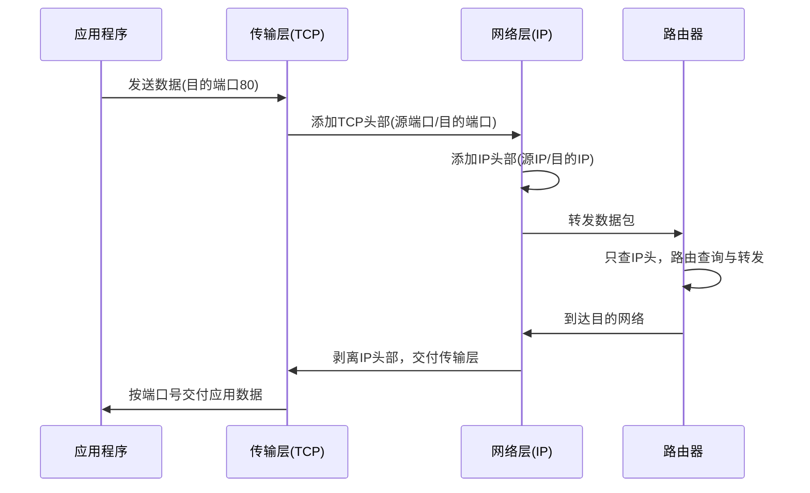

传输层位于网络层之上，负责**进程到进程**的通信，并把网络层"不可靠的主机到主机交付"提升为应用可用的服务。本篇先厘清传输层与网络层的分工边界，后续 TCP/UDP 的具体机制在此基础上展开。

# 1 传输层解决什么问题

| 问题 | 传输层的答案 | 网络层为何不管 |
| :--- | :--- | :--- |
| 数据该交给**哪个进程** | 端口号（复用 / 分用） | IP 只能定位到主机 |
| 数据是否**完整有序** | TCP 序号 / 确认 / 重传 | IP 尽力而为，不保证 |
| 收发**速度是否匹配** | 滑动窗口、流量控制 | 网络层无端到端概念 |
| 网络**拥塞**如何处理 | 拥塞控制 | 网络层只能丢弃 |

# 2 端到端与点到点的分工

| 维度 | 传输层（端到端） | 网络层（点到点 / 主机到主机） |
| :--- | :--- | :--- |
| 通信主体 | 进程 ↔ 进程 | 主机 ↔ 主机 |
| 寻址依据 | 端口号 | IP 地址 |
| 可见范围 | 只在两端主机上处理 | 路径上每台路由器都处理 |
| 是否感知中间节点 | **不感知**（透明） | 逐跳决策 |
| 可靠性 | TCP 提供完整可靠机制 | 只做尽力而为交付 |
| 数据单元 | 段（Segment） | 包（Packet） |

> [!important] 一句话辨析
> **网络层负责"把包送到对面那台机器"，传输层负责"把数据交给对面那个程序"。**
> 路径上的路由器只看 IP 头，从不查看端口号（NAT 是唯一例外，它需要端口来区分内网主机，见 [[03_网络层#7 网络地址转换（NAT）]]）。

# 3 一次完整通信的分层协作

**三个必须记住的"不变与变"**：

| 项 | 是否沿途变化 | 说明 |
| :--- | :--- | :--- |
| 目的 IP | **不变**（NAT 除外） | 端到端语义的保证 |
| 源/目的端口 | **不变**（NAT 例外） | 仅两端主机处理 |
| 源/目的 MAC | **每跳重写** | 适配当前链路（见 [[03_网络层#4.4 跨网段：ARP 解析的是网关 MAC（高频易错点）]]） |

# 4 复用、分用与五元组

- **复用（Multiplexing）**：多个应用进程共用同一套网络层服务，靠端口号区分
- **分用（Demultiplexing）**：接收端根据目的端口把数据交给正确的进程
- **五元组**：`源IP + 源端口 + 目的IP + 目的端口 + 协议号` —— 一条连接/会话的唯一标识，也是 NAT 表项、防火墙规则、`ss`/`netstat` 输出的组织维度

| 协议 | 端口范围 | 说明 |
| :--- | :--- | :--- |
| 熟知端口 | 0 ~ 1023 | 需特权，如 22/80/443 |
| 注册端口 | 1024 ~ 49151 | 应用注册使用，如 3306/6379 |
| 临时端口（ephemeral） | 49152 ~ 65535 | 客户端随机选取，Linux 默认 `32768~60999` |

# 5 与网络层的边界

| 场景 | 归属层 | 说明 |
| :--- | :--- | :--- |
| IP 分片与重组 | 网络层 | 由链路 MTU 触发 |
| TCP 分段（MSS 协商） | 传输层 | 主动避免 IP 分片 |
| 路由环路防护 | 网络层 | TTL |
| 重复报文去重 | 传输层 | 序号机制 |
| 拥塞时的丢包 | 网络层 | 队列溢出；拥塞**控制**在传输层 |
| 拥塞时的退让 | 传输层 | AIMD、慢启动等 |

> [!summary] 本篇核心
> 1. 传输层是**进程到进程**的通信，靠端口号实现复用与分用
> 2. **端到端 vs 点到点**：传输层只在两端处理，网络层逐跳处理
> 3. **目的 IP 不变、MAC 每跳变**，路由器从不看端口（NAT 例外）
> 4. 五元组是连接的唯一标识，也是运维排查（`ss`、conntrack、防火墙）的核心维度
