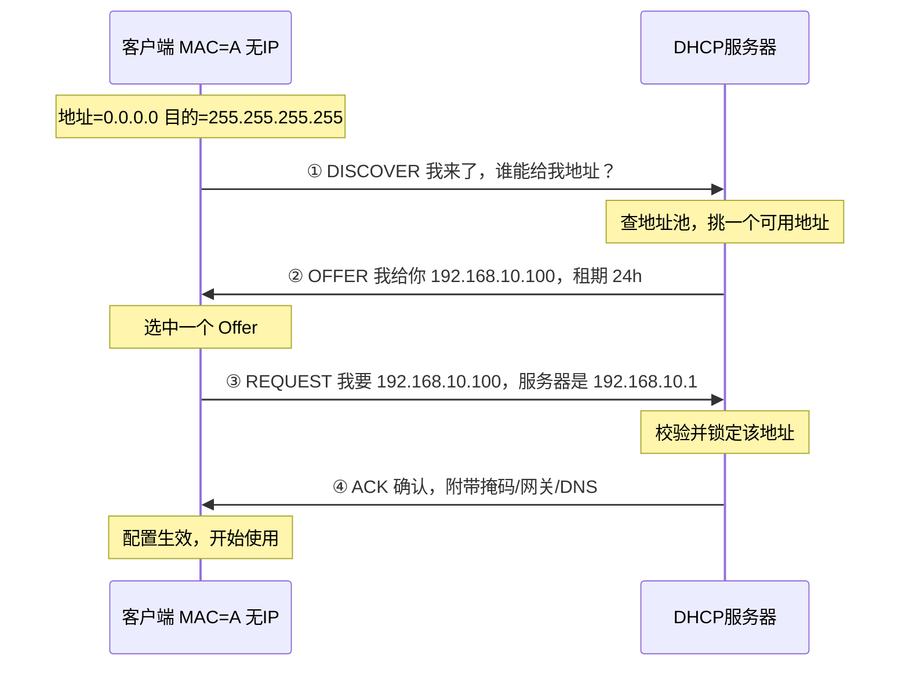
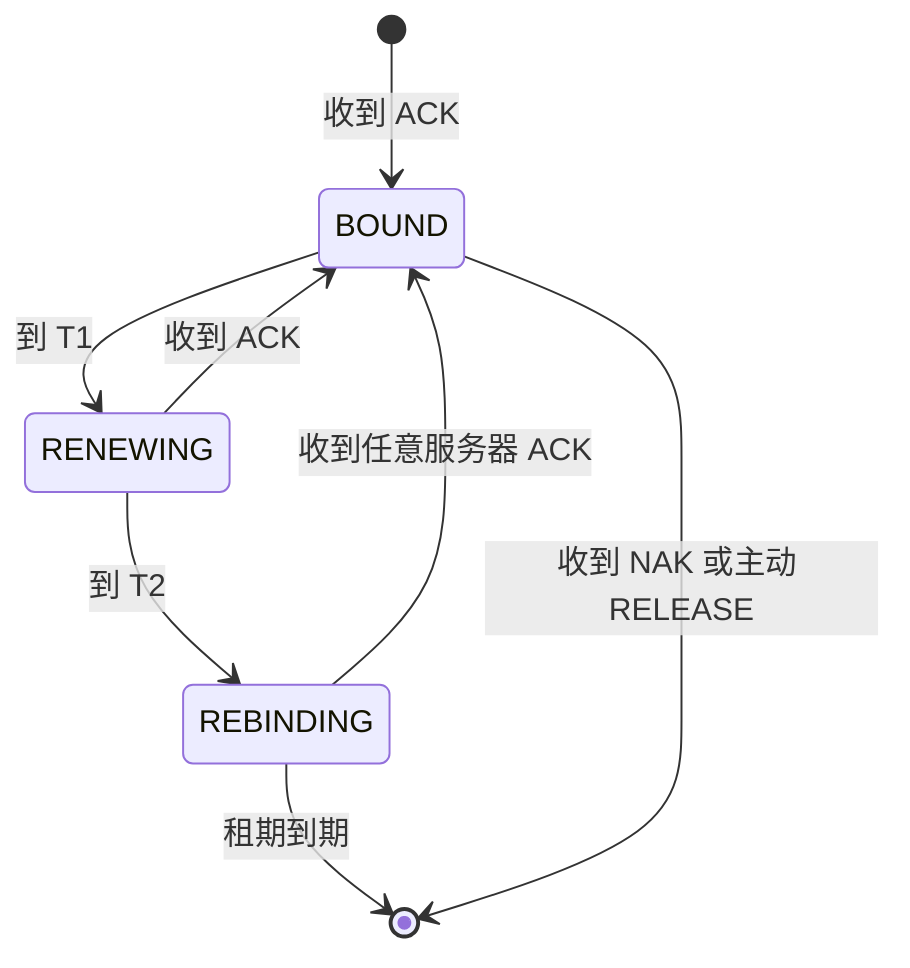

本篇覆盖应用层的**地址配置服务 DHCP**。DHCP 虽然服务于"IP 地址分配"这一网络层职能，但它自身基于 UDP 67/68 传输，属于标准的应用层协议，因此归入本篇。

# 1 应用层的定位与协议全景

应用层是唯一直接面向用户业务的层次，它**不定义数据如何传输，只定义数据的语义与交互格式**。

| 协议 | 传输层 | 端口 | 用途 |
| :--- | :--- | :--- | :--- |
| HTTP / HTTPS | TCP | 80 / 443 | 万维网 |
| DNS | UDP（大响应转 TCP） | 53 | 域名解析 |
| **DHCP** | **UDP** | **67（服务器）/ 68（客户端）** | **IP 地址自动配置** |
| FTP | TCP | 21（控制）/ 20（数据） | 文件传输 |
| SMTP / IMAP | TCP | 25 / 143 | 邮件 |
| SSH | TCP | 22 | 远程登录 |
| NTP | UDP | 123 | 时间同步 |
| SNMP | UDP | 161 / 162 | 网络管理 |

> [!note] 应用层协议与网络层职能的交叉
> DNS 分配"名字"，DHCP 分配"地址"，二者都是**配置类基础设施**，但都实现在应用层 —— 这正是"分层是按职能划分，而不是按用途划分"的典型例证。

# 2 DHCP 动态主机配置协议

## 2.1 解决什么问题

一台主机要接入 IP 网络，必须知道四件事：

| 配置项 | 示例 | 缺失后果 |
| :--- | :--- | :--- |
| IP 地址 + 子网掩码 | `192.168.10.2/24` | 无法与任何主机通信 |
| 默认网关 | `192.168.10.1` | 只能访问同网段，无法出网 |
| DNS 服务器 | `223.5.5.5` | 能用 IP 访问，域名全部失效 |
| 租期 | `86400` 秒 | 地址无法自动回收复用 |

手工静态配置的三大痛点：**易冲突、易配错、不可移动**（笔记本换网络就要改配置）。DHCP 用**集中式地址池 + 租约机制**解决这三个问题。

| 对比项 | 静态配置 | DHCP 动态配置 |
| :--- | :--- | :--- |
| 地址冲突 | 靠人工避免，易出错 | 服务器统一分配，天然不冲突 |
| 移动性 | 换网络需重配 | 即插即用 |
| 管理成本 | 与主机数成正比 | 集中在服务器侧维护 |
| 适用场景 | 服务器、网关、打印机 | 终端、访客、大规模部署 |

## 2.2 协议栈中的位置与报文构成

```
以太网帧 目的MAC=FF:FF:FF:FF:FF:FF  类型=0x0800
└─ IP 头 源IP=0.0.0.0 → 目的IP=255.255.255.255（或 DHCP 服务器单播）
   └─ UDP 头 源端口=68 → 目的端口=67
      └─ DHCP 报文（236 字节固定头部 + Magic Cookie + Options）
```

**固定字段（236 字节）中的关键项**：

| 字段 | 作用 |
| :--- | :--- |
| `op` | 1=请求（BOOTREQUEST），2=应答（BOOTREPLY） |
| `xid` | 事务 ID，客户端生成，同一会话的报文必须一致 |
| `ciaddr` | 客户端**已有**的 IP（续租时使用） |
| `yiaddr` | 服务器分配给客户端的 IP（"your IP"） |
| `siaddr` | 下一跳服务器地址（通常为 DHCP 服务器或 TFTP） |
| `giaddr` | **中继代理**地址，服务器据此判断该分配哪个地址池（见 2.5） |
| `chaddr` | 客户端 MAC 地址，服务器的"身份识别依据" |
| `flags` | `0x8000` 置位表示"我不会处理单播，请广播回复" |

**Options 字段**（Magic Cookie = `0x63825363` 之后，TLV 格式）：

| 选项 | 名称 | 说明 |
| :--- | :--- | :--- |
| 53 | Message Type | 报文类型（1 Discover / 2 Offer / 3 Request / 5 ACK / 6 NAK / 7 Release） |
| 50 | Requested IP | 客户端想申请的地址 |
| 54 | Server Identifier | 指明是哪台服务器的 Offer 被选中 |
| 51 / 58 / 59 | Lease Time / T1 / T2 | 租期、续租时刻、重建时刻 |
| 55 | Parameter Request List | 客户端索要的配置项（掩码/网关/DNS…） |
| 61 | Client Identifier | 通常为 MAC，虚拟机/容器可用自定义 ID |
| 82 | Relay Agent Info | 中继填充，标识请求来自哪个接入端口（用于定位与防伪造） |

## 2.3 DORA 四步交互流程



| 阶段 | 报文 | 目的 IP / MAC | 关键点 |
| :--- | :--- | :--- | :--- |
| ① **D**iscover | 广播 | `255.255.255.255` / `FF:FF:FF:FF:FF:FF` | 客户端还不知道服务器在哪 |
| ② **O**ffer | 单播或广播 | 依 `flags` 而定 | 多台服务器可同时 Offer，客户端挑一个 |
| ③ **R**equest | **广播** | `255.255.255.255` | 广播是为了**告知其他服务器"我拒绝了你们的 Offer"**，让其释放预留地址 |
| ④ **A**CK | 单播或广播 | 同上 | 附带完整配置；若地址已被占用则回 `NAK` |

> [!warning] 为什么 Request 必须广播
> 如果 Request 单播给选中的服务器，其他发过 Offer 的服务器就永远不知道自己的 Offer 被拒绝，预留给该客户端的地址要等 Offer 超时才释放。**广播 Request 是一种隐式的"拒绝通知"机制。**
> 这是考试与面试的高频追问点，也是最容易被记成"四步都是广播"或"默认单播"的地方。

> [!tip] 记忆方法
> **D**iscover → **O**ffer → **R**equest → **A**CK，取首字母就是 **DORA**。
> 语义上可理解为：**找卖家 → 卖家报价 → 选定成交 → 确认发货**。

## 2.4 租期与续租

租期让地址可以**回收复用**（这也是 DHCP 区别于静态配置的核心机制）。客户端必须按期续租才能继续使用。

| 时刻 | 触发条件 | 动作 | 报文方式 |
| :--- | :--- | :--- | :--- |
| T1（租期 50%） | 正常运行 | 向**原服务器**请求续租 | REQUEST，**单播**，`ciaddr` 填已用地址 |
| T2（租期 87.5%） | 原服务器无响应 | 向**任意服务器**请求续租 | REQUEST，**广播** |
| 租期到期 | 仍未续租成功 | 地址失效，回到 DISCOVER 重新申请 | 新 `xid`，重新 DORA |



> [!important] 关键理解
> 续租常用**单播**（客户端已知服务器地址），只有 T2 的"广播求援"才是广播 —— 因为此时连服务器都联系不上了。
> 租期设置是权衡：**短租期**提高地址回收率（适合访客网络、公共 Wi-Fi），**长租期**减少广播与控制报文开销（适合办公网、家庭网）。

## 2.5 DHCP 中继代理

**问题**：DHCP Discover 是广播，而**路由器不转发广播**。若服务器在另一个网段，客户端永远联系不上它。

**方案**：在客户端所在网段的网关/交换机上配置 DHCP Relay（中继代理），把广播**单播转交**给远端服务器。


| 要点 | 说明 |
| :--- | :--- |
| 定位依据 | 服务器读取 `giaddr`，据此判断请求来自哪个子网，从对应地址池分配 |
| 地址池配置 | 服务器上每个网段需配置独立作用域（Scope） |
| Option 82 | 中继可插入接入端口信息，实现"按端口分配"与防伪造 |

## 2.6 故障排查与安全

**排查清单**：

```bash
# 1. 查看当前地址来源与租期
ip a                                   # 看是否拿到 169.254.x.x（APIPA，说明 DHCP 失败）
ip -4 addr show scope global

# 2. 手动触发一次完整 DORA 并观察
dhclient -v eth0                       # 详细输出四步交互
# 或绕过开启的 dhclient，只用抓包观察
tcpdump -i eth0 -n port 67 or port 68

# 3. 确认广播是否被放行（防火墙/交换机端口安全）
#    客户端 68 → 服务器 67 的广播必须能出去

# 4. Windows
ipconfig /release && ipconfig /renew
```

| 现象 | 根因 | 处理 |
| :--- | :--- | :--- |
| 拿到 `169.254.x.x` | DHCP 完全失败（APIPA 自动私有地址兜底） | 查链路、查中继、查服务器作用域是否耗尽 |
| 时好时坏、首次接入慢 | 交换机端口未开 PortFast，STP 收敛期间丢弃请求 | 接终端端口启用 PortFast / 边缘端口 |
| 拿到其他网段的地址 | 多台 DHCP 服务器竞争，先到先得 | 统一规划，非法服务器用 DHCP Snooping 阻断 |
| 频繁断网重连 | 租期过短或地址池过小 | 调大租期或扩容地址池 |

**两类典型攻击**：

| 攻击 | 原理 | 防护 |
| :--- | :--- | :--- |
| **DHCP 饿死（Starvation）** | 伪造大量 MAC 发起 Discover，耗尽地址池 | 交换机端口安全限制 MAC 数量；DAI/Snooping 限速 |
| ** rogue DHCP 服务器** | 接入伪造服务器，下发自己的网关 → 中间人 | **DHCP Snooping**：只有信任端口能发 Offer，其他端口只能发请求 |

> [!summary] 本篇核心
> 1. DHCP 用 **UDP 67/68**，属于**应用层**协议，本质是"集中式地址分配 + 租约回收"
> 2. 四步 **DORA**：Discover → Offer → Request → ACK，其中 **Request 必须广播**（隐式拒绝其他 Offer）
> 3. 续租：T1（50%）单播给原服务器，T2（87.5%）广播求任意服务器，到期回 DISCOVER
> 4. 广播不跨路由器，跨网段必须靠 **DHCP 中继**，服务器按 `giaddr` 选择地址池
> 5. 拿到 `169.254.x.x` = DHCP 失败；防护靠 **DHCP Snooping**（限制 Offer 来源、限速防饿死）
