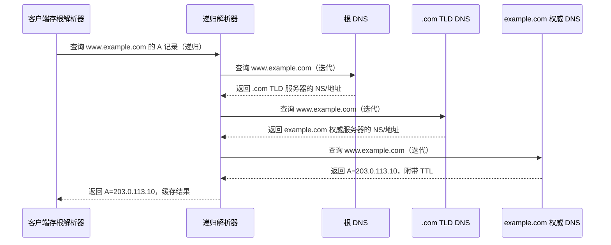
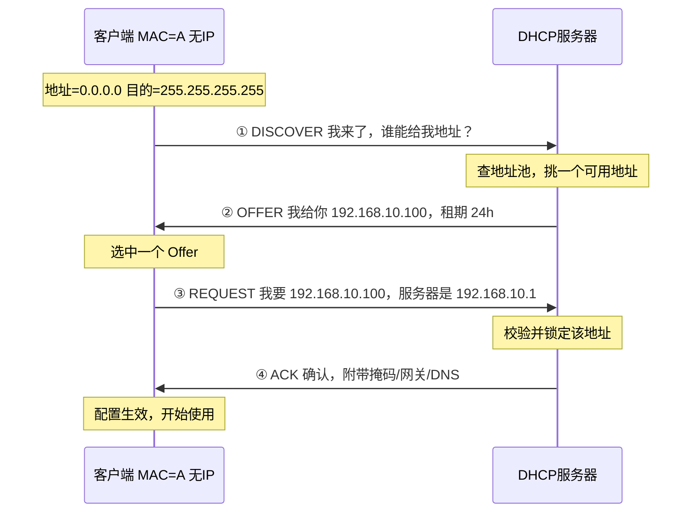
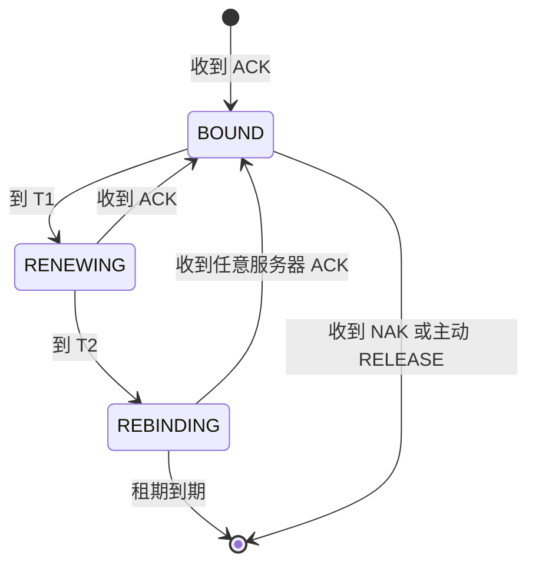

本篇覆盖应用层的**域名解析服务 DNS**与**地址配置服务 DHCP**。DNS 负责把便于人类记忆的域名解析为 IP 地址，DHCP 负责为主机自动配置 IP 地址、网关和 DNS 服务器。二者都属于应用层协议，但分别解决"名字怎么找到地址"和"地址从哪里来"的问题。

# 1 应用层的定位与协议全景

应用层是唯一直接面向用户业务的层次，它**不定义数据如何传输，只定义数据的语义与交互格式**。

| 协议 | 传输层 | 端口 | 用途 |
| :--- | :--- | :--- | :--- |
| HTTP / HTTPS | TCP | 80 / 443 | 万维网 |
| DNS | UDP（大响应转 TCP） | 53 | 域名解析 |
| **DHCP** | **UDP** | **67（服务器）/ 68（客户端）** | **IP 地址自动配置** |
| FTP | TCP | 21（控制）/ 20（数据） | 文件传输 |
| SMTP / IMAP | TCP | 25 / 143 | 邮件 |
| SSH | TCP | 22 | 远程登录 |
| NTP | UDP | 123 | 时间同步 |
| SNMP | UDP | 161 / 162 | 网络管理 |

> [!note] 应用层协议与网络层职能的交叉
> DNS 分配"名字"，DHCP 分配"地址"，二者都是**配置类基础设施**，但都实现在应用层 —— 这正是"分层是按职能划分，而不是按用途划分"的典型例证。

# 2 DNS 域名系统与查询流程

DNS（Domain Name System，域名系统）把层次化、便于记忆的域名映射为 IP 地址，也可以提供邮件服务器、别名和反向解析等信息。它不是简单的本地配置文件，而是一个由缓存、递归解析器和权威服务器共同组成的分布式数据库系统。

## 2.1 DNS 解决什么问题

用户访问网站时通常输入 `www.example.com`，网络层却需要目的 IP 地址。DNS 完成的是：

$$
\boxed{\text{域名} \longrightarrow \text{IP 地址}}
$$

DNS 与 DHCP 的关系是：DHCP 可以把 DNS 服务器地址作为配置项下发给主机；主机随后把域名查询发送给该 DNS 服务器。

| 协议 | 解决的问题 | 典型结果 |
| :--- | :--- | :--- |
| DNS | 名字如何映射到网络地址 | `www.example.com` → `203.0.113.10` |
| DHCP | 主机如何获得网络配置 | IP、掩码、网关、DNS 服务器 |
| ARP | 当前链路如何找到下一跳网卡 | 下一跳 IP → MAC |

> [!important] 三种解析不要混淆
> DNS 解析域名到 IP，ARP 解析下一跳 IP 到 MAC，DHCP 为主机配置 IP 和 DNS 服务器。它们分别位于应用层、链路/IP 协同位置和应用层。

## 2.2 域名层次与 DNS 服务器角色

域名从右向左表示层次，完整域名最后隐含一个根域名 `.`：

```text
www.example.com.
│   │       │  └─ 根（Root）
│   │       └──── 顶级域（TLD）：com
│   └──────────── 二级域/注册域：example
└──────────────── 主机名或服务名：www
```

一次解析过程中可能涉及以下角色：

| 角色 | 作用 |
| :--- | :--- |
| **Stub Resolver** | 客户端操作系统或应用中的存根解析器，向配置的递归解析器发起查询 |
| **递归解析器** | 代表客户端完成后续查询，维护缓存并返回最终结果；通常由运营商、企业或公共 DNS 提供 |
| **根服务器** | 不直接回答大多数主机记录，返回对应顶级域服务器的地址 |
| **TLD 服务器** | 管理 `.com`、`.cn` 等顶级域，返回目标域的权威服务器地址 |
| **权威 DNS 服务器** | 保存某个域的正式资源记录，给出最终答案 |

> [!tip] 递归和迭代
> 客户端通常向递归解析器提出“请帮我查到最终答案”的**递归查询**；递归解析器向根、TLD 和权威服务器逐级询问，通常采用“告诉我下一步去哪里”的**迭代查询**。

## 2.3 DNS 资源记录

DNS 数据库中的一条记录称为资源记录（Resource Record，RR），基本形式是：

```text
NAME    TTL    CLASS    TYPE    RDATA
```

| 类型 | 作用 | 示例含义 |
| :--- | :--- | :--- |
| `A` | 域名映射到 IPv4 地址 | `www.example.com` → `203.0.113.10` |
| `AAAA` | 域名映射到 IPv6 地址 | `www.example.com` → `2001:db8::10` |
| `CNAME` | 别名指向规范名称 | `www` → `web.example.com` |
| `NS` | 指定域的权威名称服务器 | `example.com` 的 DNS 服务器 |
| `MX` | 指定邮件服务器及优先级 | 邮件投递到 `mail.example.com` |
| `PTR` | 反向解析：IP 指向域名 | `10.1.168.192.in-addr.arpa` → 主机名 |
| `TXT` | 保存文本型策略或验证信息 | SPF、域名验证等 |
| `SOA` | 描述区域的起始授权信息 | 主 DNS、序列号、刷新计时器 |

`TTL`（Time To Live）表示解析结果允许在缓存中保存的时间，单位通常为秒。TTL 到期后，缓存记录需要重新向权威服务器或上级解析器查询。

## 2.4 一次完整的递归查询流程

假设客户端查询 `www.example.com`，本机和递归解析器缓存中都没有答案：



查询步骤可以概括为：

1. 应用调用本机存根解析器，先检查浏览器缓存、操作系统缓存和 `hosts` 文件。
2. 缓存未命中时，存根解析器向配置的递归解析器发送 DNS 查询。
3. 递归解析器先检查自己的缓存；仍未命中时，从根服务器开始逐级查询。
4. 根服务器通常只返回 `.com` 等 TLD 服务器信息，TLD 服务器再返回目标域的权威服务器信息。
5. 权威服务器返回 `A`/`AAAA` 等最终记录；递归解析器按 TTL 缓存并答复客户端。
6. 客户端取得 IP 后，才开始建立 TCP/QUIC 连接或发送应用层请求。

> [!warning] DNS 查询不是 HTTP 请求
> 访问 `https://www.example.com` 前通常要先完成 DNS 解析，但 DNS 查询本身是独立的应用层交互。解析成功只说明拿到了地址，不代表 TCP、TLS 或 HTTP 一定成功。

## 2.5 递归查询、迭代查询与缓存

| 查询方式 | 谁负责继续查找 | 典型通信 |
| :--- | :--- | :--- |
| **递归查询** | 被询问的服务器负责返回最终答案或失败结果 | 客户端 → 递归解析器 |
| **迭代查询** | 请求方根据 Referral 自己继续查找 | 递归解析器 → 根/TLD/权威服务器 |

递归解析器通常会缓存：

- 正向解析结果，如 `A`、`AAAA`、`CNAME`。
- 权威服务器的 `NS` 和对应地址。
- 负面结果，如域名不存在（NXDOMAIN），也会按 SOA 相关规则短暂缓存。

缓存的作用是减少重复查询、降低延迟和权威服务器负载；代价是记录在 TTL 未过期前可能仍是旧地址。

> [!important] CNAME 查询
> 如果查询结果是 `CNAME`，解析器还要继续查询 CNAME 指向的规范名称，直到得到 `A` 或 `AAAA` 等最终地址。一个域名可以有多个 `A`/`AAAA` 记录，解析器或客户端可能据此实现简单的负载分散。

## 2.6 DNS 报文与传输方式

DNS 报文通常由首部、问题区、回答区、授权区和附加信息区组成：

| 区域 | 内容 |
| :--- | :--- |
| Header | 事务 ID、查询/响应标志、递归期望 `RD`、递归可用 `RA`、错误码等 |
| Question | 查询名、查询类型、查询类（通常为 `IN`） |
| Answer | 直接回答的资源记录 |
| Authority | 权威服务器或 Referral 信息，常包含 `NS`/SOA |
| Additional | 与回答相关的附加地址记录，例如 `NS` 对应的 `A`/`AAAA` |

- **UDP 53**：普通 DNS 查询的默认传输方式，开销小、延迟低。
- **TCP 53**：区域传送（AXFR/IXFR）、响应过大或 UDP 响应设置 `TC`（截断）时使用；客户端收到截断响应后通常改用 TCP 重试。
- **DoT/DoH**：分别把 DNS 放在 TLS 或 HTTPS 中传输，主要解决传输过程中的隐私与篡改问题，背后仍然使用 DNS 查询语义。

> [!warning] DNS 使用 UDP 不代表 DNS 只能使用 UDP
> 经典 DNS 查询通常走 UDP 53；响应过大、区域传送或特定部署场景会使用 TCP 53。不要把“默认 UDP”记成“永远 UDP”。

## 2.7 常见 DNS 结果与故障排查

| 现象/结果 | 含义 |
| :--- | :--- |
| `NOERROR` | 查询成功；可能有答案，也可能是 NODATA（域存在但没有请求类型的记录） |
| `NXDOMAIN` | 查询的域名不存在 |
| `SERVFAIL` | 服务器无法完成查询，可能是上游超时、DNSSEC 校验失败或配置异常 |
| `REFUSED` | 服务器拒绝该查询，常见于访问控制策略 |
| 超时 | 网络不可达、53 端口被拦截、递归服务器故障或权威链路异常 |

```bash
# 查询 A 记录
nslookup www.example.com

dig www.example.com A

# 观察递归查询链路：根 → TLD → 权威服务器
dig +trace www.example.com

# 查询指定 DNS 服务器
dig @1.1.1.1 www.example.com A

# 查询权威服务器和邮件服务器
dig example.com NS
dig example.com MX
```

排查时建议按顺序区分：

1. 本机是否把域名误写进 `hosts` 文件或缓存了旧记录。
2. 客户端配置的递归 DNS 地址是否可达，UDP/TCP 53 是否被防火墙拦截。
3. 递归解析器能否访问根、TLD 和权威服务器。
4. 权威区域中的 `NS`、`A`/`AAAA`、`CNAME` 和 TTL 是否配置正确。
5. 如果只有 IPv6 访问失败，分别检查 `AAAA` 记录和 IPv6 路由，不要只看 `A` 记录。

## 2.8 DNS 的安全与工程注意事项

| 问题 | 说明 |
| :--- | :--- |
| DNS 缓存投毒 | 伪造响应污染递归解析器缓存；事务随机化、源端口随机化和 DNSSEC 可降低风险 |
| DNS 欺骗/劫持 | 查询或响应被中间设备篡改；DoT/DoH 可保护传输链路，DNSSEC 可验证数据来源 |
| 放大攻击 | 开放递归解析器被滥用向受害者放大响应；应限制递归访问来源 |
| TTL 过长 | 减少查询开销，但地址变更传播慢 |
| TTL 过短 | 变更传播快，但增加 DNS 查询和服务器负载 |

> [!summary] DNS 查询核心
> 1. 客户端通常向递归解析器发起递归查询，递归解析器向根、TLD 和权威服务器进行迭代查询。
> 2. 根服务器找 TLD，TLD 找权威服务器，权威服务器返回最终资源记录。
> 3. `A`/`AAAA` 查地址，`CNAME` 查别名，`NS` 查权威服务器，`MX` 查邮件服务器，`PTR` 做反向解析。
> 4. 普通查询通常使用 UDP 53；响应截断、区域传送等情况使用 TCP 53。
> 5. TTL 决定缓存时间；DNS 成功只表示域名解析成功，不代表后续 TCP、TLS 或 HTTP 一定成功。

# 3 DHCP 动态主机配置协议

## 3.1 解决什么问题

一台主机要接入 IP 网络，必须知道四件事：

| 配置项 | 示例 | 缺失后果 |
| :--- | :--- | :--- |
| IP 地址 + 子网掩码 | `192.168.10.2/24` | 无法与任何主机通信 |
| 默认网关 | `192.168.10.1` | 只能访问同网段，无法出网 |
| DNS 服务器 | `223.5.5.5` | 能用 IP 访问，域名全部失效 |
| 租期 | `86400` 秒 | 地址无法自动回收复用 |

手工静态配置的三大痛点：**易冲突、易配错、不可移动**（笔记本换网络就要改配置）。DHCP 用**集中式地址池 + 租约机制**解决这三个问题。

| 对比项 | 静态配置 | DHCP 动态配置 |
| :--- | :--- | :--- |
| 地址冲突 | 靠人工避免，易出错 | 服务器统一分配，天然不冲突 |
| 移动性 | 换网络需重配 | 即插即用 |
| 管理成本 | 与主机数成正比 | 集中在服务器侧维护 |
| 适用场景 | 服务器、网关、打印机 | 终端、访客、大规模部署 |

## 3.2 协议栈中的位置与报文构成

```
以太网帧 目的MAC=FF:FF:FF:FF:FF:FF  类型=0x0800
└─ IP 头 源IP=0.0.0.0 → 目的IP=255.255.255.255（或 DHCP 服务器单播）
   └─ UDP 头 源端口=68 → 目的端口=67
      └─ DHCP 报文（236 字节固定头部 + Magic Cookie + Options）
```

**固定字段（236 字节）中的关键项**：

| 字段 | 作用 |
| :--- | :--- |
| `op` | 1=请求（BOOTREQUEST），2=应答（BOOTREPLY） |
| `xid` | 事务 ID，客户端生成，同一会话的报文必须一致 |
| `ciaddr` | 客户端**已有**的 IP（续租时使用） |
| `yiaddr` | 服务器分配给客户端的 IP（"your IP"） |
| `siaddr` | 下一跳服务器地址（通常为 DHCP 服务器或 TFTP） |
| `giaddr` | **中继代理**地址，服务器据此判断该分配哪个地址池（见 2.5） |
| `chaddr` | 客户端 MAC 地址，服务器的"身份识别依据" |
| `flags` | `0x8000` 置位表示"我不会处理单播，请广播回复" |

**Options 字段**（Magic Cookie = `0x63825363` 之后，TLV 格式）：

| 选项 | 名称 | 说明 |
| :--- | :--- | :--- |
| 53 | Message Type | 报文类型（1 Discover / 2 Offer / 3 Request / 5 ACK / 6 NAK / 7 Release） |
| 50 | Requested IP | 客户端想申请的地址 |
| 54 | Server Identifier | 指明是哪台服务器的 Offer 被选中 |
| 51 / 58 / 59 | Lease Time / T1 / T2 | 租期、续租时刻、重建时刻 |
| 55 | Parameter Request List | 客户端索要的配置项（掩码/网关/DNS…） |
| 61 | Client Identifier | 通常为 MAC，虚拟机/容器可用自定义 ID |
| 82 | Relay Agent Info | 中继填充，标识请求来自哪个接入端口（用于定位与防伪造） |

## 3.3 DORA 四步交互流程



| 阶段 | 报文 | 目的 IP / MAC | 关键点 |
| :--- | :--- | :--- | :--- |
| ① **D**iscover | 广播 | `255.255.255.255` / `FF:FF:FF:FF:FF:FF` | 客户端还不知道服务器在哪 |
| ② **O**ffer | 单播或广播 | 依 `flags` 而定 | 多台服务器可同时 Offer，客户端挑一个 |
| ③ **R**equest | **广播** | `255.255.255.255` | 广播是为了**告知其他服务器"我拒绝了你们的 Offer"**，让其释放预留地址 |
| ④ **A**CK | 单播或广播 | 同上 | 附带完整配置；若地址已被占用则回 `NAK` |

> [!warning] 为什么 Request 必须广播
> 如果 Request 单播给选中的服务器，其他发过 Offer 的服务器就永远不知道自己的 Offer 被拒绝，预留给该客户端的地址要等 Offer 超时才释放。**广播 Request 是一种隐式的"拒绝通知"机制。**
> 这是考试与面试的高频追问点，也是最容易被记成"四步都是广播"或"默认单播"的地方。

> [!tip] 记忆方法
> **D**iscover → **O**ffer → **R**equest → **A**CK，取首字母就是 **DORA**。
> 语义上可理解为：**找卖家 → 卖家报价 → 选定成交 → 确认发货**。

## 3.4 租期与续租

租期让地址可以**回收复用**（这也是 DHCP 区别于静态配置的核心机制）。客户端必须按期续租才能继续使用。

| 时刻 | 触发条件 | 动作 | 报文方式 |
| :--- | :--- | :--- | :--- |
| T1（租期 50%） | 正常运行 | 向**原服务器**请求续租 | REQUEST，**单播**，`ciaddr` 填已用地址 |
| T2（租期 87.5%） | 原服务器无响应 | 向**任意服务器**请求续租 | REQUEST，**广播** |
| 租期到期 | 仍未续租成功 | 地址失效，回到 DISCOVER 重新申请 | 新 `xid`，重新 DORA |



> [!important] 关键理解
> 续租常用**单播**（客户端已知服务器地址），只有 T2 的"广播求援"才是广播 —— 因为此时连服务器都联系不上了。
> 租期设置是权衡：**短租期**提高地址回收率（适合访客网络、公共 Wi-Fi），**长租期**减少广播与控制报文开销（适合办公网、家庭网）。

## 3.5 DHCP 中继代理

**问题**：DHCP Discover 是广播，而**路由器不转发广播**。若服务器在另一个网段，客户端永远联系不上它。

**方案**：在客户端所在网段的网关/交换机上配置 DHCP Relay（中继代理），把广播**单播转交**给远端服务器。


| 要点 | 说明 |
| :--- | :--- |
| 定位依据 | 服务器读取 `giaddr`，据此判断请求来自哪个子网，从对应地址池分配 |
| 地址池配置 | 服务器上每个网段需配置独立作用域（Scope） |
| Option 82 | 中继可插入接入端口信息，实现"按端口分配"与防伪造 |

## 3.6 故障排查与安全

**排查清单**：

```bash
# 1. 查看当前地址来源与租期
ip a                                   # 看是否拿到 169.254.x.x（APIPA，说明 DHCP 失败）
ip -4 addr show scope global

# 2. 手动触发一次完整 DORA 并观察
dhclient -v eth0                       # 详细输出四步交互
# 或绕过开启的 dhclient，只用抓包观察
tcpdump -i eth0 -n port 67 or port 68

# 3. 确认广播是否被放行（防火墙/交换机端口安全）
#    客户端 68 → 服务器 67 的广播必须能出去

# 4. Windows
ipconfig /release && ipconfig /renew
```

| 现象 | 根因 | 处理 |
| :--- | :--- | :--- |
| 拿到 `169.254.x.x` | DHCP 完全失败（APIPA 自动私有地址兜底） | 查链路、查中继、查服务器作用域是否耗尽 |
| 时好时坏、首次接入慢 | 交换机端口未开 PortFast，STP 收敛期间丢弃请求 | 接终端端口启用 PortFast / 边缘端口 |
| 拿到其他网段的地址 | 多台 DHCP 服务器竞争，先到先得 | 统一规划，非法服务器用 DHCP Snooping 阻断 |
| 频繁断网重连 | 租期过短或地址池过小 | 调大租期或扩容地址池 |

**两类典型攻击**：

| 攻击 | 原理 | 防护 |
| :--- | :--- | :--- |
| **DHCP 饿死（Starvation）** | 伪造大量 MAC 发起 Discover，耗尽地址池 | 交换机端口安全限制 MAC 数量；DAI/Snooping 限速 |
| ** rogue DHCP 服务器** | 接入伪造服务器，下发自己的网关 → 中间人 | **DHCP Snooping**：只有信任端口能发 Offer，其他端口只能发请求 |

> [!summary] 本篇核心
> 1. DHCP 用 **UDP 67/68**，属于**应用层**协议，本质是"集中式地址分配 + 租约回收"
> 2. 四步 **DORA**：Discover → Offer → Request → ACK，其中 **Request 必须广播**（隐式拒绝其他 Offer）
> 3. 续租：T1（50%）单播给原服务器，T2（87.5%）广播求任意服务器，到期回 DISCOVER
> 4. 广播不跨路由器，跨网段必须靠 **DHCP 中继**，服务器按 `giaddr` 选择地址池
> 5. 拿到 `169.254.x.x` = DHCP 失败；防护靠 **DHCP Snooping**（限制 Offer 来源、限速防饿死）
